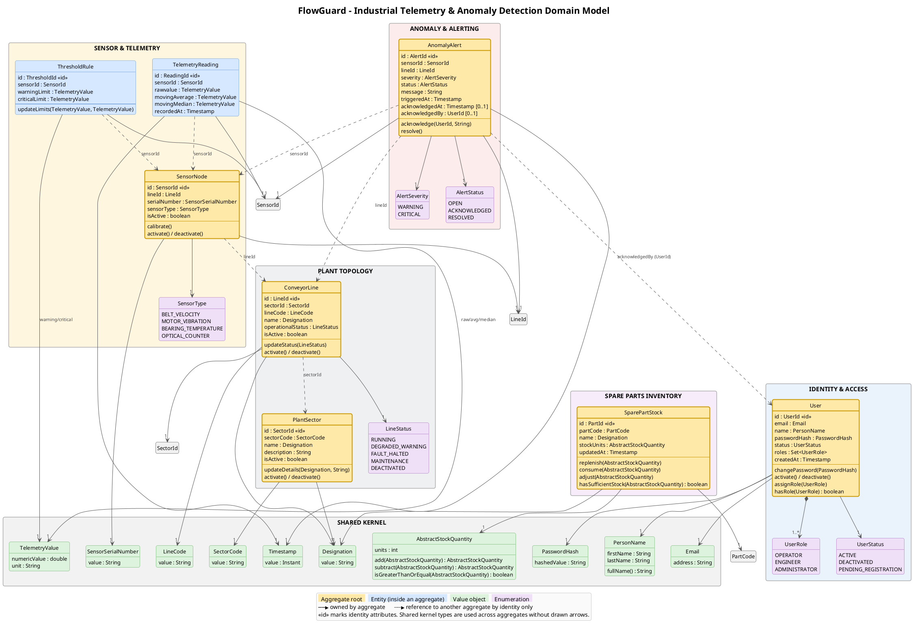
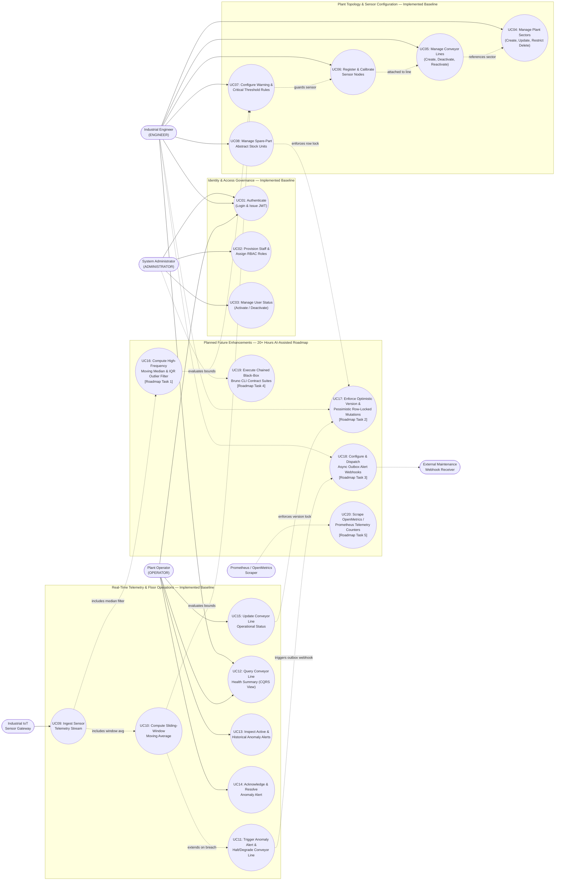
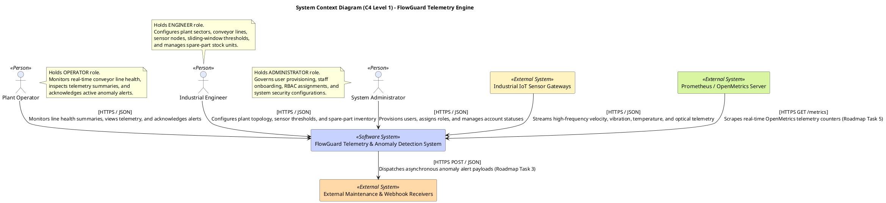
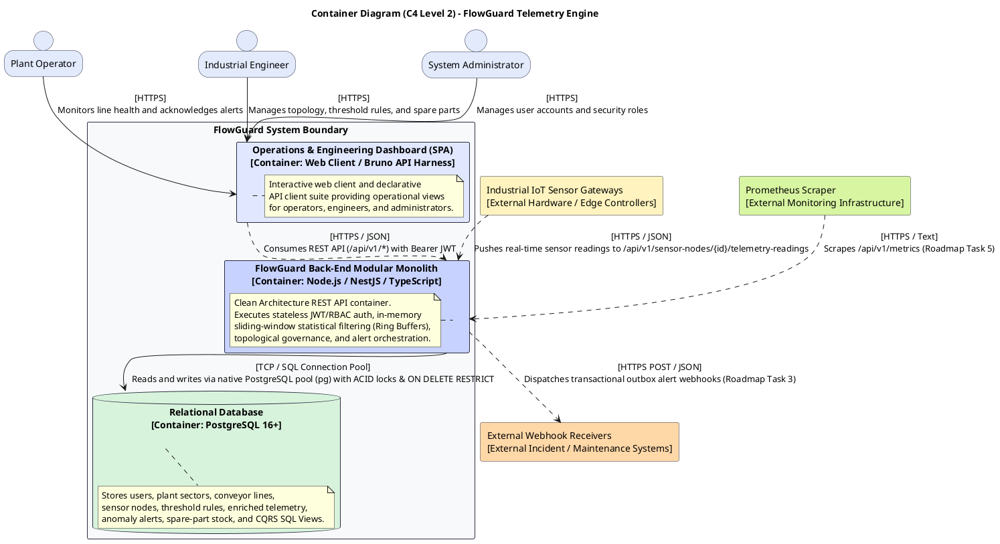

```plantuml
@startuml
!pragma layout smetana
skinparam packageStyle rectangle
skinparam componentStyle uml2
skinparam shadowing false
skinparam linetype ortho
skinparam nodesep 45
skinparam ranksep 55

skinparam component {
  BackgroundColor #F8F9FA
  BorderColor #2B2D42
  ArrowColor #1D3557
  FontName "Arial"
  FontSize 12
}

skinparam interface {
  BackgroundColor #FFFFFF
  BorderColor #1D3557
}

title FlowGuard Back-End - Component Diagram (C4 Level 3 / Clean Architecture Container)

' =========================================================
' EXTERNAL CLIENTS & INTEGRATORS (OpenAPI REST Interfaces)
' =========================================================
cloud "External Clients & Industrial Integrators" {
  [Operations & Engineering Client (SPA / Bruno)] as SPA #E2EAFC
  [Industrial IoT Sensor Gateways] as SensorGateways #FFF3BF
  [Prometheus Metrics Scraper (Task 5)] as Prometheus #D8F5A2
  [External Maintenance Webhook Receiver (Task 3)] as WebhookReceiver #FFD8A8
}

package "FlowGuard Back-End Modular Monolith Container (Node.js / NestJS / TypeScript)" {

  ' =========================================================
  ' 1. PRESENTATION & DELIVERY LAYER (Driving Adapters)
  ' =========================================================
  package "1. Presentation & Delivery Layer (HTTP Controllers, Guards & Validation Pipes)" {
    [Auth & User Controller\n(JwtAuthGuard, RolesGuard)] as C_Auth
    [Plant Topology Controller\n(Sectors & Conveyor Lines)] as C_Topology
    [Sensor & Threshold Controller\n(Calibration & Bounds)] as C_Sensor
    [Telemetry Ingestion Controller\n(High-Frequency Stream Boundary)] as C_Telemetry
    [Anomaly Alert Controller\n(Acknowledge & Resolve)] as C_Alert
    [Spare Parts Stock Controller\n(Abstract Integer Inventory)] as C_Stock
    [Health & Metrics Controller\n(Health + OpenMetrics Task 5)] as C_Metrics
  }

  ' REST Endpoints Exposed
  () "/api/v1/auth & /users" as API_Auth
  () "/api/v1/plant-sectors & /conveyor-lines" as API_Topology
  () "/api/v1/sensor-nodes & /threshold-rules" as API_Sensor
  () "/api/v1/sensor-nodes/:id/telemetry-readings" as API_Telemetry
  () "/api/v1/anomaly-alerts" as API_Alert
  () "/api/v1/spare-parts" as API_Stock
  () "/api/v1/health & /metrics" as API_Metrics

  API_Auth -down- C_Auth
  API_Topology -down- C_Topology
  API_Sensor -down- C_Sensor
  API_Telemetry -down- C_Telemetry
  API_Alert -down- C_Alert
  API_Stock -down- C_Stock
  API_Metrics -down- C_Metrics

  SPA ..> API_Auth : HTTPS / JSON
  SPA ..> API_Topology : HTTPS / JSON
  SPA ..> API_Sensor : HTTPS / JSON
  SPA ..> API_Alert : HTTPS / JSON
  SPA ..> API_Stock : HTTPS / JSON
  SensorGateways ..> API_Telemetry : HTTPS / JSON
  Prometheus ..> API_Metrics : HTTPS / GET

  ' =========================================================
  ' 2. APPLICATION SERVICES LAYER (Use Cases & Orchestration)
  ' =========================================================
  package "2. Application Services Layer (Transactional Use Cases)" {
    [AuthAndUserService\n(Argon2id, JWT & RBAC Onboarding)] as S_Auth
    [PlantTopologyService\n(Sector/Line Lifecycle & Optimistic Lock Task 2)] as S_Topology
    [SensorManagementService\n(Sensor Registration & Threshold Rules)] as S_Sensor
    [TelemetryIngestionService\n(Orchestrates Window Eval & Alert Creation)] as S_Telemetry
    [AnomalyAlertService\n(Alert Lifecycle & Outbox Webhook Task 3)] as S_Alert
    [SparePartsStockService\n(Row-Locked Stock Adjustments Task 2)] as S_Stock
    [LineHealthQueryService\n(CQRS Read Projections & Metrics Task 5)] as S_Query
  }

  C_Auth ..> S_Auth : executes
  C_Topology ..> S_Topology : executes
  C_Topology ..> S_Query : queries summary
  C_Sensor ..> S_Sensor : executes
  C_Telemetry ..> S_Telemetry : executes
  C_Alert ..> S_Alert : executes
  C_Stock ..> S_Stock : executes
  C_Metrics ..> S_Query : scrapes metrics

  ' =========================================================
  ' 3. DOMAIN CORE LAYER (Entities, VOs & Domain Services)
  ' =========================================================
  package "3. Domain Core Layer (Pure TypeScript Invariants & Sliding-Window Math)" {
    [Identity Aggregate\n(User, UserRole, PasswordHash)] as D_User
    [Plant Topology Aggregates\n(PlantSector, ConveyorLine, LineStatus)] as D_Topology
    [Sensor & Telemetry Aggregates\n(SensorNode, ThresholdRule, TelemetryReading)] as D_Sensor
    [Anomaly Alert Aggregate\n(AnomalyAlert, AlertSeverity, AlertStatus)] as D_Alert
    [Spare Parts Aggregate\n(SparePartStock, AbstractStockQuantity)] as D_Stock

    [TelemetryEvaluationEngine\n(Pipes & Filters: Ring Buffer, Moving Avg,\nMoving Median Task 1, Z-Score)] as DS_TelemetryEngine
    [LineStateTransitionDomainService\n(Coordinates Line Fault Halts & Warnings)] as DS_LineState
  }

  S_Auth ..> D_User : operates
  S_Topology ..> D_Topology : operates
  S_Sensor ..> D_Sensor : operates
  S_Telemetry ..> D_Sensor : operates
  S_Telemetry ..> DS_TelemetryEngine : evaluates window
  S_Telemetry ..> DS_LineState : transitions line
  S_Alert ..> D_Alert : operates
  S_Stock ..> D_Stock : operates

  DS_TelemetryEngine ..> D_Sensor : inspects bounds
  DS_LineState ..> D_Topology : mutates state
  DS_LineState ..> D_Alert : instantiates alert

  ' =========================================================
  ' 4. INFRASTRUCTURE & PERSISTENCE LAYER (Driven Adapters)
  ' =========================================================
  package "4. Infrastructure & Persistence Layer (Ports & Secondary Adapters)" {
    interface "IUserRepository" as IR_User
    interface "IPlantTopologyRepository" as IR_Topology
    interface "ISensorTelemetryRepository" as IR_Sensor
    interface "IAnomalyAlertRepository" as IR_Alert
    interface "ISparePartStockRepository" as IR_Stock
    interface "IAlertWebhookDispatcher" as IP_Webhook

    [PgUserRepository\n(pg Pool / UserMapper)] as R_User
    [PgPlantTopologyRepository\n(pg Pool / Optimistic Version Lock)] as R_Topology
    [PgSensorTelemetryRepository\n(pg Pool / Batch & Enriched Insert)] as R_Sensor
    [PgAnomalyAlertRepository\n(pg Pool / Transactional Outbox)] as R_Alert
    [PgSparePartStockRepository\n(pg Pool / SELECT FOR UPDATE)] as R_Stock
    [HttpWebhookDispatcherAdapter\n(Async Outbox Worker - Task 3)] as A_Webhook
  }

  S_Auth ..> IR_User : uses
  S_Topology ..> IR_Topology : uses
  S_Sensor ..> IR_Sensor : uses
  S_Telemetry ..> IR_Sensor : uses
  S_Telemetry ..> IR_Topology : uses
  S_Telemetry ..> IR_Alert : uses
  S_Alert ..> IR_Alert : uses
  S_Alert ..> IP_Webhook : dispatches
  S_Stock ..> IR_Stock : uses
  S_Query ..> IR_Topology : queries view
  S_Query ..> IR_Alert : queries counts

  R_User -up-|> IR_User
  R_Topology -up-|> IR_Topology
  R_Sensor -up-|> IR_Sensor
  R_Alert -up-|> IR_Alert
  R_Stock -up-|> IR_Stock
  A_Webhook -up-|> IP_Webhook
}

' =========================================================
' DATABASE STORE & EXTERNAL WEBHOOK TARGETS
' =========================================================
database "PostgreSQL 16+ Relational Database\n(3NF Schema, ON DELETE RESTRICT, CHECK stock >= 0,\nSELECT FOR UPDATE, v_conveyor_line_health_summary)" as PostgreSQL #D8F3DC

R_User ..> PostgreSQL : SQL / pg Pool
R_Topology ..> PostgreSQL : SQL / pg Pool
R_Sensor ..> PostgreSQL : SQL / pg Pool
R_Alert ..> PostgreSQL : SQL / pg Pool
R_Stock ..> PostgreSQL : SQL / pg Pool
A_Webhook ..> WebhookReceiver : HTTPS POST (JSON)

@enduml
```

# Knowledge Base: FlowGuard (Industrial Line & Conveyor Telemetry & Anomaly Detection Engine) — Extended Edition

> **Metadados:** Versão 2.4 | Âmbito: Projeto Pessoal (FlowGuard) | Última atualização: Outubro 2026
> 
> **Prompt de Sistema Sugerido para Chat:**
> *"Usa esta Knowledge Base como fonte de verdade absoluta para o projeto FlowGuard. Quando responderes, cita a secção (ex: ver §3.2) para justificar as decisões de arquitetura ou código. Segue rigorosamente as decisões tomadas nos ADRs (0001 a 0008) e as regras de Clean Architecture. Se uma questão não estiver coberta, diz explicitamente 'A KB do FlowGuard não aborda este tema' em vez de inventar."*

> **Nota de atualização (v2.3 — Extensão de Contratos, Persistência Física & Glossário):** Esta edição acrescenta informação sem remover nada do existente. As novas secções **§16 a §27** formalizam a especificação contratual da API REST (`06-api-design-specification.md`, `openapi.yaml`), o mapeamento físico DDD→PostgreSQL (`07-relational-mapping-and-persistence-strategy.md`), o ERD relacional e views CQRS (`08-database-structure.md`) e o Glossário Global de Linguagem Ubíqua (`glossary.md`). As secções §1–§15 permanecem inalteradas.

> **Nota de atualização (v2.4 — Extensão de Roadmap Detalhado & Infraestrutura de Deployment):** Esta edição acrescenta informação sem remover nada do existente. As novas secções **§28 a §30** formalizam o roadmap detalhado de 28+ horas (`ROADMAP.md`), a configuração de infraestrutura Docker Compose (`docker-compose.yml`) e o version history da própria KB. As secções §1–§27 permanecem 100% inalteradas.

## Índice
1. Visão Geral & Contexto de Negócio
2. Stakeholders & Personas
3. Princípios de Engenharia & Guidelines
4. Cenários Arquiteturais Chave
5. Decisões Arquiteturais (ADRs 0001–0008)
6. Persistência Relacional & Concorrência (PostgreSQL)
7. API REST, Segurança & Validação
8. Estratégia de Testes & CI/CD
9. Roadmap de Desenvolvimento (20+ Horas)
10. **Modelo de Domínio Detalhado (Estrutura & PlantUML)**
11. **Rationale do Modelo de Domínio & Decisões Evolutivas**
12. **Architecture Summary & Service Breakdown**
13. **Component Architecture (C4 Level 3)**
14. **Use Case Diagram & Functional Scope**
15. **System Context & Container Diagrams (C4 Level 1 & 2)**
16. **API Design Specification & Contract-First Methodology**
17. **RBAC Endpoint Permissions Matrix (Complete)**
18. **DTO Contracts & Payload Specifications**
19. **Standardized Error Envelope & HTTP Status Code Resolution Matrix**
20. **Input Boundary Validation Architecture (Joi / Zod Pipes)**
21. **Relational Mapping & Persistence Strategy (DDD → PostgreSQL)**
22. **Physical DDL Mapping by Bounded Module**
23. **Concurrency Control, Transaction Demarcation & Reproducible Seeding**
24. **Physical Relational ERD & Referential Integrity Matrix**
25. **CQRS Read Views & Indexing Strategy**
26. **Ubiquitous Language & Architectural Glossary**
27. **OpenAPI 3.0.3 Contract Reference (Summary)**
28. **Detailed Engineering Roadmap & Milestone Breakdown (28+ Hours)**
29. **Infrastructure Deployment & Docker Compose Configuration**
30. **Version History & Document Evolution**

---

## Notas de Navegação entre Secções

### §1–§15 (Baseline Original — Inalteradas)
As secções originais da KB v2.2 permanecem **100% inalteradas** e continuam a ser a fonte primária para:
* **Visão de negócio, stakeholders e personas** (§1, §2).
* **Princípios de engenharia e guidelines** (§3).
* **Cenários arquiteturais chave** (§4 — autenticação, integridade topológica, ingestão sliding-window, dedução de stock).
* **ADRs 0001–0008** (§5 — Modular Monolith, Stack, PostgreSQL, Sliding Window, JWT/Argon2id, REST, Testes, CI/CD).
* **Persistência relacional e concorrência** (§6 — constraints de ouro, optimistic/pessimistic locking, views CQRS).
* **API REST, segurança e validação** (§7 — mapeamento de exceções, CORS, mass-assignment defense).
* **Estratégia de testes e CI/CD** (§8 — 4 camadas Jest/Supertest/Bruno).
* **Roadmap de 20+ horas** (§9 — Tasks 1–5).
* **Modelo de Domínio Detalhado** (§10 — PlantUML completo, 5 agregados + Shared Kernel).
* **Rationale do Modelo de Domínio** (§11 — fronteiras de agregados, decision logs, invariantes de deleção).
* **Architecture Summary & Service Breakdown** (§12 — pipeline de processamento, matriz de serviços, matriz completa de endpoints REST).
* **Component Architecture (C4 Level 3)** (§13 — diagrama de componentes Clean Architecture).
* **Use Case Diagram** (§14 — baseline UC01–UC15 + roadmap UC16–UC20).
* **System Context & Container Diagrams (C4 Level 1 & 2)** (§15 — diagramas PlantUML).

### §16–§27 (Extensão v2.3 — Informação Acrescentada)

| Secção | Conteúdo | Documento Fonte |
|---|---|---|
| **§16** | Contract-First methodology, versionamento `/api/v1`, content negotiation, semântica HTTP e idempotência (Richardson Level 2). | `06-api-design-specification.md` §1–§2 |
| **§17** | Matriz completa de permissões RBAC por endpoint (Public, OPERATOR, ENGINEER, ADMINISTRATOR) com success/error codes. | `06-api-design-specification.md` §3 |
| **§18** | Especificações de DTOs (request/response payloads) para todos os módulos `FG-AUTH`, `FG-TOPO`, `FG-SENS`, `FG-INGEST`, `FG-ALERT`, `FG-STOCK`. | `06-api-design-specification.md` §4 |
| **§19** | Error envelope JSON uniforme + matriz de resolução de HTTP status codes (`200`–`500`) com cenários arquiteturais. | `06-api-design-specification.md` §5 |
| **§20** | Boundary validation architecture (Joi/Zod pipes, `stripUnknown: true`, fail-fast execution). | `06-api-design-specification.md` §6 |
| **§21** | Relational mapping strategy (DDD→PostgreSQL): zero ORM contamination, data mappers, dual identity (UUID + business codes), VO flattening, cross-aggregate refs by ID only. | `07-relational-mapping-and-persistence-strategy.md` §1–§2 |
| **§22** | DDL físico completo por bounded module (`users`, `user_roles`, `plant_sectors`, `conveyor_lines`, `sensor_nodes`, `threshold_rules`, `telemetry_readings`, `anomaly_alerts`, `spare_part_stock`, `spare_part_movements`, `outbox_webhook_events`). | `07-relational-mapping-and-persistence-strategy.md` §3 |
| **§23** | Concurrency control (ACID multi-table transactions, pessimistic `SELECT FOR UPDATE`, optimistic `version`), seed script determinístico (`003_seed_industrial_baseline.sql`). | `07-relational-mapping-and-persistence-strategy.md` §4 |
| **§24** | Mermaid ERD relacional + matriz completa de referential integrity & cascade actions (CASCADE / RESTRICT / SET NULL) por FK. | `08-database-structure.md` §2, §4 |
| **§25** | CQRS read views (`v_conveyor_line_health_summary`, `v_sensor_latest_telemetry`) + indexing strategy (functional B-tree, time-series, partial indexes). | `08-database-structure.md` §5–§6 |
| **§26** | Ubiquitous Language & Architectural Glossary — definições de todos os conceitos de domínio, estatísticos e arquiteturais com referências cruzadas. | `glossary.md` |
| **§27** | OpenAPI 3.0.3 contract reference (metadata, servers, tags, security scheme, parameters, schemas summary, executable tooling). | `openapi.yaml` |

### §28–§30 (Extensão v2.4 — Informação Acrescentada)

| Secção | Conteúdo | Documento Fonte |
|---|---|---|
| **§28** | Detailed Engineering Roadmap & Milestone Breakdown — 5 milestones (28+ horas) com target layers, deliverables granulares e arquitetura de referência: (M1) Moving Median $\tilde{x}_W$ & IQR Outlier Rejection (6.0h); (M2) Optimistic & Pessimistic Concurrency Control (5.0h); (M3) Transactional Outbox & Async Webhook Alert Dispatcher (6.5h); (M4) Exhaustive Boundary Validation & Git-Native Bruno `.yml` Suites (6.0h); (M5) OpenMetrics/Prometheus Telemetry Scraper Endpoint (4.5h). Inclui summary table com total de 28.0h. | `ROADMAP.md` |
| **§29** | Infrastructure Deployment & Docker Compose Configuration — `postgres:16-alpine` + `backend` (Node.js/NestJS) services, healthchecks (`pg_isready`), volume mounts de migrations (`/docker-entrypoint-initdb.d`), environment variables (`DB_*`, `JWT_SECRET`, `CORS_ALLOWED_ORIGINS`), volume `postgres_data` e network `flowguard-network` (bridge). Inclui boot sequence, comandos operacionais e integração com CI/CD (§29.6). | `docker-compose.yml` |
| **§30** | Version History & Document Evolution — tabela de versões (v2.2 → v2.3 → v2.4), princípios de evolução aditiva (nunca subtrativa), versionamento semântico, mapa de correspondência KB ↔ ficheiros do repositório, e próximos passos sugeridos (§31–§34 futuros). | Este documento (meta-documentação) |

---

## Estado Atual da KB

* **Versão:** 2.4 (Extended)
* **Secções originais preservadas:** §1–§15 (nenhum conteúdo eliminado)
* **Secções v2.3 preservadas:** §16–§27 (nenhum conteúdo eliminado)
* **Secções acrescentadas em v2.4:** §28–§30 (3 novas secções)
* **Total de secções:** 30
* **Fontes consolidadas:** 10+ documentos (`knowledge_base_flowguard.md`, `knowledge_base_esoft_eapli_arqsi.md`, `06-api-design-specification.md`, `07-relational-mapping-and-persistence-strategy.md`, `08-database-structure.md`, `glossary.md`, `openapi.yaml`, `ROADMAP.md`, `docker-compose.yml`, + ADRs 0001–0008 referenciados internamente)

---

## Princípios de Evolução da KB (Resumo)

1. **Aditivo, nunca subtrativo:** Cada versão acrescenta informação sem remover conteúdo existente. Quando uma secção é refinada (ex: §9 → §28), a versão original permanece acessível e a nova secção é explicitamente marcada como fonte autoritária para o aspeto refinado.
2. **Rastreabilidade explícita:** Cada nova secção documenta o ficheiro-fonte (`ROADMAP.md`, `docker-compose.yml`, `openapi.yaml`, etc.) e referencia os ADRs e secções da Master KB (`knowledge_base_esoft_eapli_arqsi.md`) que a justificam.
3. **Versionamento semântico:** Incrementos minor (v2.3 → v2.4) refletem extensões aditivas; incrementos major (v2.x → v3.x) seriam reservados para reestruturações que quebrem compatibilidade de referências cruzadas.
4. **Fonte de verdade única:** Em caso de conflito entre esta KB e um ficheiro do repositório (ex: `openapi.yaml` divergir de §27), o ficheiro do repositório prevalece — a KB deve ser atualizada para refletir o estado real do código.

---

## 1. Visão Geral & Contexto de Negócio

### 1.1. O Problema Real
Nas linhas de montagem modernas (fábricas) e centros logísticos de alta capacidade (ex: centros de distribuição LIDL, Sonae), falhas em tapetes transportadores (*conveyor belts*), bloqueios em cruzamentos e sobrecarga de motores causam paragens não planeadas que custam milhares de euros por minuto. Os operadores tradicionais descobrem estas falhas apenas quando a linha já parou fisicamente, através de inspeção visual ou falha catastrófica.

### 1.2. A Solução (FlowGuard)
O **FlowGuard** é um motor de backend e gateway de telemetria leve e de alto desempenho. Ele resolve a dor da Indústria 4.0 ao:
* Ingerir fluxos de dados de sensores industriais (velocidade, vibração, temperatura, contadores óticos) em tempo real.
* Aplicar janelas deslizantes (*sliding windows*) e algoritmos de filtragem estatística **em memória** para calcular médias e medianas móveis.
* Detetar micro-bloqueios ou sobreaquecimento *antes* da falha física.
* Persistir o histórico de telemetria e alertas garantindo integridade relacional estrita (ACID).

### 1.3. Diferenciação e Destaques Técnicos
* **Âmbito Real:** Resolve um problema clássico de logística pesada e automação industrial.
* **Domínio de Dados:** Uso de *Ring Buffers* (buffers circulares) para janelas deslizantes, evitando sobrecarga de memória.
* **Clean Architecture:** Isolamento rigoroso entre Domínio (regras de negócio), Aplicação (casos de uso) e Infraestrutura (PostgreSQL, NestJS).
* **CQRS Leve:** Separação de operações de escrita (Comandos) de leitura otimizada (Queries com SQL Views).

---

## 2. Stakeholders & Personas

O sistema é protegido por Role-Based Access Control (RBAC) e serve três personas principais:
1. **Plant Operators (`OPERATOR`):** Monitorizam a saúde da linha em tempo real, reconhecem alertas de anomalia ativos e supervisionam o throughput diário.
2. **Industrial Engineers & Maintenance Managers (`ENGINEER`):** Configuram setores da fábrica, definem topologias de linhas, calibram limiares (*thresholds*) de janelas deslizantes e analisam relatórios históricos de telemetria para agendar manutenção preventiva.
3. **System Administrators (`ADMINISTRATOR`):** Responsáveis pela governança de segurança, provisionamento de contas, atribuição de roles e manutenção da BD.
4. **Integradores Automatizados:** Serviços de ML, scrapers OpenMetrics/Prometheus e message brokers (MQTT/RabbitMQ) que consomem as APIs REST padronizadas.

---

## 3. Princípios de Engenharia & Guidelines

O FlowGuard adere aos seguintes princípios (alinhados com a Master KB §1.2 e §10):
* **Princípio 1 — The Dependency Rule:** Todo o código aponta para dentro. O Domínio (entidades, VOs, Domain Services) não conhece NestJS, PostgreSQL ou HTTP.
* **Princípio 2 — Database as a Fortress:** O PostgreSQL não é um mero repositório; ele defende os invariantes (ex: `ON DELETE RESTRICT`, `CHECK (stock_units >= 0)`).
* **Princípio 3 — Intentional APIs:** URIs baseadas em substantivos, métodos HTTP corretos e validação de payload à entrada (Joi/Zod) antes de tocar na camada de aplicação.
* **Princípio 4 — Testability by Design:** A lógica de negócio e a matemática das janelas deslizantes são testáveis em milissegundos sem BD ou rede.
* **Princípio 5 — Less is More:** Uso de um Modular Monolith em vez de Microserviços (1.º Mandamento dos Sistemas Distribuídos).

---

## 4. Cenários Arquiteturais Chave

### 4.1. Autenticação Segura de Engenheiro e Autorização por Role
* **Fluxo:** `POST /api/v1/auth/login` envia credenciais. O sistema verifica o hash (Argon2id) e emite um JWT assinado com claims (`sub`, `role`, `exp`). O `RolesGuard` interceta pedidos futuros e verifica se o token tem a role `ENGINEER` antes de permitir aceder a rotas de configuração de topologia.

### 4.2. Integridade Topológica na Eliminação de Ativos
* **Fluxo:** Um pedido `DELETE /api/v1/plant-sectors/{id}` tenta apagar um setor que tem `ConveyorLines` associadas. A FK do PostgreSQL (`ON DELETE RESTRICT`) bloqueia a operação. A aplicação captura o erro e devolve `409 Conflict` com detalhes dos ativos dependentes, preservando o histórico de auditoria.

### 4.3. Ingestão de Telemetria e Avaliação Estatística (Sliding Window)
* **Fluxo:** `POST /api/v1/sensor-nodes/{sensorId}/telemetry-readings`. O payload é validado (Joi).
* O `TelemetryEvaluationEngine` processa o dado em 4 filtros (*Pipes and Filters*):
  1. *Sanitização:* Valida limites físicos do sensor.
  2. *Janela Deslizante:* Insere o valor num *Ring Buffer* em memória e calcula a média móvel (\(\mu_W\)) e mediana móvel (\(\tilde{x}_W\)).
  3. *Avaliação:* Compara a métrica suavizada com o `ThresholdRule` (WARNING/CRITICAL).
  4. *Ação:* Persiste a leitura e, se houver quebra, gera um `AnomalyAlert` e altera o estado da linha (`RUNNING` -> `FAULT_HALTED`).

### 4.4. Dedução de Stock com Alta Contenção
* **Fluxo:** Múltiplos pedidos de manutenção deduzem peças de stock ao mesmo tempo. A aplicação abre uma transação e usa **Pessimistic Locking** (`SELECT ... FOR UPDATE`). A entidade valida se o stock não fica negativo. Se for válido, atualiza e faz `COMMIT`; se não, faz `ROLLBACK` e devolve `422 Unprocessable Entity`.

---

## 5. Decisões Arquiteturais (ADRs 0001–0008)

### ADR-0001: Modular Monolith com Clean / Onion Architecture
* **Decisão:** O sistema é empacotado como uma única unidade de deploy, mas dividido em módulos verticais (`IdentityAndAccess`, `PlantTopology`, `TelemetryIngestion`, `AnomalyAlerting`, `SparePartsInventory`).
* **Camadas:** Domain (puro TypeScript) -> Application (Use Cases e Ports) -> Infrastructure & Presentation (Controllers NestJS, Repositórios PostgreSQL).
* **Justificação:** Elimina latência de rede entre módulos, permite testar o domínio isoladamente e facilita a evolução para microserviços se necessário no futuro.

### ADR-0002: Stack Tecnológica (Node.js + TypeScript + NestJS)
* **Decisão:** Node.js (LTS) para I/O não-bloqueante (ideal para telemetria concorrente). TypeScript (Strict Mode) para tipagem estática e DDD. NestJS sobre Express para injeção de dependências (IoC), modularidade e guards/pipes.
* **Justificação:** Facilita a implementação da Clean Architecture, com testes rápidos e um ecossistema moderno.

### ADR-0003: Persistência Relacional (PostgreSQL)
* **Decisão:** PostgreSQL (v16+) com schema normalizado (3NF/BCNF), constraints nativas (`ON DELETE RESTRICT`, `CHECK`), indexação funcional (case-insensitive) e `JSONB` para metadados semiestruturados.
* **Concorrência:** Transações ACID, *Pessimistic Locking* (`FOR UPDATE`) para stock e *Optimistic Locking* (coluna `version`) para configurações.
* **Justificação:** O MongoDB não garante integridade referencial no `DELETE`, sendo vulnerável a race conditions. O PostgreSQL é a "fortaleza" dos invariantes.

### ADR-0004: In-Memory Sliding-Window Telemetry
* **Decisão:** Processamento de telemetria via *Ring Buffers* (tamanho \(N \le 128\)) mantidos em memória por sensor. O cálculo de médias móveis é instantâneo (\(O(W)\)).
* **Justificação:** Consultar a BD com `PERCENTILE_CONT` a cada leitura de sensor destruiria a performance (I/O e CPU). O uso de memória é estritamente limitado a \(O(S \times N)\).

### ADR-0005: Autenticação Stateless JWT & RBAC
* **Decisão:** JWT com `expiresIn: 8h` (turno industrial) e hashing de passwords com **Argon2id** (memory-hard e resistente a GPUs).
* **Regras:** Prevenção de *Mass Assignment* (roles nunca vêm do body), ocultação de `password_hash` nas queries e respostas idênticas no login (`401 Unauthorized`) para evitar enumeração.

### ADR-0006: API REST (Level 2 Richardson) & OpenAPI 3.0
* **Decisão:** URIs plurais, uso rigoroso de métodos HTTP e status codes (`200`, `201`, `400`, `401`, `403`, `404`, `409`, `422`). Validação na fronteira com Joi/Zod. Documentação interativa em `/api/docs`.

### ADR-0007: Estratégia de Testes (Jest + Supertest + Bruno API Suites)
* **Decisão (4 Camadas):** Pirâmide de testes estendida para 4 camadas:
  1. **Unit Tests (Jest):** Focados no Domínio e no `SlidingWindowEngine`. Rápidos (< 1s), sem I/O, sem mocks.
  2. **Application Tests (Jest + Test Doubles):** Testam Casos de Uso com *In-Memory Fakes* (ex: `InMemoryDomainRepository`) e *Mocks/Spies*.
  3. **In-Memory HTTP Integration (Supertest):** Testam o pipeline HTTP completo (Routers, Guards, Controllers, Exception Filters) em memória, sem abrir portas TCP (Evita conflitos e portas ocupadas em CI).
  4. **Black-Box API & Workflows (Bruno CLI):** Coleções declarativas **`.yml`** (Git-native) que correm contra um servidor real e BD PostgreSQL. Permitem *State Chaining* (ex: extrair JWT dinamicamente, criar setor, criar linha, ingerir telemetria e verificar o alerta). Executadas via GUI (Bruno) ou headless (`bru run`).
* **Justificação:** Feedback ultra-rápido (F.I.R.S.T.), testes independentes, zero conflitos de portas em CI, e verificação *end-to-end* versionada no Git sem dependências de clouds pagas (como o Postman). O Bruno resolve o problema de diffs ilegíveis de JSON e limites de colaboradores (max 3).

### ADR-0008: CI/CD e API Tooling (GitHub Actions + Bruno)
* **Decisão:** Bruno para coleções de API Git-native (**`.yml`**). GitHub Actions para correr CI (Lint, Build, Test, Audit) em cada Push/PR.
* **Justificação:** Bruno é livre de limites de cloud e os seus diffs no Git são legíveis. O CI garante que nenhuma alteração parte o build.

---

## 6. Persistência Relacional & Concorrência (PostgreSQL)

* **Schema:** Altamente normalizado.
* **Constraints de Ouro:**
  * `CHECK (stock_units >= 0)` para stock.
  * `CHECK (critical_threshold > warning_threshold)` para regras.
  * `ON DELETE RESTRICT` para proteger ativos em uso.
* **Optimistic Locking:** Uso de coluna `version` para evitar *lost updates* em configurações.
* **Pessimistic Locking:** Uso de `SELECT ... FOR UPDATE` para dedução de stock de peças sob alta concorrência.
* **Views Otimizadas (CQRS na BD):**
  * `v_conveyor_line_health_summary`: Agrega estado da linha, número de sensores e alertas ativos.
  * Evita o problema **N+1 Queries**.

---

## 7. API REST, Segurança & Validação

* **Formato de Erros:** JSON consistente com `timestamp`, `status`, `error` e `message` (sem stack traces em produção).
* **Mapeamento de Exceções:**
  * `400 Bad Request`: Erro de sintaxe ou validação Joi/Zod.
  * `401 Unauthorized`: Token inválido/expirado.
  * `403 Forbidden`: Role insuficiente.
  * `409 Conflict`: Violação de integridade referencial ou versão otimista.
  * `422 Unprocessable Entity`: Violação de invariante de domínio (ex: stock negativo).
* **Segurança:** Uso de CORS com *allowlist* (nunca `*`), JWT via `Authorization: Bearer <token>`, e *stripping* de campos não permitidos nos payloads (para evitar Mass Assignment).

---

## 8. Estratégia de Testes & CI/CD

A estratégia de testes do FlowGuard é dividida em 4 camadas distintas:

1. **Unit Tests (Base - Jest):** Focados no Domínio e no `SlidingWindowEngine`. Executam em milissegundos puramente em memória (V8).
2. **Application Tests (Middle - Jest + Test Doubles):** Testam os Casos de Uso (Services). Injetam *In-Memory Fake Repositories* para garantir testes rápidos e isolados sem BD.
3. **Integration Tests (Upper-Middle - Supertest):** Testam o pipeline HTTP completo (Routers, Guards, Controllers, Exception Filters) em memória, sem invocar `app.listen()`. Evita flakiness por portas ocupadas no CI.
4. **Black-Box API & CLI (Topo - Bruno):** Coleções Git-native (`.bru`) que validam fluxos de trabalho completos (*Stateful Workflows*) contra um servidor real, incluindo *Token Extraction* e *State Chaining* (ex: criar setor -> criar linha -> ingerir telemetria -> verificar alerta). Executado via Bruno GUI ou CLI (`npx @usebruno/cli run`).

* **CI Pipeline (GitHub Actions):**
  1. `npm ci` (instalação limpa).
  2. `tsc --noEmit` e ESLint (análise estática).
  3. `npm run build`.
  4. `npm test -- --coverage` (corre testes unitários e de integração).
  5. `npm audit` (segurança).
  6. *(Opcional/QA)*: Execução da suite Bruno CLI contra a BD de teste (se aplicável no futuro).
* **API Tooling:** Bruno armazena os `.bru` files no repositório, permitindo executar as chamadas e extrair tokens automaticamente (`bru.setEnvVar`). A escolha do Bruno em detrimento do Postman prende-se com a integração Git (ficheiros de texto vs JSON monstruoso) e limites do free-tier (Postman limita a 3 colaboradores).

---

## 9. Roadmap de Desenvolvimento (20+ Horas)

O estado atual (Baseline) é um sistema funcional com Domain Models, Persistência, REST API, Segurança e Testes. As próximas 20+ horas de trabalho (com apoio de IA) focar-se-ão em:

1. **Task 1 (Sliding Window Avançado):** Implementar filtros de mediana móvel de alta frequência (usando *min-max heaps* ou *order statistic trees*) para rejeitar picos de vibração transitórios.
2. **Task 2 (Concorrência):** Introduzir *Optimistic Locking* (`version`) em todas as mutações de estado das linhas e *Row-level locking* no stock.
3. **Task 3 (Alert Engine Dinâmico):** Construir um motor de regras de anomalia que dispara *webhooks* assíncronos para sistemas externos (usando o padrão *Transactional Outbox*).
4. **Task 4 (Testes de Fronteira):** Expandir os testes de integração e as coleções Bruno (`.bru`) com casos exaustivos de erros (400, 401, 403, 404, 409, 422) e fluxos encadeados de ponta-a-ponta.
5. **Task 5 (Observabilidade):** Expor um endpoint `/metrics` compatível com OpenMetrics/Prometheus para scraping em tempo real.

---

## 10. Modelo de Domínio Detalhado (Estrutura & PlantUML)

O Modelo de Domínio é representado visualmente através de UML e organiza-se em 5 agregados de negócio principais, mais um *Shared Kernel*.

### 10.1. Estrutura de Pacotes e Classes
* **IDENTITY & ACCESS:** `User` (Root), `UserRole` (Enum), `UserStatus` (Enum).
* **PLANT TOPOLOGY:** `PlantSector` (Root), `ConveyorLine` (Root), `LineStatus` (Enum).
* **SENSOR & TELEMETRY:** `SensorNode` (Root), `ThresholdRule` (Entity), `TelemetryReading` (Entity), `SensorType` (Enum).
* **ANOMALY & ALERTING:** `AnomalyAlert` (Root), `AlertSeverity` (Enum), `AlertStatus` (Enum).
* **SPARE PARTS INVENTORY:** `SparePartStock` (Root).
* **SHARED KERNEL:** `PersonName`, `Email`, `PasswordHash`, `SectorCode`, `LineCode`, `Designation`, `SensorSerialNumber`, `TelemetryValue`, `AbstractStockQuantity`, `Timestamp` (todos Value Objects).

### 10.2. Código PlantUML de Referência


---

## 11. Rationale do Modelo de Domínio & Decisões Evolutivas

### 11.1. Aggregate Decomposition and Consistency Boundaries
O domínio do FlowGuard está organizado em 5 agregados de negócio e um *Shared Kernel*, aderindo estritamente à regra de invariante DDD: *um agregado define uma fronteira dentro da qual os invariantes de negócio são mantidos num estado totalmente consistente (ACID), e entidades externas só podem referenciar a Aggregate Root através do seu identificador de negócio globalmente único*.

| Agregado | Aggregate Root | Responsabilidade de Negócio & Âmbito |
| --- | --- | --- |
| **Identity & Access Aggregate** | `User` | Credenciais de utilizador, nome pessoal (`PersonName`), estado do ciclo de vida (`ACTIVE`, `DEACTIVATED`, `PENDING_REGISTRATION`), e Role-Based Access Control (`OPERATOR`, `ENGINEER`, `ADMINISTRATOR`). |
| **Plant Topology Aggregate** | `PlantSector`, `ConveyorLine` | Gestão hierárquica de ativos industriais representando setores físicos da fábrica, segmentos de produção e topologias de tapetes transportadores. |
| **Sensor & Telemetry Aggregate** | `SensorNode`, `ThresholdRule` | Nós de sensores heterogéneos (velocidade, vibração, temperatura, contadores óticos), metadados de calibração e limites de janelas deslizantes. |
| **Anomaly & Alerting Aggregate** | `AnomalyAlert` | Quebras de limiares em tempo real, estados de anomalia, ciclos de vida de alertas automatizados e transições de estado operacional das linhas. |
| **Spare Parts Inventory Aggregate** | `SparePartStock` | Unidades de stock abstratas normalizadas (\(u \in \mathbb{N}_0\)) para componentes de substituição e rastreio de manutenção. |

### 11.2. Log de Decisões Evolutivas (Traceability)

**Decision Log 1: User Roles and Staff Onboarding Lifecycle (ADR-0005)**
* **Contexto:** O sistema requer permissões operacionais distintas para operadores de chão de fábrica, engenheiros de manutenção e administradores. O registo público deve ser restrito, enquanto o onboarding de staff deve seguir um fluxo de convite seguro.
* **Rationale:** A enumeração `UserRole` define `{OPERATOR, ENGINEER, ADMINISTRATOR}`. A enumeração `UserStatus` define `{ACTIVE, DEACTIVATED, PENDING_REGISTRATION}`. O auto-registo público provisiona contas `OPERATOR` padrão com estado `PENDING_REGISTRATION` até serem completadas por um administrador.

**Decision Log 2: Hierarchical Referential Integrity on Asset Deletion (ADR-0003)**
* **Contexto:** As topologias industriais formam hierarquias estritas pai-filho (`PlantSector` \(\rightarrow\) `ConveyorLine` \(\rightarrow\) `SensorNode`). A eliminação acidental de ativos pai ativos corromperia os registos de auditoria de telemetria.
* **Rationale:** Aplicado via chaves estrangeiras relacionais com constraints **`ON DELETE RESTRICT`**. A desativação de ativos deve ser feita via *soft deactivation* (`is_active = FALSE`) em vez de eliminação física.

**Decision Log 3: In-Memory Sliding-Window Telemetry Pipeline (ADR-0004)**
* **Contexto:** Fluxos de sensores brutos chegam a alta frequência. Avaliar queries históricas à base de dados para médias e medianas móveis a cada pedido de ingestão saturaria o I/O de disco e a CPU.
* **Rationale:** Encapsulado no *Domain Service* `TelemetryEvaluationEngine`, mantendo *ring buffers* circulares em memória limitada por sensor ativo para calcular estatísticas deslizantes em microssegundos.

**Decision Log 4: Non-Negative Abstract Stock Units**
* **Contexto:** Peças de substituição e inventário de manutenção devem ser rastreados sem sobrecarga de conversão de unidades complexas.
* **Rationale:** Modelado usando o Value Object `AbstractStockQuantity`, apoiado por pré-condições de domínio e constraints PostgreSQL `CHECK (stock_units >= 0)` para impedir saldos negativos.

### 11.3. Referential Integrity and Deletion Invariants
Para satisfazer as regras de integridade ao nível da base de dados e do domínio, as operações de eliminação impõem constraints de consistência estritas:
* **Referential Guards:** Ativos mestres (`PlantSector`, `ConveyorLine`) não podem ser removidos se existirem sensores filhos ativos ou registos históricos de telemetria. As queries do repositório impõem verificações de dependência antes da eliminação, devolvendo `409 Conflict` em violações.
* **Soft Lifecycle Deactivation:** Ativos que já não estão operacionais são marcados como inativos via métodos de domínio (`ConveyorLine.deactivate()`) em vez de serem fisicamente removidos, preservando a correlação histórica de telemetria.

---

## 12. Architecture Summary & Service Breakdown

### 12.1. Pipeline de Processamento
Cada pedido em **FlowGuard** atravessa um pipeline determinístico de Clean Architecture:
**Client / Sensor Gateway $\rightarrow$ NestJS Routing Perimeter (`JwtAuthGuard`, `RolesGuard`, Joi/Zod Validation Pipe) $\rightarrow$ REST Controller $\rightarrow$ Application Service $\rightarrow$ Pure Domain Model / Sliding-Window Engine $\rightarrow$ Repository Port $\rightarrow$ Native PostgreSQL Pool (`pg`)**.

### 12.2. Serviços e Componentes de Domínio
| Service / Domain Component | Layer | Responsibility | Used by |
|---|---|---|---|
| `AuthAndUserService` | Application | Verifies user credentials against **Argon2id** hashes, issues stateless JWTs (8h shift expiry), and governs staff onboarding (`PENDING_REGISTRATION` $\rightarrow$ `ACTIVE`). | Authentication, User Provisioning, Role Management |
| `PlantTopologyService` | Application | Manages `PlantSector` and `ConveyorLine` lifecycles, enforces unique business codes (`sectorCode`, `lineCode`), handles soft deactivation, and coordinates optimistic concurrency locking (`Task 2`). | Sector & Conveyor Line Management, Operational Status Transitions |
| `SensorManagementService` | Application | Registers `SensorNode` transducers (`BELT_VELOCITY`, `MOTOR_VIBRATION`, `BEARING_TEMPERATURE`, `OPTICAL_COUNTER`), manages calibration states, and attaches `ThresholdRule` bounds. | Sensor Node Management, Threshold Calibration |
| `TelemetryIngestionService` | Application | Orchestrates real-time telemetry ingestion, invokes `TelemetryEvaluationEngine`, persists enriched readings, and atomically triggers alerts and line state transitions upon breaches. | High-Frequency Sensor Telemetry Ingestion |
| `TelemetryEvaluationEngine` | Domain Service | Executes the 4-stage *Pipes-and-Filters* in-memory pipeline over bounded circular **Ring Buffers** ($N \le 128$), computing Moving Averages ($\mu_W$) and Moving Medians ($\tilde{x}_W$, `Task 1`). | `TelemetryIngestionService` |
| `LineStateTransitionDomainService` | Domain Service | Evaluates severity breaches (`WARNING` vs. `CRITICAL`), instantiates `AnomalyAlert` aggregates, and transitions parent `ConveyorLine` states (`RUNNING` $\rightarrow$ `DEGRADED_WARNING` or `FAULT_HALTED`). | `TelemetryIngestionService` |
| `AnomalyAlertService` | Application | Governs alert acknowledgement (`OPEN` $\rightarrow$ `ACKNOWLEDGED` $\rightarrow$ `RESOLVED`) by operators and coordinates asynchronous Transactional Outbox webhook dispatches (`Task 3`). | Alert Monitoring, Operator Acknowledgement, Webhook Dispatch |
| `SparePartsStockService` | Application | Manages normalized non-negative integer spare-part balances ($u \in \mathbb{N}_0$), executing replenishments and row-locked (`SELECT ... FOR UPDATE`) deductions (`Task 2`). | Maintenance Inventory Management, Stock Adjustments |
| `LineHealthQueryService` | Application (CQRS Read) | Queries the pre-joined PostgreSQL View `v_conveyor_line_health_summary` to avoid N+1 queries and formats system counters for the OpenMetrics `/api/v1/metrics` endpoint (`Task 5`). | Floor Dashboards, Health Checks, Prometheus Scraping |

### 12.3. Resumo de Funcionalidades
* **Identity, Authentication & RBAC Governance (`FG-AUTH`):** Autenticação stateless com JWT (8h shift), Argon2id, anti-enumeração, mass-assignment defense, e RBAC (`OPERATOR`, `ENGINEER`, `ADMINISTRATOR`).
* **Plant Sector & Conveyor Line Topology Management (`FG-TOPO`):** Modelação hierárquica, proteção de eliminação (`ON DELETE RESTRICT`), e desativação/reativação suave.
* **Sensor Nodes & Threshold Rule Configuration (`FG-SENS`):** Suporte a múltiplos transdutores, limites (Warning/Critical) protegidos por invariantes de domínio e SQL (`CHECK`).
* **Real-Time Telemetry Ingestion & In-Memory Sliding Window (`FG-INGEST`):** Ring Buffers, sanitização, agregação em janela (Média e Mediana móvel), avaliação e persistência atómica com alertas.
* **Anomaly Alerting & Operational Acknowledgement (`FG-ALERT`):** Ciclo de vida determinístico (`OPEN` -> `ACKNOWLEDGED` -> `RESOLVED`), com notas de operador e webhooks assíncronos (Outbox).
* **Abstract Spare-Part Inventory Control (`FG-STOCK`):** Stock abstrato ($u \in \mathbb{N}_0$), deduções seguras com `SELECT ... FOR UPDATE`, e validação contra valores negativos (`422`).

### 12.4. Matriz Completa de Endpoints REST

**Níveis de Acesso:** `Public`, `Gateway / Engineer`, `Operator+`, `Engineer+`, `Admin`.

#### 12.4.1. Diagnostics, Health & Observability
| Method | Endpoint | Description | Access | Success | Errors |
|---|---|---|---|---|---|
| `GET` | `/api/v1/health` | Liveness and readiness diagnostic probe | Public | `200 OK` | `503` |
| `GET` | `/api/v1/metrics` | Scrape OpenMetrics / Prometheus counters *(Task 5)* | Public / Scraper | `200 OK` (Text) | `500` |

#### 12.4.2. Authentication & User Governance (`FG-AUTH`)
| Method | Endpoint | Description | Access | Success | Errors |
|---|---|---|---|---|---|
| `POST` | `/api/v1/auth/login` | Authenticate credentials (Argon2id) and issue stateless JWT | Public | `200 OK` + Token | `400`, `401` |
| `POST` | `/api/v1/auth/register` | Public operator self-registration (`PENDING_REGISTRATION`) | Public | `201 Created` | `400`, `409` |
| `POST` | `/api/v1/users` | Provision staff account (`OPERATOR`, `ENGINEER`, `ADMINISTRATOR`) | Admin | `201 Created` | `400`, `401`, `403`, `409` |
| `GET` | `/api/v1/users` | List system users with pagination and role filtering | Admin | `200 OK` + Page | `401`, `403` |
| `PATCH` | `/api/v1/users/:id/status` | Activate or deactivate user account | Admin | `200 OK` | `400`, `401`, `403`, `404` |
| `PATCH` | `/api/v1/users/:id/roles` | Assign or revoke RBAC roles | Admin | `200 OK` | `400`, `401`, `403`, `404` |

#### 12.4.3. Plant Sectors & Conveyor Lines (`FG-TOPO`, `FG-QUERY`)
| Method | Endpoint | Description | Access | Success | Errors |
|---|---|---|---|---|---|
| `GET` | `/api/v1/plant-sectors` | List plant sectors (filterable by `isActive`) | Operator+ | `200 OK` + Array | `401` |
| `GET` | `/api/v1/plant-sectors/:id` | Get plant sector details by UUID or `sectorCode` | Operator+ | `200 OK` + Object | `401`, `404` |
| `POST` | `/api/v1/plant-sectors` | Register a new industrial plant sector | Engineer+ | `201 Created` | `400`, `401`, `403`, `409` |
| `PUT` | `/api/v1/plant-sectors/:id` | Update plant sector designation and description | Engineer+ | `200 OK` | `400`, `401`, `403`, `404`, `409` |
| `DELETE` | `/api/v1/plant-sectors/:id` | Delete unreferenced plant sector (`ON DELETE RESTRICT` guard) | Engineer+ | `204 No Content` | `401`, `403`, `404`, `409` |
| `GET` | `/api/v1/conveyor-lines` | List conveyor lines with CQRS health summary (`v_conveyor_line_health_summary`) | Operator+ | `200 OK` + Array | `401` |
| `GET` | `/api/v1/conveyor-lines/:id` | Get conveyor line details and current operational state | Operator+ | `200 OK` + Object | `401`, `404` |
| `POST` | `/api/v1/conveyor-lines` | Create conveyor line inside a plant sector | Engineer+ | `201 Created` | `400`, `401`, `403`, `404`, `409` |
| `PATCH` | `/api/v1/conveyor-lines/:id/operational-status` | Transition operational status (`RUNNING`, `MAINTENANCE`, `DEACTIVATED`) *(Optimistic Lock Task 2)* | Operator+ | `200 OK` | `400`, `401`, `404`, `409`, `422` |
| `DELETE` | `/api/v1/conveyor-lines/:id` | Delete unreferenced conveyor line (`ON DELETE RESTRICT` guard) | Engineer+ | `204 No Content` | `401`, `403`, `404`, `409` |

#### 12.4.4. Sensor Nodes, Threshold Rules & Telemetry Ingestion (`FG-SENS`, `FG-INGEST`)
| Method | Endpoint | Description | Access | Success | Errors |
|---|---|---|---|---|---|
| `GET` | `/api/v1/sensor-nodes` | List sensor nodes (filterable by `lineId`, `sensorType`, `isActive`) | Operator+ | `200 OK` + Array | `401` |
| `POST` | `/api/v1/sensor-nodes` | Attach a new sensor node to a conveyor line | Engineer+ | `201 Created` | `400`, `401`, `403`, `404`, `409` |
| `PUT` | `/api/v1/sensor-nodes/:id/threshold-rule` | Configure or update `warningLimit` and `criticalLimit` (`critical > warning`) | Engineer+ | `200 OK` | `400`, `401`, `403`, `404`, `422` |
| `PATCH` | `/api/v1/sensor-nodes/:id/deactivate` | Soft-deactivate sensor node | Engineer+ | `200 OK` | `401`, `403`, `404` |
| `POST` | `/api/v1/sensor-nodes/:id/telemetry-readings` | Ingest real-time telemetry reading, compute sliding-window stats ($\mu_W$, $\tilde{x}_W$), and evaluate anomaly bounds | Gateway / Engineer+ | `201 Created` + Evaluation Result | `400`, `401`, `404`, `422` |
| `GET` | `/api/v1/sensor-nodes/:id/telemetry-readings` | Query paginated historical readings and window metrics | Operator+ | `200 OK` + Page | `400`, `401`, `404` |

#### 12.4.5. Anomaly Alerts & Spare-Part Inventory (`FG-ALERT`, `FG-STOCK`)
| Method | Endpoint | Description | Access | Success | Errors |
|---|---|---|---|---|---|
| `GET` | `/api/v1/anomaly-alerts` | List anomaly alerts (filterable by `status`, `severity`, `lineId`, paginated) | Operator+ | `200 OK` + Page | `401` |
| `POST` | `/api/v1/anomaly-alerts/:id/acknowledge` | Intentional command: Operator acknowledges alert with diagnostic note | Operator+ | `200 OK` | `400`, `401`, `404`, `409`, `422` |
| `POST` | `/api/v1/anomaly-alerts/:id/resolve` | Intentional command: Mark acknowledged alert as resolved | Engineer+ | `200 OK` | `401`, `403`, `404`, `409`, `422` |
| `GET` | `/api/v1/spare-parts` | List spare-part inventory balances ($u \in \mathbb{N}_0$) | Operator+ | `200 OK` + Array | `401` |
| `POST` | `/api/v1/spare-parts` | Register new spare-part catalog item with initial stock | Engineer+ | `201 Created` | `400`, `401`, `403`, `409`, `422` |
| `POST` | `/api/v1/spare-parts/:id/replenish` | Increase abstract spare-part stock units | Engineer+ | `200 OK` + Balance | `400`, `401`, `403`, `404`, `422` |
| `POST` | `/api/v1/spare-parts/:id/consume` | Deduct abstract spare-part stock units (`SELECT ... FOR UPDATE`, prevents $< 0$) | Operator+ | `200 OK` + Balance | `400`, `401`, `404`, `422` |

---

## 13. Component Architecture (C4 Level 3)

### 13.1. Contexto e Estrutura de Camadas
O sistema segue o modelo C4 (Nível 3), detalhando a decomposição interna do contentor *Back-End Modular Monolith*.

**Pipeline de Camadas:**
1. **Presentation & Delivery Layer (Primary / Driving Adapters):** NestJS Routers, `JwtAuthGuard`, `RolesGuard`, `HttpExceptionFilter`, e validação Joi/Zod (`stripUnknown: true`).
2. **Application Services Layer:** Serviços orquestradores de casos de uso (ex: `TelemetryIngestionService`, `AnomalyAlertService`), demarcação de transações ACID e coordenação de Ports.
3. **Domain Core Layer:** Entidades puras TypeScript, Agregados, Value Objects, e Domain Services (`TelemetryEvaluationEngine`, `LineStateTransitionDomainService`).
4. **Infrastructure & Persistence Layer (Driven Adapters):** Implementações dos Ports (ex: `PgUserRepository`, `PgSensorTelemetryRepository`), Data Mappers e adaptadores de webhook.

### 13.2. PlantUML do Diagrama de Componentes


---

## 14. Use Case Diagram & Functional Scope

O âmbito funcional está dividido entre o *Baseline* (implementado) e o *Roadmap* (20+ horas futuras).

### 14.1. Casos de Uso (Baseline)
* **Identity & Access Governance:** `UC01` (Autenticar/Login), `UC02` (Provisionar Staff/RBAC), `UC03` (Gerir Estado de Utilizador).
* **Plant Topology & Sensor Configuration:** `UC04` (Gerir Setores), `UC05` (Gerir Linhas), `UC06` (Registar/Calibrar Sensores), `UC07` (Configurar Thresholds), `UC08` (Gerir Stock Abstrato).
* **Real-Time Telemetry & Floor Operations:** `UC09` (Ingerir Telemetria), `UC10` (Calcular Média Móvel), `UC11` (Gerar Alerta e Mudar Estado da Linha), `UC12` (Consultar Saúde da Linha - CQRS), `UC13` (Inspecionar Alertas), `UC14` (Reconhecer/Resolver Alerta), `UC15` (Atualizar Estado Operacional).

### 14.2. Casos de Uso (Roadmap)
* `UC16` (Mediana Móvel e Filtro IQR - Task 1)
* `UC17` (Optimistic Lock e Row-Level Locking - Task 2)
* `UC18` (Webhooks Assíncronos Outbox - Task 3)
* `UC19` (Executar Suites Bruno CLI - Task 4)
* `UC20` (Scraping OpenMetrics/Prometheus - Task 5)

### 14.3. Diagrama de Casos de Uso (Mermaid)


---

## 15. System Context & Container Diagrams (C4 Level 1 & 2)

### 15.1. System Context Diagram (C4 Level 1)


### 15.2. Container Diagram (C4 Level 2)


---

## 16. API Design Specification & Contract-First Methodology

### 16.1. Contract-First Methodology & Authoritative Source
Em alinhamento estrito com **ADR-0006** (RESTful API Design, Intentional Resource Modeling, Boundary Validation & OpenAPI 3.0) e com os princípios de REST de Roy Fielding (KB §8.2, §8.3), o contrato HTTP do FlowGuard é regido por três invariantes:

1. **Authoritative OpenAPI 3.0.3 Baseline:** O ficheiro `docs/api/openapi.yaml` é a **fonte de verdade única** para todos os endpoints, esquemas de request/response e esquemas de segurança. Qualquer alteração de contrato exige atualização sincronizada do OpenAPI antes de tocar no código (`ADR-0006`).
2. **Intentional / Task-Based Resource Modeling (CQRS Alignment):** Além do CRUD tradicional, mutações de estado que carregam intenção de domínio específica — reconhecer um alerta, transitar uma linha para manutenção, consumir unidades discretas de stock — são expostas como **sub-recursos intencionais e reveladores de intenção** (`POST /anomaly-alerts/{id}/acknowledge`, `PATCH /conveyor-lines/{id}/operational-status`, `POST /spare-parts/{id}/consume`), em vez de `PUT /alerts/{id}` genéricos (KB §7.5, §8.2).
3. **Four-Tier Automated Contract Verification:** Todos os contratos, fronteiras de validação e códigos de estado (`200`, `201`, `204`, `400`, `401`, `403`, `404`, `409`, `422`) são verificados automaticamente via **Supertest** (integração in-memory) e coleções Git-native **Bruno (`.bru`)** (black-box end-to-end), conforme `ADR-0007` e `ADR-0008`.

### 16.2. Protocolo, Versionamento & Content Negotiation
* **Base Path:** `/api/v1` (versionamento explícito no path, preservando compatibilidade retroativa para gateways industriais de bordo).
* **Transporte:** HTTPS obrigatório em staging/produção; HTTP permitido exclusivamente em desenvolvimento local e em runners de CI.
* **Content Negotiation:** Bodies JSON com `application/json; charset=utf-8` (KB §8.2 Princípio 3). O endpoint `/api/v1/metrics` (Roadmap Task 5) negocía `text/plain; version=0.0.4; charset=utf-8` em conformidade com a especificação OpenMetrics/Prometheus exposition.
* **Casing & Naming Standards:**
  * **URI Resource Paths:** substantivos plurais em lowercase `kebab-case` (`/plant-sectors`, `/conveyor-lines`, `/sensor-nodes`, `/anomaly-alerts`, `/spare-parts`). Nomes de verbos CRUD em URIs (`/getLines`, `/deleteSector`) são **estritamente proibidos** (KB §8.2 Princípio 1).
  * **JSON Payload Properties (DTOs):** `camelCase` (`sectorCode`, `warningLimit`, `movingAverage`, `stockUnits`).
  * **Domain Enumerations:** `UPPER_SNAKE_CASE` (`MOTOR_VIBRATION`, `DEGRADED_WARNING`, `FAULT_HALTED`, `ACKNOWLEDGED`).

### 16.3. Semântica dos Métodos HTTP & Idempotência (Richardson Maturity Level 2)
Conforme KB §8.2 (Princípio 2) e §8.3:

| Método HTTP | Semântica em FlowGuard | Safe? | Idempotente? |
|---|---|---|---|
| **`GET`** | Recupera representações de recursos ou coleções paginadas/filtradas. Nunca muta estado. | **Sim** | **Sim** |
| **`POST`** | Cria um recurso subordinado numa coleção (`201 Created` + `Location`) ou dispara um comando de domínio atómico (telemetria, acknowledge, replenish/consume) — `200 OK`/`201 Created`. | Não | **Não** |
| **`PUT`** | Substitui a totalidade de uma configuração mutável (`UpdatePlantSector`, `UpsertThresholdRule`). | Não | **Sim** |
| **`PATCH`** | Executa transições de estado intencionais e delimitadas (`/operational-status`, `/users/{id}/status`, `/sensor-nodes/{id}/deactivate`). | Não | Não |
| **`DELETE`** | Remoção física de master record sem referências (`204 No Content`); bloqueado por `ON DELETE RESTRICT` se referenciado (`409 Conflict`). | Não | **Sim** |

---

## 17. RBAC Endpoint Permissions Matrix (Complete)

Conforme **ADR-0005**, o FlowGuard impõe três roles (`OPERATOR`, `ENGINEER`, `ADMINISTRATOR`) validadas via claims JWT stateless (`Authorization: Bearer <token>`) e verificação de conta ativa (`UserStatus.ACTIVE`).

| Capability / Scope | Method | Resource URI | Permitted Roles | Success | Error Codes |
|---|---|---|---|---|---|
| **Diagnostics** | `GET` | `/api/v1/health` | **Public** | `200 OK` | `503` |
| **Observability (Task 5)** | `GET` | `/api/v1/metrics` | **Public / Scraper** | `200 OK` | `500` |
| **FG-AUTH** | `POST` | `/api/v1/auth/login` | **Public** | `200 OK` | `400`, `401`, `403` |
| **FG-AUTH** | `POST` | `/api/v1/auth/register` | **Public** | `201 Created` | `400`, `409` |
| **FG-AUTH** | `POST` | `/api/v1/users` | `ADMINISTRATOR` | `201 Created` | `400`, `401`, `403`, `409` |
| **FG-AUTH** | `GET` | `/api/v1/users?role=...&page=1&pageSize=20` | `ADMINISTRATOR` | `200 OK` | `400`, `401`, `403` |
| **FG-AUTH** | `PATCH` | `/api/v1/users/{id}/status` | `ADMINISTRATOR` | `200 OK` | `400`, `401`, `403`, `404` |
| **FG-AUTH** | `PATCH` | `/api/v1/users/{id}/roles` | `ADMINISTRATOR` | `200 OK` | `400`, `401`, `403`, `404` |
| **FG-TOPO** | `POST` | `/api/v1/plant-sectors` | `ENGINEER`, `ADMINISTRATOR` | `201 Created` | `400`, `401`, `403`, `409` |
| **FG-TOPO** | `GET` | `/api/v1/plant-sectors?isActive=true` | `OPERATOR`, `ENGINEER`, `ADMINISTRATOR` | `200 OK` | `400`, `401` |
| **FG-TOPO** | `GET` | `/api/v1/plant-sectors/{id}` | `OPERATOR`, `ENGINEER`, `ADMINISTRATOR` | `200 OK` | `401`, `404` |
| **FG-TOPO** | `PUT` | `/api/v1/plant-sectors/{id}` | `ENGINEER`, `ADMINISTRATOR` | `200 OK` | `400`, `401`, `403`, `404`, `409` |
| **FG-TOPO** | `DELETE` | `/api/v1/plant-sectors/{id}` | `ENGINEER`, `ADMINISTRATOR` | `204 No Content` | `401`, `403`, `404`, `409` |
| **FG-TOPO / QUERY** | `GET` | `/api/v1/conveyor-lines?sectorId=...` | `OPERATOR`, `ENGINEER`, `ADMINISTRATOR` | `200 OK` | `400`, `401` |
| **FG-TOPO** | `GET` | `/api/v1/conveyor-lines/{id}` | `OPERATOR`, `ENGINEER`, `ADMINISTRATOR` | `200 OK` | `401`, `404` |
| **FG-TOPO** | `POST` | `/api/v1/conveyor-lines` | `ENGINEER`, `ADMINISTRATOR` | `201 Created` | `400`, `401`, `403`, `404`, `409` |
| **FG-TOPO (Task 2)** | `PATCH` | `/api/v1/conveyor-lines/{id}/operational-status` | `OPERATOR`, `ENGINEER`, `ADMINISTRATOR` | `200 OK` | `400`, `401`, `404`, `409`, `422` |
| **FG-TOPO** | `DELETE` | `/api/v1/conveyor-lines/{id}` | `ENGINEER`, `ADMINISTRATOR` | `204 No Content` | `401`, `403`, `404`, `409` |
| **FG-SENS** | `GET` | `/api/v1/sensor-nodes?lineId=...&sensorType=...` | `OPERATOR`, `ENGINEER`, `ADMINISTRATOR` | `200 OK` | `400`, `401` |
| **FG-SENS** | `POST` | `/api/v1/sensor-nodes` | `ENGINEER`, `ADMINISTRATOR` | `201 Created` | `400`, `401`, `403`, `404`, `409` |
| **FG-SENS** | `PUT` | `/api/v1/sensor-nodes/{id}/threshold-rule` | `ENGINEER`, `ADMINISTRATOR` | `200 OK` | `400`, `401`, `403`, `404`, `422` |
| **FG-SENS** | `PATCH` | `/api/v1/sensor-nodes/{id}/deactivate` | `ENGINEER`, `ADMINISTRATOR` | `200 OK` | `401`, `403`, `404` |
| **FG-INGEST (Task 1)** | `POST` | `/api/v1/sensor-nodes/{id}/telemetry-readings` | `ENGINEER`, `ADMINISTRATOR` (ou Gateway Token) | `201 Created` | `400`, `401`, `403`, `404`, `422` |
| **FG-INGEST** | `GET` | `/api/v1/sensor-nodes/{id}/telemetry-readings?page=1&pageSize=50` | `OPERATOR`, `ENGINEER`, `ADMINISTRATOR` | `200 OK` | `400`, `401`, `404` |
| **FG-ALERT** | `GET` | `/api/v1/anomaly-alerts?status=OPEN&severity=CRITICAL` | `OPERATOR`, `ENGINEER`, `ADMINISTRATOR` | `200 OK` | `400`, `401` |
| **FG-ALERT** | `POST` | `/api/v1/anomaly-alerts/{id}/acknowledge` | `OPERATOR`, `ENGINEER`, `ADMINISTRATOR` | `200 OK` | `400`, `401`, `404`, `409`, `422` |
| **FG-ALERT** | `POST` | `/api/v1/anomaly-alerts/{id}/resolve` | `ENGINEER`, `ADMINISTRATOR` | `200 OK` | `401`, `403`, `404`, `409`, `422` |
| **FG-STOCK** | `GET` | `/api/v1/spare-parts` | `OPERATOR`, `ENGINEER`, `ADMINISTRATOR` | `200 OK` | `401` |
| **FG-STOCK** | `POST` | `/api/v1/spare-parts` | `ENGINEER`, `ADMINISTRATOR` | `201 Created` | `400`, `401`, `403`, `409`, `422` |
| **FG-STOCK** | `POST` | `/api/v1/spare-parts/{id}/replenish` | `ENGINEER`, `ADMINISTRATOR` | `200 OK` | `400`, `401`, `403`, `404`, `422` |
| **FG-STOCK (Task 2)** | `POST` | `/api/v1/spare-parts/{id}/consume` | `OPERATOR`, `ENGINEER`, `ADMINISTRATOR` | `200 OK` | `400`, `401`, `404`, `422` |

---

## 18. DTO Contracts & Payload Specifications

### 18.1. Authentication & User Governance DTOs (`FG-AUTH`)

**`LoginRequestDTO`** (`POST /api/v1/auth/login`):
```json
{
  "email": "eng.ribeiro@flowguard.industrial",
  "password": "Str0ng!ShiftPassword#2026"
}
```

**`LoginResponseDTO`** (`200 OK`):
```json
{
  "accessToken": "eyJhbGciOiJIUzI1NiIsInR5cCI6IkpXVCJ9...",
  "tokenType": "Bearer",
  "expiresIn": 28800,
  "user": {
    "id": "6f8a2b10-9c44-4d1a-8b22-112233445566",
    "firstName": "Pedro",
    "lastName": "Ribeiro",
    "email": "eng.ribeiro@flowguard.industrial",
    "status": "ACTIVE",
    "roles": ["ENGINEER"]
  }
}
```

**`PublicRegisterRequestDTO`** (`POST /api/v1/auth/register`): `{ firstName, lastName, email, password }` → cria conta `OPERATOR` em `PENDING_REGISTRATION`.

**`CreateUserRequestDTO`** (`POST /api/v1/users`, Admin): `{ firstName, lastName, email, password, roles: [OPERATOR|ENGINEER|ADMINISTRATOR] }`.

**`UpdateUserStatusRequestDTO`** (`PATCH /users/{id}/status`, Admin): `{ status: UserStatusEnum }`.

**`UpdateUserRolesRequestDTO`** (`PATCH /users/{id}/roles`, Admin): `{ roles: UserRoleEnum[] }`.

### 18.2. Plant Topology & Optimistic Concurrency DTOs (`FG-TOPO`, `FG-QUERY`)

**`CreateConveyorLineRequestDTO`** (`POST /api/v1/conveyor-lines`):
```json
{
  "sectorId": "a1b2c3d4-e5f6-4a5b-8c9d-001122334455",
  "lineCode": "LINE-SORT-NORTH-01",
  "name": "North Parcel Sorter Primary Belt"
}
```

**`UpdateLineOperationalStatusRequestDTO`** (`PATCH /conveyor-lines/{id}/operational-status`): inclui `expectedVersion` para Optimistic Concurrency Control (`ADR-0003`, Roadmap Task 2). Se outro engenheiro ou uma transição automática por falha modificou a linha em paralelo, o endpoint rejeita o write stale com HTTP `409 Conflict`.
```json
{
  "operationalStatus": "MAINTENANCE",
  "expectedVersion": 3,
  "reason": "Scheduled bearing replacement on drive roller #2"
}
```

**`ConveyorLineHealthSummaryResponseDTO`** (`GET /api/v1/conveyor-lines` — CQRS View Projection):
```json
{
  "id": "b2c3d4e5-f6a7-4b6c-9d0e-112233445566",
  "sectorId": "a1b2c3d4-e5f6-4a5b-8c9d-001122334455",
  "sectorCode": "SEC-LOGISTICS-A",
  "lineCode": "LINE-SORT-NORTH-01",
  "name": "North Parcel Sorter Primary Belt",
  "operationalStatus": "DEGRADED_WARNING",
  "isActive": true,
  "version": 4,
  "activeSensorCount": 4,
  "openWarningAlertCount": 1,
  "openCriticalAlertCount": 0,
  "updatedAt": "2026-10-28T14:22:10.000Z"
}
```

### 18.3. Sensor Node & Threshold Rule DTOs (`FG-SENS`)

**`UpsertThresholdRuleRequestDTO`** (`PUT /sensor-nodes/{id}/threshold-rule`): impõe o invariante de domínio e SQL `criticalLimit > warningLimit`. Violação → HTTP `422 Unprocessable Entity`.
```json
{
  "warningLimit": 4.5,
  "criticalLimit": 7.1,
  "unit": "mm/s",
  "windowSizeSamples": 32
}
```

**`CreateSensorNodeRequestDTO`** (`POST /sensor-nodes`): `{ lineId, serialNumber, sensorType }`.

### 18.4. Real-Time Telemetry Ingestion & Sliding-Window Evaluation DTOs (`FG-INGEST`)

**`IngestTelemetryReadingRequestDTO`** (`POST /sensor-nodes/{id}/telemetry-readings`):
```json
{
  "rawValue": 7.85,
  "unit": "mm/s",
  "recordedAt": "2026-10-28T14:25:00.120Z"
}
```

**`TelemetryIngestionEvaluationResponseDTO`** (`201 Created`): devolve a reading persistida, enriquecida com as estatísticas de sliding window in-memory ($\mu_W$, $\tilde{x}_W$) e quaisquer `AnomalyAlert` ou transições de estado `ConveyorLine` desencadeadas (`ADR-0004`).
```json
{
  "reading": {
    "id": "f9e8d7c6-b5a4-4f3e-8d2c-998877665544",
    "sensorId": "c3d4e5f6-a7b8-4c7d-8e1f-223344556677",
    "rawValue": 7.85,
    "movingAverage": 7.32,
    "movingMedian": 7.28,
    "unit": "mm/s",
    "windowSampleCount": 32,
    "recordedAt": "2026-10-28T14:25:00.120Z"
  },
  "evaluation": {
    "breachDetected": true,
    "severity": "CRITICAL",
    "previousLineStatus": "DEGRADED_WARNING",
    "newLineStatus": "FAULT_HALTED",
    "triggeredAlertId": "d4e5f6a7-b8c9-4d8e-9f2a-334455667788"
  }
}
```

### 18.5. Anomaly Alert Acknowledgement & Spare-Part Stock DTOs (`FG-ALERT`, `FG-STOCK`)

**`AcknowledgeAlertRequestDTO`** (`POST /anomaly-alerts/{id}/acknowledge`):
```json
{
  "diagnosticNote": "Inspecting drive motor mount bolts on Line North-01; belt halted safely."
}
```

**`StockAdjustmentRequestDTO`** (`POST /spare-parts/{id}/consume` ou `/replenish`):
```json
{
  "units": 2,
  "reason": "Replaced 2 SKF-6204 bearings on LINE-SORT-NORTH-01 (Alert d4e5f6a7)"
}
```

**`SparePartStockResponseDTO`** (`200 OK`):
```json
{
  "id": "e5f6a7b8-c9d0-4e9f-8a3b-445566778899",
  "partCode": "PRT-BRG-6204",
  "name": "High-Speed Conveyor Roller Bearing SKF-6204",
  "stockUnits": 18,
  "updatedAt": "2026-10-28T14:30:15.000Z"
}
```

**`CreateSparePartRequestDTO`** (`POST /spare-parts`): `{ partCode, name, initialStockUnits: int ≥ 0 }`.

---

## 19. Standardized Error Envelope & HTTP Status Code Resolution Matrix

Quando um pedido falha validação, autenticação, autorização, checks referenciais ou invariantes de domínio, o `HttpExceptionFilter` global devolve um envelope JSON uniforme e RFC-compliant (stack traces nunca expostas em produção, KB §9.2, §16.1):

```json
{
  "timestamp": "2026-10-28T14:32:10.405Z",
  "status": 409,
  "error": "Conflict",
  "message": "Cannot delete PlantSector SEC-LOGISTICS-A: actively referenced by 3 conveyor lines.",
  "path": "/api/v1/plant-sectors/a1b2c3d4-e5f6-4a5b-8c9d-001122334455",
  "details": [
    "Foreign key constraint fk_conveyor_lines_sector (ON DELETE RESTRICT) blocked deletion."
  ]
}
```

| Status Code | RFC Semantics | Architectural Scenario in FlowGuard |
|---|---|---|
| **`200 OK`** | Success | `GET` seguro, acknowledge/resolve de alerta, ou atualização de stock balance. |
| **`201 Created`** | Resource Created | Criação de user, plant sector, conveyor line, sensor node, spare part ou telemetry reading. |
| **`204 No Content`** | Empty Success | `DELETE` de sector ou linha sem referências. |
| **`400 Bad Request`** | Syntax / Validation Error | Falha de validação Joi/Zod no perímetro (UUID malformado, campo obrigatório ausente, stock não-inteiro). |
| **`401 Unauthorized`** | Unauthenticated | Bearer JWT ausente/malformado/expirado, ou credenciais de login inválidas (mensagem idêntica para anti-enumeração, `ADR-0005`). |
| **`403 Forbidden`** | Unauthorized Role / Status | JWT válido mas role RBAC insuficiente (ex: `OPERATOR` em `DELETE /plant-sectors`) ou conta `DEACTIVATED`. |
| **`404 Not Found`** | Resource Not Found | UUID ou business code (`sectorCode`, `lineCode`, `serialNumber`) alvo não existe. |
| **`409 Conflict`** | State / Referential Conflict | Duplicação de business code (`sectorCode`, `email`), violação `ON DELETE RESTRICT`, transição de estado de alerta inválida, ou mismatch de `version` otimista. |
| **`422 Unprocessable Entity`** | Domain Invariant Breach | Violação semântica: `criticalLimit <= warningLimit`, velocidade de tapete negativa, telemetria para sensor `DEACTIVATED`, ou dedução de stock excedendo `stockUnits`. |
| **`500 Internal Server Error`** | Unhandled Server Fault | Falha de infraestrutura inesperada; mensagem genérica sanitizada. |

---

## 20. Input Boundary Validation Architecture (Joi / Zod Pipes)

Conforme KB §9.2 e **ADR-0005 / ADR-0006**, os controllers nunca confiam em `req.body`, `req.query` ou `req.params` brutos:

1. **Strict Schema Enforcement:** Cada rota anexa um schema declarativo de validação verificando tipos primitivos, bounds de strings, formatos UUID e paginação inteira positiva (`page >= 1`, `1 <= pageSize <= 100`).
2. **Mass-Assignment Protection (`stripUnknown: true`):** Campos não reconhecidos — como um cliente a tentar injetar `"roles": ["ADMINISTRATOR"]` ou `"status": "ACTIVE"` em `/api/v1/auth/register` — são removidos ou rejeitados no perímetro antes de chegar ao controller.
3. **Fail-Fast Execution:** Pedidos inválidos curto-circuitam imediatamente com HTTP `400 Bad Request`, consumindo zero conexões de BD ou ciclos de CPU de domínio.

---

## 21. Relational Mapping & Persistence Strategy (DDD → PostgreSQL)

### 21.1. Regras Fundamentais (ADR-0001, ADR-0002, ADR-0003)
A arquitetura de persistência do FlowGuard impõe quatro regras de engenharia fundacionais:

1. **Zero ORM Contamination in the Domain Ring:** Entidades, aggregate roots e value objects escritos em 100% TypeScript puro com zero decorators de persistência (`@Entity`, `@Column`) ou imports de driver (`ADR-0001`).
2. **Native Connection Pool (`pg`) & Explicit Bidirectional Data Mappers:** Repositórios executam SQL parametrizado (`$1, $2`) sobre um pool gerido `pg.Pool`. Classes Data Mapper dedicadas (Pure Fabrication, KB §4.1, §7.4) traduzem entre Aggregates encapsulados e linhas relacionais flat via `toDomain(row)` (reconstitute) e `toPersistence(aggregate)`.
3. **Database as a Fortress for Domain Invariants:** Todos os invariantes estruturais — bloqueios de deleção hierárquica (`ON DELETE RESTRICT`), balances não-negativos (`CHECK (stock_units >= 0)`), ordenação de thresholds (`CHECK (critical_limit > warning_limit)`) — são impostos nativamente pelo motor PostgreSQL (`ADR-0003`, KB §21.1).
4. **Evolutionary Continuity (Baseline → 20+ Hour Roadmap):** O schema suporta baseline implementado e enhancements agendados (colunas `version` de optimistic concurrency, `SELECT ... FOR UPDATE` pessimista, tabela `outbox_webhook_events` para entrega assíncrona de webhooks).

### 21.2. Dual Identity Strategy: Surrogate UUID + Natural Business Codes
* **Technical Surrogate Key (`id UUID PRIMARY KEY`):** Toda Aggregate Root e tabela de entidade interna usa UUID RFC 4122 (`gen_random_uuid()` / `crypto.randomUUID()`) como PK relacional imutável e alvo de FKs.
* **Domain Business Code (`sector_code`, `line_code`, `serial_number`, `part_code`):** Identificadores industriais legíveis encapsulados como Value Objects (`SectorCode`, `LineCode`, `SensorSerialNumber`, `PartCode`) mapeados para `VARCHAR(30–40) NOT NULL` protegidos por **case-insensitive functional unique indexes** (`CREATE UNIQUE INDEX ... ON ... (UPPER(code))`). Isto previne duplicados diferindo só em casing (`line-01` vs. `LINE-01`) mesmo sob writes concorrentes.

### 21.3. Value Objects Mapping (Flattening & Collection Strategies)
VOs não têm identidade própria (KB §3.2, §13.1) e são persistidos em três padrões determinísticos:

1. **Single-Column Primitive Flattening:** VOs de atributo único (`Email`, `PasswordHash`, `Designation`, `SectorCode`, `LineCode`, `SensorSerialNumber`, `AbstractStockQuantity`) → colunas tipadas na tabela do agregado (`email VARCHAR(255)`, `stock_units INTEGER`).
2. **Multi-Column Prefixed Flattening:** VOs compostos (`PersonName`, `TelemetryValue`) → colunas prefixadas na tabela do agregado:
   * `User.name` (`PersonName`) → `first_name VARCHAR(75) NOT NULL`, `last_name VARCHAR(75) NOT NULL`.
   * `ThresholdRule` → `warning_limit DOUBLE PRECISION NOT NULL`, `critical_limit DOUBLE PRECISION NOT NULL`, `unit VARCHAR(20) NOT NULL`.
   * `TelemetryReading` → `raw_value DOUBLE PRECISION NOT NULL`, `moving_average DOUBLE PRECISION NOT NULL`, `moving_median DOUBLE PRECISION NOT NULL`, `unit VARCHAR(20) NOT NULL`.
3. **Owned Dependent Tables (`ON DELETE CASCADE`):** Coleções multi-valor estritamente dentro da fronteira de um Aggregate Root — nomeadamente `User.roles: Set<UserRole>` — armazenadas em tabela dependente (`user_roles`) com PK composta `(user_id, role)` e `FOREIGN KEY (user_id) REFERENCES users(id) ON DELETE CASCADE` (KB §3.2 Rule 4).

### 21.4. Cross-Aggregate References by Identifier Only
Conforme regras DDD de agregados (KB §3.2, §21.1):
* Agregados nunca embebem object references a outras Aggregate Roots em memória, nem repositórios executam eager ORM graph loads entre fronteiras de agregados.
* Links cross-aggregate (`ConveyorLine → PlantSector`; `SensorNode → ConveyorLine`; `AnomalyAlert → SensorNode`, `ConveyorLine`, `User`) armazenam apenas o UUID alvo (`sector_id`, `line_id`, `sensor_id`, `acknowledged_by`) apoiado por `FOREIGN KEY ... ON DELETE RESTRICT`.

### 21.5. Diagrama de Fronteira Domain ↔ Infrastructure

```text
+----------------------------------------+          +----------------------------------------+
|              DOMAIN RING               |          |          INFRASTRUCTURE RING           |
|                                        |          |                                        |
|  +----------------------------------+  |  Mapper  |  +----------------------------------+  |
|  |   Aggregate Root / Entity        |  | Contract |  |   PgRepository + DataMapper      |  |
|  | - Technical UUID (EntityId)      |  |<-------->|  | - Parameterized SQL ($1, $2)     |  |
|  | - Business Code VOs (SectorCode) |  | toDomain |  | - Reconstitutes VOs & Entities   |  |
|  | - Embedded VOs (TelemetryValue)  |  | toPersist|  | - Manages Explicit Transactions  |  |
|  +----------------------------------+  |          |  +----------------------------------+  |
+----------------------------------------+          +----------------------------------------+
                                                                        |
                                                                        v
                                                    +----------------------------------------+
                                                    |        POSTGRESQL 16+ DATABASE         |
                                                    | - 3NF / BCNF Normalized Tables         |
                                                    | - FOREIGN KEY ... ON DELETE RESTRICT   |
                                                    | - CHECK Invariant Constraints          |
                                                    | - Functional Unique Indexes (LOWER)    |
                                                    | - CQRS Read View (v_conveyor_line_...) |
                                                    +----------------------------------------+
```

---

## 22. Physical DDL Mapping by Bounded Module

### 22.1. Identity & Access Module (`users`, `user_roles`)
```sql
CREATE TABLE users (
    id UUID PRIMARY KEY DEFAULT gen_random_uuid(),
    first_name VARCHAR(75) NOT NULL,
    last_name VARCHAR(75) NOT NULL,
    email VARCHAR(255) NOT NULL,
    password_hash VARCHAR(255) NOT NULL,
    status VARCHAR(30) NOT NULL DEFAULT 'ACTIVE',
    created_at TIMESTAMPTZ NOT NULL DEFAULT CURRENT_TIMESTAMP,
    updated_at TIMESTAMPTZ NOT NULL DEFAULT CURRENT_TIMESTAMP,
    CONSTRAINT chk_users_status CHECK (
        status IN ('ACTIVE', 'DEACTIVATED', 'PENDING_REGISTRATION')
    )
);

CREATE UNIQUE INDEX uq_users_email_lower ON users (LOWER(email));

CREATE TABLE user_roles (
    user_id UUID NOT NULL,
    role VARCHAR(30) NOT NULL,
    CONSTRAINT pk_user_roles PRIMARY KEY (user_id, role),
    CONSTRAINT fk_user_roles_user FOREIGN KEY (user_id)
        REFERENCES users(id) ON DELETE CASCADE,
    CONSTRAINT chk_user_roles_valid CHECK (
        role IN ('OPERATOR', 'ENGINEER', 'ADMINISTRATOR')
    )
);
```

### 22.2. Plant Topology Module (`plant_sectors`, `conveyor_lines`)
```sql
CREATE TABLE plant_sectors (
    id UUID PRIMARY KEY DEFAULT gen_random_uuid(),
    sector_code VARCHAR(30) NOT NULL,
    name VARCHAR(120) NOT NULL,
    description TEXT NULL,
    is_active BOOLEAN NOT NULL DEFAULT TRUE,
    created_at TIMESTAMPTZ NOT NULL DEFAULT CURRENT_TIMESTAMP,
    updated_at TIMESTAMPTZ NOT NULL DEFAULT CURRENT_TIMESTAMP
);

CREATE UNIQUE INDEX uq_plant_sectors_code_upper ON plant_sectors (UPPER(sector_code));

CREATE TABLE conveyor_lines (
    id UUID PRIMARY KEY DEFAULT gen_random_uuid(),
    sector_id UUID NOT NULL,
    line_code VARCHAR(30) NOT NULL,
    name VARCHAR(150) NOT NULL,
    operational_status VARCHAR(30) NOT NULL DEFAULT 'RUNNING',
    is_active BOOLEAN NOT NULL DEFAULT TRUE,
    version INTEGER NOT NULL DEFAULT 1,
    created_at TIMESTAMPTZ NOT NULL DEFAULT CURRENT_TIMESTAMP,
    updated_at TIMESTAMPTZ NOT NULL DEFAULT CURRENT_TIMESTAMP,
    CONSTRAINT fk_conveyor_lines_sector FOREIGN KEY (sector_id)
        REFERENCES plant_sectors(id) ON DELETE RESTRICT,
    CONSTRAINT chk_conveyor_lines_status CHECK (
        operational_status IN ('RUNNING', 'DEGRADED_WARNING', 'FAULT_HALTED', 'MAINTENANCE', 'DEACTIVATED')
    ),
    CONSTRAINT chk_conveyor_lines_active_consistency CHECK (
        (is_active = FALSE AND operational_status = 'DEACTIVATED') OR
        (is_active = TRUE AND operational_status <> 'DEACTIVATED')
    ),
    CONSTRAINT chk_conveyor_lines_version_positive CHECK (version >= 1)
);

CREATE UNIQUE INDEX uq_conveyor_lines_code_upper ON conveyor_lines (UPPER(line_code));
```

### 22.3. Sensor & Telemetry Module (`sensor_nodes`, `threshold_rules`, `telemetry_readings`)
```sql
CREATE TABLE sensor_nodes (
    id UUID PRIMARY KEY DEFAULT gen_random_uuid(),
    line_id UUID NOT NULL,
    serial_number VARCHAR(40) NOT NULL,
    sensor_type VARCHAR(30) NOT NULL,
    is_active BOOLEAN NOT NULL DEFAULT TRUE,
    last_calibrated_at TIMESTAMPTZ NULL,
    created_at TIMESTAMPTZ NOT NULL DEFAULT CURRENT_TIMESTAMP,
    updated_at TIMESTAMPTZ NOT NULL DEFAULT CURRENT_TIMESTAMP,
    CONSTRAINT fk_sensor_nodes_line FOREIGN KEY (line_id)
        REFERENCES conveyor_lines(id) ON DELETE RESTRICT,
    CONSTRAINT chk_sensor_nodes_type CHECK (
        sensor_type IN ('BELT_VELOCITY', 'MOTOR_VIBRATION', 'BEARING_TEMPERATURE', 'OPTICAL_COUNTER')
    )
);

CREATE UNIQUE INDEX uq_sensor_nodes_serial_upper ON sensor_nodes (UPPER(serial_number));

CREATE TABLE threshold_rules (
    id UUID PRIMARY KEY DEFAULT gen_random_uuid(),
    sensor_id UUID NOT NULL,
    warning_limit DOUBLE PRECISION NOT NULL,
    critical_limit DOUBLE PRECISION NOT NULL,
    unit VARCHAR(20) NOT NULL,
    window_size_samples INTEGER NOT NULL DEFAULT 32,
    version INTEGER NOT NULL DEFAULT 1,
    updated_at TIMESTAMPTZ NOT NULL DEFAULT CURRENT_TIMESTAMP,
    CONSTRAINT uq_threshold_rules_sensor UNIQUE (sensor_id),
    CONSTRAINT fk_threshold_rules_sensor FOREIGN KEY (sensor_id)
        REFERENCES sensor_nodes(id) ON DELETE CASCADE,
    CONSTRAINT chk_threshold_rules_bounds CHECK (critical_limit > warning_limit),
    CONSTRAINT chk_threshold_rules_window_size CHECK (window_size_samples BETWEEN 3 AND 128)
);

CREATE TABLE telemetry_readings (
    id UUID PRIMARY KEY DEFAULT gen_random_uuid(),
    sensor_id UUID NOT NULL,
    raw_value DOUBLE PRECISION NOT NULL,
    moving_average DOUBLE PRECISION NOT NULL,
    moving_median DOUBLE PRECISION NOT NULL,
    unit VARCHAR(20) NOT NULL,
    window_sample_count INTEGER NOT NULL DEFAULT 1,
    recorded_at TIMESTAMPTZ NOT NULL DEFAULT CURRENT_TIMESTAMP,
    CONSTRAINT fk_telemetry_readings_sensor FOREIGN KEY (sensor_id)
        REFERENCES sensor_nodes(id) ON DELETE RESTRICT,
    CONSTRAINT chk_telemetry_window_count CHECK (window_sample_count >= 1)
);
```

### 22.4. Anomaly Alerting, Spare Parts & Outbox (`anomaly_alerts`, `spare_part_stock`, `spare_part_movements`, `outbox_webhook_events`)
```sql
CREATE TABLE anomaly_alerts (
    id UUID PRIMARY KEY DEFAULT gen_random_uuid(),
    sensor_id UUID NOT NULL,
    line_id UUID NOT NULL,
    reading_id UUID NULL,
    severity VARCHAR(20) NOT NULL,
    status VARCHAR(20) NOT NULL DEFAULT 'OPEN',
    message TEXT NOT NULL,
    diagnostic_note TEXT NULL,
    triggered_at TIMESTAMPTZ NOT NULL DEFAULT CURRENT_TIMESTAMP,
    acknowledged_at TIMESTAMPTZ NULL,
    acknowledged_by UUID NULL,
    resolved_at TIMESTAMPTZ NULL,
    CONSTRAINT fk_alerts_sensor FOREIGN KEY (sensor_id)
        REFERENCES sensor_nodes(id) ON DELETE RESTRICT,
    CONSTRAINT fk_alerts_line FOREIGN KEY (line_id)
        REFERENCES conveyor_lines(id) ON DELETE RESTRICT,
    CONSTRAINT fk_alerts_reading FOREIGN KEY (reading_id)
        REFERENCES telemetry_readings(id) ON DELETE SET NULL,
    CONSTRAINT fk_alerts_ack_user FOREIGN KEY (acknowledged_by)
        REFERENCES users(id) ON DELETE RESTRICT,
    CONSTRAINT chk_alerts_severity CHECK (severity IN ('WARNING', 'CRITICAL')),
    CONSTRAINT chk_alerts_status CHECK (status IN ('OPEN', 'ACKNOWLEDGED', 'RESOLVED')),
    CONSTRAINT chk_alerts_ack_consistency CHECK (
        (status = 'OPEN' AND acknowledged_at IS NULL AND acknowledged_by IS NULL) OR
        (status IN ('ACKNOWLEDGED', 'RESOLVED') AND acknowledged_at IS NOT NULL AND acknowledged_by IS NOT NULL)
    )
);

CREATE TABLE spare_part_stock (
    id UUID PRIMARY KEY DEFAULT gen_random_uuid(),
    part_code VARCHAR(30) NOT NULL,
    name VARCHAR(150) NOT NULL,
    stock_units INTEGER NOT NULL DEFAULT 0,
    created_at TIMESTAMPTZ NOT NULL DEFAULT CURRENT_TIMESTAMP,
    updated_at TIMESTAMPTZ NOT NULL DEFAULT CURRENT_TIMESTAMP,
    CONSTRAINT chk_spare_part_stock_non_negative CHECK (stock_units >= 0)
);

CREATE UNIQUE INDEX uq_spare_part_code_upper ON spare_part_stock (UPPER(part_code));

CREATE TABLE spare_part_movements (
    id UUID PRIMARY KEY DEFAULT gen_random_uuid(),
    part_id UUID NOT NULL,
    movement_type VARCHAR(20) NOT NULL,
    amount INTEGER NOT NULL,
    reason TEXT NOT NULL,
    performed_by UUID NULL,
    recorded_at TIMESTAMPTZ NOT NULL DEFAULT CURRENT_TIMESTAMP,
    CONSTRAINT fk_part_movements_part FOREIGN KEY (part_id)
        REFERENCES spare_part_stock(id) ON DELETE RESTRICT,
    CONSTRAINT fk_part_movements_user FOREIGN KEY (performed_by)
        REFERENCES users(id) ON DELETE SET NULL,
    CONSTRAINT chk_part_movements_type CHECK (movement_type IN ('REPLENISHMENT', 'CONSUMPTION')),
    CONSTRAINT chk_part_movements_amount_positive CHECK (amount > 0)
);

-- Transactional Outbox for Asynchronous Alert Webhooks (Roadmap Task 3, KB §17.2)
CREATE TABLE outbox_webhook_events (
    id UUID PRIMARY KEY DEFAULT gen_random_uuid(),
    alert_id UUID NOT NULL,
    event_type VARCHAR(50) NOT NULL,
    payload JSONB NOT NULL,
    delivery_status VARCHAR(20) NOT NULL DEFAULT 'PENDING',
    attempt_count INTEGER NOT NULL DEFAULT 0,
    created_at TIMESTAMPTZ NOT NULL DEFAULT CURRENT_TIMESTAMP,
    processed_at TIMESTAMPTZ NULL,
    CONSTRAINT fk_outbox_alert FOREIGN KEY (alert_id)
        REFERENCES anomaly_alerts(id) ON DELETE CASCADE,
    CONSTRAINT chk_outbox_status CHECK (delivery_status IN ('PENDING', 'DISPATCHED', 'FAILED'))
);
```

---

## 23. Concurrency Control, Transaction Demarcation & Reproducible Seeding

### 23.1. Atomic Multi-Table Transactions & Locking Protocols (`ADR-0003`)
Todas as mutações multi-statement executam dentro de blocos explícitos `BEGIN ... COMMIT / ROLLBACK` usando um `PoolClient` dedicado adquirido de `pg.Pool`:

1. **Telemetry Breach & Alert Creation (`TelemetryIngestionService`):**
   * Insere a linha `telemetry_readings` enriquecida.
   * Se houve breach de threshold, insere a linha `anomaly_alerts`, insere o registo JSONB `outbox_webhook_events` (Roadmap Task 3) e atualiza `conveyor_lines.operational_status` dentro da **mesma transação ACID exata**. Se qualquer passo falhar, toda a transação sofre rollback.

2. **Pessimistic Row-Level Locking on Spare Parts (`SparePartsStockService` — Roadmap Task 2):**
   * Executa `SELECT id, part_code, name, stock_units FROM spare_part_stock WHERE id = $1 FOR UPDATE`.
   * Avalia `SparePartStock.consume(quantity)` no modelo de domínio.
   * Atualiza `stock_units = $2` e insere o registo de auditoria `spare_part_movements` antes de emitir `COMMIT`.

3. **Optimistic Concurrency Control on Conveyor Lines (`PlantTopologyService` — Roadmap Task 2):**
   * Executa `UPDATE conveyor_lines SET operational_status = $1, is_active = $2, version = version + 1, updated_at = NOW() WHERE id = $3 AND version = $4`.
   * Se `rowCount === 0` (existindo o ID da linha), lança `OptimisticConcurrencyConflictException`, mapeada para HTTP `409 Conflict`.

### 23.2. Reproducible Seed Script (`003_seed_industrial_baseline.sql`)
Para garantir arranques locais determinísticos e execuções repetíveis de Bruno/Supertest, as migrações de seed executam em estrita ordem de dependência de FKs:

1. **Identity Seeds:** 1 `ADMINISTRATOR` (`admin@flowguard.industrial`), 1 `ENGINEER` (`eng.ribeiro@flowguard.industrial`) e 1 `OPERATOR` (`op.silva@flowguard.industrial`) com hashes `Argon2id` pré-computados.
2. **Plant Topology Seeds:** 2 Plant Sectors (`SEC-LOGISTICS-A`, `SEC-PACKAGING-B`) e 3 Conveyor Lines (`LINE-SORT-NORTH-01`, `LINE-SORT-SOUTH-02`, `LINE-PACK-MAIN-01`).
3. **Sensor & Threshold Seeds:** 4 `SensorNode` calibrados (`MOTOR_VIBRATION`, `BELT_VELOCITY`, `BEARING_TEMPERATURE`, `OPTICAL_COUNTER`) com `ThresholdRule` anexadas.
4. **Spare Parts Inventory Seeds:** 3 peças padrão de substituição (`PRT-BRG-6204`, `PRT-BELT-MOD-10`, `PRT-OPT-LENS-02`) com balances inteiros positivos iniciais.

---

## 24. Physical Relational ERD & Referential Integrity Matrix

### 24.1. Mermaid ERD (KB §21.3)


### 24.2. Referential Integrity & Cascade Action Matrix (KB §21.3)

| Foreign Key Constraint | Source Table & Column | Target Table & Column | Delete Action | Architectural Rationale & Governing Rule |
|---|---|---|---|---|
| `fk_user_roles_user` | `user_roles(user_id)` | `users(id)` | **`CASCADE`** | VO collection owned strictly inside `User` aggregate boundary (KB §3.2 Rule 4). |
| `fk_conveyor_lines_sector` | `conveyor_lines(sector_id)` | `plant_sectors(id)` | **`RESTRICT`** | Previne apagar `PlantSector` com conveyor lines (`409 Conflict`). |
| `fk_sensor_nodes_line` | `sensor_nodes(line_id)` | `conveyor_lines(id)` | **`RESTRICT`** | Previne apagar `ConveyorLine` com sensores montados (`409 Conflict`). |
| `fk_threshold_rules_sensor` | `threshold_rules(sensor_id)` | `sensor_nodes(id)` | **`CASCADE`** | `ThresholdRule` é entidade interna owned por `SensorNode`; remover sensor sem referências remove a sua regra. |
| `fk_telemetry_readings_sensor` | `telemetry_readings(sensor_id)` | `sensor_nodes(id)` | **`RESTRICT`** | Protege logs históricos de telemetria; sensores com dados registados devem ser soft-deactivated, nunca purged. |
| `fk_alerts_sensor` | `anomaly_alerts(sensor_id)` | `sensor_nodes(id)` | **`RESTRICT`** | Preserva histórico de auditoria de anomalias ligado ao transdutor de origem. |
| `fk_alerts_line` | `anomaly_alerts(line_id)` | `conveyor_lines(id)` | **`RESTRICT`** | Preserva histórico de auditoria de anomalias ligado à linha afetada. |
| `fk_alerts_reading` | `anomaly_alerts(reading_id)` | `telemetry_readings(id)` | **`SET NULL`** | Permite archival/partitioning de readings antigas sem perder o registo de anomalia. |
| `fk_alerts_ack_user` | `anomaly_alerts(acknowledged_by)` | `users(id)` | **`RESTRICT`** | Previne apagar user account que reconheceu alertas de segurança industrial (deactivation obrigatória). |
| `fk_outbox_alert` | `outbox_webhook_events(alert_id)` | `anomaly_alerts(id)` | **`CASCADE`** | Outbox delivery records pertencem ao ciclo de vida do alerta que os desencadeou. |
| `fk_part_movements_part` | `spare_part_movements(part_id)` | `spare_part_stock(id)` | **`RESTRICT`** | Previne apagar spare-part catalog item com histórico de inventory movements. |

---

## 25. CQRS Read Views & Indexing Strategy

### 25.1. View 1: `v_conveyor_line_health_summary`
Agrega cada conveyor line com o sector code pai, contagem de sensores ativos e contagens real-time de alertas abertos (warning/critical) numa única query:
```sql
CREATE OR REPLACE VIEW v_conveyor_line_health_summary AS
SELECT
    cl.id,
    cl.sector_id,
    ps.sector_code,
    ps.name AS sector_name,
    cl.line_code,
    cl.name,
    cl.operational_status,
    cl.is_active,
    cl.version,
    cl.updated_at,
    COUNT(DISTINCT sn.id) FILTER (WHERE sn.is_active = TRUE)::INTEGER AS active_sensor_count,
    COUNT(DISTINCT aa.id) FILTER (WHERE aa.status = 'OPEN' AND aa.severity = 'WARNING')::INTEGER AS open_warning_alert_count,
    COUNT(DISTINCT aa.id) FILTER (WHERE aa.status = 'OPEN' AND aa.severity = 'CRITICAL')::INTEGER AS open_critical_alert_count
FROM conveyor_lines cl
INNER JOIN plant_sectors ps ON cl.sector_id = ps.id
LEFT JOIN sensor_nodes sn ON sn.line_id = cl.id
LEFT JOIN anomaly_alerts aa ON aa.line_id = cl.id
GROUP BY cl.id, ps.sector_code, ps.name;
```

### 25.2. View 2: `v_sensor_latest_telemetry`
Usa `DISTINCT ON` para projetar cada sensor node com a sua threshold rule ativa e a reading sliding-window mais recente:
```sql
CREATE OR REPLACE VIEW v_sensor_latest_telemetry AS
SELECT DISTINCT ON (sn.id)
    sn.id AS sensor_id,
    sn.serial_number,
    sn.sensor_type,
    sn.line_id,
    sn.is_active,
    tr.warning_limit,
    tr.critical_limit,
    tr.window_size_samples,
    rd.id AS latest_reading_id,
    rd.raw_value AS latest_raw_value,
    rd.moving_average AS latest_moving_average,
    rd.moving_median AS latest_moving_median,
    rd.recorded_at AS latest_recorded_at
FROM sensor_nodes sn
LEFT JOIN threshold_rules tr ON tr.sensor_id = sn.id
LEFT JOIN telemetry_readings rd ON rd.sensor_id = sn.id
ORDER BY sn.id, rd.recorded_at DESC NULLS LAST;
```

### 25.3. Indexing & Query Performance Strategy
1. **Case-Insensitive Uniqueness Indexes (Functional B-Tree):**
   * `CREATE UNIQUE INDEX uq_users_email_lower ON users (LOWER(email));`
   * `CREATE UNIQUE INDEX uq_plant_sectors_code_upper ON plant_sectors (UPPER(sector_code));`
   * `CREATE UNIQUE INDEX uq_conveyor_lines_code_upper ON conveyor_lines (UPPER(line_code));`
   * `CREATE UNIQUE INDEX uq_sensor_nodes_serial_upper ON sensor_nodes (UPPER(serial_number));`
   * `CREATE UNIQUE INDEX uq_spare_part_code_upper ON spare_part_stock (UPPER(part_code));`
2. **Time-Series Telemetry & Alert Lookup Indexes:**
   * `CREATE INDEX idx_telemetry_sensor_recorded_desc ON telemetry_readings (sensor_id, recorded_at DESC);` (acelera `v_sensor_latest_telemetry` e queries de bootstrap sliding-window).
   * `CREATE INDEX idx_alerts_line_status_severity ON anomaly_alerts (line_id, status, severity);` (acelera `v_conveyor_line_health_summary` e filtragem de alertas do operador).
   * `CREATE INDEX idx_outbox_pending_created ON outbox_webhook_events (delivery_status, created_at ASC) WHERE delivery_status = 'PENDING';` (partial index que otimiza o worker outbox relay do Roadmap Task 3).

---

## 26. Ubiquitous Language & Architectural Glossary

Alphabetically organized domain, statistical, and architectural concepts drawn from the problem statement, context, ADRs, domain model, and relational specifications. In strict compliance with DDD (KB §2.1, §3.1, §10.1), these exact terms must be used consistently across domain entities, value objects, application services, database migrations, OpenAPI schemas, and automated test suites.

| Concept | Explanation | Source / Reference |
|---|---|---|
| **Abstract Stock Quantity (`AbstractStockQuantity`)** | Immutable VO representing spare-part inventory balances as discrete, normalized non-negative integers ($u \in \mathbb{N}_0$). Eliminates physical unit conversion overhead while strictly preventing negative balances. | `01-problem-statement.md` §2.3; `domain-model.puml`; `ADR-0003` |
| **Access Control (RBAC)** | Server-side security mechanism restricting endpoint execution based on authenticated user's assigned roles (`OPERATOR`, `ENGINEER`, `ADMINISTRATOR`) enforced via NestJS `RolesGuard`. | `02-context.md` §3; `ADR-0005`; KB §9.4, §16.1 |
| **Acknowledge Alert (`acknowledge`)** | Intentional domain operation executed by a `Plant Operator` (`OPERATOR`) transitioning an `AnomalyAlert` from `OPEN` to `ACKNOWLEDGED`, recording the operator's `UserId`, timestamp, and diagnostic note. | `08-architecture-summary.md` §2.5; `ADR-0006` |
| **Aggregate & Aggregate Root** | Cluster of domain entities and value objects treated as a single transactional (ACID) consistency boundary. External aggregates may only reference an Aggregate Root (`User`, `PlantSector`, `ConveyorLine`, `SensorNode`, `AnomalyAlert`, `SparePartStock`) by its unique identifier. | `domain-model.sketch.md` §2; KB §3.2, §3.3 |
| **Alert Severity (`AlertSeverity`)** | Enumeration classifying threshold breach criticality: `WARNING` (degraded operation requiring inspection) or `CRITICAL` (imminent failure halting the conveyor line). | `domain-model.puml`; `ADR-0004` |
| **Alert Status (`AlertStatus`)** | State machine governing the lifecycle of an `AnomalyAlert`: `OPEN → ACKNOWLEDGED → RESOLVED`. | `domain-model.puml`; `08-architecture-summary.md` §2.5 |
| **Anomaly Alert (`AnomalyAlert`)** | Aggregate Root generated automatically when a sensor's smoothed sliding-window metric breaches its configured `ThresholdRule`. Tracks severity, status, triggering reading, parent line, and operator acknowledgement. | `01-problem-statement.md` §2.1; `domain-model.puml` |
| **API Contract (`openapi.yaml`)** | Machine-readable OpenAPI 3.0.3 specification serving as the authoritative contract for all REST endpoints, DTO schemas, security schemes, and HTTP status codes. | `ADR-0006`; `docs/api/openapi.yaml`; KB §8.2 |
| **Application Service** | Orchestration class in the Application Ring coordinating a transactional use case, invoking domain methods and Domain Services, and interacting with outbound Repository Ports without containing raw business formulas or SQL. | `06-component-diagram-sketch.md` §2.2; KB §7.2 |
| **Architecture Decision Record (ADR)** | Versioned document capturing a significant architectural decision (`ADR-0001` through `ADR-0008`), its context, considered alternatives, and trade-offs. | `docs/sad/adrs/`; KB §1.2, §19.1 |
| **Argon2id** | Memory-hard cryptographic password hashing algorithm (winner of the Password Hashing Competition and OWASP primary recommendation) executed outside the Node.js event loop to protect credentials against GPU/ASIC cracking and timing attacks. | `ADR-0002`; `ADR-0005`; KB §9.4, §16.1 |
| **Bearer Token (JWT)** | Stateless RFC 7519 credential supplied in `Authorization: Bearer <token>`, containing signed identity (`sub`), `email`, `roles`, and 8-hour shift expiration (`exp`) claims. | `ADR-0005`; KB §9.4, §13.5 |
| **Bidirectional Data Mapper** | Pure fabrication infrastructure class (`UserMapper`, `ConveyorLineMapper`, `SensorNodeMapper`) translating between pure TypeScript Domain Aggregates and normalized PostgreSQL row records. | `ADR-0001`; `11-relational-mapping-and-persistence-strategy.md` §2; KB §4.1, §7.4 |
| **Boundary Validation Pipe** | Declarative Joi/Zod validation middleware executed at the NestJS routing perimeter before controllers run. Enforces schema types, whitelists fields (`stripUnknown: true`), and rejects malformed payloads with HTTP `400 Bad Request`. | `ADR-0006`; `10-api-design-specification.md` §6; KB §9.2 |
| **Bruno (`*.bru` Suites)** | Git-native, plain-text declarative API testing tool and CLI runner (`@usebruno/cli`) used for black-box multi-step workflow verification, automatic JWT extraction, and contract assertions without cloud lock-in. | `ADR-0007`; `ADR-0008`; KB §19.2, §22.2 |
| **Business Code** | Human-readable, domain-meaningful unique identifier (`SectorCode` e.g., `SEC-PACK-01`; `LineCode` e.g., `LINE-CONV-A1`; `SensorSerialNumber` e.g., `SN-VIB-9001`; `PartCode` e.g., `PRT-BRG-204`) enforced with case-insensitive uniqueness alongside internal UUID primary keys. | `domain-model.puml`; `ADR-0003`; KB §21.1 |
| **Check Constraint (`CHECK`)** | Native PostgreSQL table constraint enforcing domain invariants directly at the storage boundary (e.g., `CHECK (stock_units >= 0)`, `CHECK (critical_limit > warning_limit)`). | `ADR-0003`; `12-database-structure.md` §3; KB §11.4, §21.1 |
| **Circular Ring Buffer (`SlidingWindowBuffer`)** | Bounded in-memory array structure ($N \le 128$ samples per sensor) overwriting the oldest sample in $O(1)$ time. Prevents unbounded heap growth while enabling sub-millisecond statistical evaluation. | `ADR-0004`; `04-key-scenarios.md` §4 |
| **Clean / Onion Architecture** | Concentric architectural style enforcing *The Dependency Rule*: inner Domain and Application rings define pure business logic and abstract *Ports*, while outer rings provide NestJS HTTP *Driving Adapters* and PostgreSQL *Driven Adapters*. | `ADR-0001`; `03-principles-and-guidelines.md` §2; KB §7.2 |
| **Conveyor Line (`ConveyorLine`)** | Aggregate Root representing a physical motorized conveyor belt assembly within a `PlantSector`. Tracks its unique `LineCode`, operational status (`LineStatus`), active flag, and optimistic concurrency `version`. | `01-problem-statement.md` §2.2; `domain-model.puml` |
| **CQRS Read View (`v_conveyor_line_health_summary`)** | Pre-joined PostgreSQL View separating read-heavy dashboard projections (aggregating line state, active sensor count, open alert counts) from transactional write models to eliminate N+1 query bottlenecks. | `ADR-0003`; `12-database-structure.md` §5; KB §7.5, §21.2 |
| **Data Transfer Object (DTO)** | Immutable transport structure carrying serialized JSON data across the HTTP boundary (`RequestDTO` / `ResponseDTO`), preventing internal Domain Entities or database columns from leaking to clients. | `ADR-0006`; `10-api-design-specification.md` §4; KB §7.4 |
| **Foreign Key Restrict Policy (`ON DELETE RESTRICT`)** | Relational integrity rule blocking physical deletion of a parent record (`PlantSector`, `ConveyorLine`, `SensorNode`) if dependent child assets, telemetry logs, or alerts reference it, mapped deterministically to HTTP `409 Conflict`. | `01-problem-statement.md` §2.2; `ADR-0003`; `04-key-scenarios.md` §3; KB §9.3, §21.1 |
| **F.I.R.S.T. Principles** | Quality criteria for automated tests (*Fast, Independent, Repeatable, Self-Validating, Timely*) satisfied across Jest unit tests, in-memory Supertest suites, and Bruno CLI workflows. | `ADR-0007`; KB §14.2 |
| **Industrial Engineer (`ENGINEER`)** | Authenticated stakeholder role authorized to configure plant sectors, conveyor lines, sensor nodes, sliding-window threshold rules, and spare-part replenishments. | `02-context.md` §3; `ADR-0005` |
| **Interquartile Range (IQR) Outlier Filter** | Statistical dispersion filter ($IQR = Q_3 - Q_1$) scheduled in **Roadmap Task 1** to strip extreme single-sample electromagnetic or impact spikes from high-frequency vibration streams before threshold evaluation. | `01-problem-statement.md` §4; `ADR-0004` |
| **Line Status (`LineStatus`)** | Enumeration governing operational state of a `ConveyorLine`: `RUNNING`, `DEGRADED_WARNING` (warning threshold breached), `FAULT_HALTED` (critical threshold breached), `MAINTENANCE`, or `DEACTIVATED`. | `domain-model.puml`; `08-architecture-summary.md` §2.2 |
| **Mass-Assignment Defense** | Security rule forbidding client payloads from injecting privileged fields (`roles`, `status`, `id`) during registration or updates, enforced via strict DTO whitelisting and Joi/Zod `stripUnknown: true`. | `ADR-0005`; `10-api-design-specification.md` §6; KB §9.4 |
| **Modular Monolith** | Macro-architectural deployment style packaging all vertical domain modules (`Identity`, `Topology`, `Telemetry`, `Alerting`, `Inventory`) into a single Node.js runtime process, honoring the 1st Commandment of Distributed Systems (*"Do not distribute"*). | `ADR-0001`; `03-principles-and-guidelines.md` §2; KB §7.4 |
| **Moving Average ($\mu_W$)** | Arithmetic mean computed in memory across the active sliding window $W$ ($\mu_W = \frac{1}{|W|}\sum x_i$) on every ingested sensor reading to smooth short-term signal jitter. | `01-problem-statement.md` §2.1; `ADR-0004` |
| **Moving Median ($\tilde{x}_W$)** | Order-statistic middle value across the sliding window $W$ ($\tilde{x}_W = \operatorname{median}(W)$). Interface established in the baseline engine; high-frequency dual-heap optimization is scheduled under **Roadmap Task 1**. | `01-problem-statement.md` §2.1, §4; `ADR-0004` |
| **Native Connection Pool (`pg` Pool)** | Node.js PostgreSQL driver managing reusable TCP database connections and explicit transactional clients (`BEGIN` / `COMMIT` / `ROLLBACK`) without heavy ORM decorator coupling. | `ADR-0003`; `11-relational-mapping-and-persistence-strategy.md` §1; KB §9.3 |
| **OpenMetrics / Prometheus Exporter** | Standardized `/api/v1/metrics` text endpoint scheduled under **Roadmap Task 5** to expose real-time counters and gauges (telemetry ingestion totals, active alerts, window latency) to enterprise monitoring scrapers. | `01-problem-statement.md` §2.5, §4; `08-architecture-summary.md` §3.1 |
| **Optimistic Concurrency Control (`version`)** | Integer version column (`version INT NOT NULL DEFAULT 1`) incremented on every aggregate update (`WHERE id = $1 AND version = $2`), preventing lost updates during concurrent administrative edits with HTTP `409 Conflict` (**Roadmap Task 2**). | `ADR-0003`; `11-relational-mapping-and-persistence-strategy.md` §5; KB §5.2 |
| **Pessimistic Row-Level Locking (`SELECT ... FOR UPDATE`)** | Database transaction lock serializing concurrent write operations on high-contention rows (such as `spare_part_stock` deductions and concurrent `conveyor_lines` status transitions) to prevent race conditions (**Roadmap Task 2**). | `01-problem-statement.md` §2.4, §4; `ADR-0003`; `04-key-scenarios.md` §5; KB §5.2, §11.7 |
| **Pipes and Filters Pipeline** | Architectural pattern structuring `TelemetryEvaluationEngine` into four sequential, decoupled processing stages: (1) Physical Plausibility Sanitizer, (2) Sliding-Window Statistical Aggregator, (3) Threshold Evaluator, and (4) State & Alert Dispatcher. | `ADR-0004`; `04-key-scenarios.md` §4; KB §7.5 |
| **Plant Operator (`OPERATOR`)** | Authenticated floor stakeholder role authorized to monitor conveyor line health, inspect sensor telemetry streams, acknowledge open anomaly alerts, and consume spare-part stock units during maintenance. | `02-context.md` §3; `ADR-0005` |
| **Plant Sector (`PlantSector`)** | Top-level topological Aggregate Root representing a physical factory zone or warehouse sorting area (e.g., Packaging Sector, Assembly Bay) containing one or more `ConveyorLine` aggregates. | `01-problem-statement.md` §2.2; `domain-model.puml` |
| **Sensor Node (`SensorNode`)** | Aggregate Root representing a physical industrial transducer mounted on a `ConveyorLine`, identified by a unique `SensorSerialNumber` and classified by `SensorType`. | `01-problem-statement.md` §2.1; `domain-model.puml` |
| **Sensor Type (`SensorType`)** | Enumeration defining the physical measurement domain of a `SensorNode`: `BELT_VELOCITY` (m/s), `MOTOR_VIBRATION` (mm/s), `BEARING_TEMPERATURE` (°C), or `OPTICAL_COUNTER` (units/min). | `domain-model.puml`; `08-architecture-summary.md` §2.3 |
| **Soft Deactivation (`isActive`)** | Safe lifecycle transition (`activate()` / `deactivate()`) marking a `PlantSector`, `ConveyorLine`, or `SensorNode` inactive without deleting its database row, preserving historical telemetry foreign keys. | `01-problem-statement.md` §2.2; `domain-model.sketch.md` §4 |
| **Spare Part Stock (`SparePartStock`)** | Aggregate Root governing the inventory balance (`AbstractStockQuantity`) and audit movements (`SparePartMovement`) of industrial replacement components. | `01-problem-statement.md` §2.3; `domain-model.puml` |
| **Supertest** | In-memory HTTP integration testing library mounting the NestJS application pipeline (`createApp`) without binding to a live TCP port, preventing `EADDRINUSE` CI failures. | `ADR-0007`; KB §9.2, §14.1 |
| **System Administrator (`ADMINISTRATOR`)** | Privileged stakeholder role responsible for staff account provisioning, RBAC role assignments, account activation/deactivation, and system security governance. | `02-context.md` §3; `ADR-0005` |
| **Telemetry Evaluation Engine (`TelemetryEvaluationEngine`)** | Pure stateless Domain Service executing the in-memory sliding-window statistical calculations ($\mu_W$, $\tilde{x}_W$, $\sigma_W$) and comparing smoothed values against `ThresholdRule` limits. | `ADR-0004`; `06-component-diagram-sketch.md` §2.3 |
| **Telemetry Reading (`TelemetryReading`)** | Immutable domain entity persisted for each ingested sensor sample, storing the `rawValue`, computed `movingAverage`, computed `movingMedian`, and `recordedAt` timestamp. | `domain-model.puml`; `ADR-0004` |
| **Threshold Rule (`ThresholdRule`)** | Domain entity attached to a `SensorNode` defining its `warningLimit` and `criticalLimit` (`TelemetryValue`), enforcing the invariant `criticalLimit > warningLimit`. | `domain-model.puml`; `ADR-0003`; `ADR-0004` |
| **Transactional Outbox (`outbox_webhook_events`)** | Reliability pattern scheduled under **Roadmap Task 3** that writes anomaly webhook payloads into a PostgreSQL `outbox_webhook_events` table within the same ACID transaction as the `AnomalyAlert`, guaranteeing at-least-once asynchronous delivery. | `01-problem-statement.md` §2.5, §4; `12-database-structure.md` §3.5; KB §17.2 |

---

## 27. OpenAPI 3.0.3 Contract Reference (Summary)

### 27.1. Metadata & Servers
* **Title:** FlowGuard — Industrial Line & Conveyor Telemetry Engine REST API
* **Version:** 1.0.0
* **License:** MIT
* **Servers:**
  * `http://localhost:3050/api/v1` — Local Development & Automated Testing
  * `https://api.flowguard.industrial/api/v1` — Production Industrial Telemetry Gateway

### 27.2. Tags / Endpoint Groups
* **Diagnostics & Observability:** `/health`, `/metrics` (Task 5).
* **Authentication & Users:** `/auth/login`, `/auth/register`, `/users`, `/users/{id}/status`, `/users/{id}/roles`.
* **Plant Sectors:** `/plant-sectors`, `/plant-sectors/{id}` (GET/PUT/DELETE).
* **Conveyor Lines:** `/conveyor-lines`, `/conveyor-lines/{id}`, `/conveyor-lines/{id}/operational-status` (CQRS health summaries + optimistic-locked status transitions).
* **Sensor Nodes & Thresholds:** `/sensor-nodes`, `/sensor-nodes/{id}/threshold-rule`, `/sensor-nodes/{id}/deactivate`.
* **Telemetry Ingestion:** `/sensor-nodes/{id}/telemetry-readings` (POST ingest + GET paginated).
* **Anomaly Alerts:** `/anomaly-alerts`, `/anomaly-alerts/{id}/acknowledge`, `/anomaly-alerts/{id}/resolve`.
* **Spare Parts Inventory:** `/spare-parts`, `/spare-parts/{id}/replenish`, `/spare-parts/{id}/consume`.

### 27.3. Security Scheme
* **`BearerAuth`:** `type: http`, `scheme: bearer`, `bearerFormat: JWT` — stateless RFC 7519 JWT emitido por `POST /api/v1/auth/login`.

### 27.4. Components Summary
* **Parameters:** `UuidPathParam` (`id` UUIDv4), `PageParam` (`page ≥ 1`, default 1), `PageSizeParam` (`1 ≤ pageSize ≤ 100`, default 20).
* **Reusable Responses:** `400BadRequest`, `401Unauthorized`, `403Forbidden`, `404NotFound`, `409Conflict`, `422Unprocessable`.
* **Enumerations:** `UserRoleEnum`, `UserStatusEnum`, `LineStatusEnum`, `SensorTypeEnum`, `AlertSeverityEnum`, `AlertStatusEnum`.
* **Schemas:** `HealthStatusResponseDTO`, `ErrorResponseDTO`, `LoginRequestDTO`, `LoginResponseDTO`, `PublicRegisterRequestDTO`, `CreateUserRequestDTO`, `UpdateUserStatusRequestDTO`, `UpdateUserRolesRequestDTO`, `UserResponseDTO`, `PaginatedUsersResponseDTO`, `CreatePlantSectorRequestDTO`, `UpdatePlantSectorRequestDTO`, `PlantSectorResponseDTO`, `CreateConveyorLineRequestDTO`, `UpdateLineOperationalStatusRequestDTO`, `ConveyorLineHealthSummaryResponseDTO`, `CreateSensorNodeRequestDTO`, `UpsertThresholdRuleRequestDTO`, `ThresholdRuleResponseDTO`, `SensorNodeResponseDTO`, `IngestTelemetryReadingRequestDTO`, `TelemetryReadingResponseDTO`, `TelemetryIngestionEvaluationResponseDTO`, `PaginatedTelemetryReadingsResponseDTO`, `AcknowledgeAlertRequestDTO`, `AnomalyAlertResponseDTO`, `PaginatedAnomalyAlertsResponseDTO`, `CreateSparePartRequestDTO`, `StockAdjustmentRequestDTO`, `SparePartStockResponseDTO`.

### 27.5. Executable Tooling
* **Swagger UI / ReDoc:** servidos em `/api/docs` (ADR-0006).
* **Bruno CLI:** `npx @usebruno/cli run` executa as coleções `.bru` versionadas no repositório (ADR-0007, ADR-0008).
* **Contract Verification:** todas as respostas do OpenAPI são verificadas por Supertest + Bruno (ver §16.1).

---

## 27. OpenAPI 3.0.3 Contract Reference (Summary)

*(Secção §27 preservada integralmente da v2.3 — ver mensagem anterior desta conversa para o conteúdo completo. Mantém-se como referência autoritária do contrato OpenAPI 3.0.3, incluindo metadata, servers, tags, security scheme, parameters, schemas summary e executable tooling.)*

---

## 28. Detailed Engineering Roadmap & Milestone Breakdown (28+ Hours)

### 28.1. Estado do Projeto & Âmbito do Roadmap
* **Project Status:** Active Baseline Implemented (`v1.0.0`)
* **Planned Upcoming Effort:** ~28 Hours across 5 Engineering Milestones
* **Architecture Reference:** Clean / Onion Modular Monolith (`docs/sad/`, `ADR-0001` to `ADR-0008`)

> **Nota de evolução:** Esta secção formaliza e expande o roadmap de 20+ horas referido em §9, detalhando agora **28+ horas** organizadas em 5 milestones com deliverables granulares, target layers e arquitetura de referência. O conteúdo de §9 permanece válido como visão macro; esta secção é a **fonte autoritária** para planeamento de iteração.

### 28.2. Baseline State (Already Implemented)
O FlowGuard possui uma fundação arquitetural e funcional estabelecida que cobre:

* **Architectural & Domain Documentation (`docs/`):** Software Architecture Document (SAD) completo, 8 Architecture Decision Records (`ADR-0001`–`ADR-0008`), diagramas C4 Model (Levels 1–3), Domain Model (`dm.puml`), contrato OpenAPI 3.0.3 (`docs/api/openapi.yaml`) e Glossário de Linguagem Ubíqua.
* **Database & Infrastructure (`docker-compose.yml`, `migrations/001–008`):** Schema PostgreSQL 16 reprodutível em 3NF/BCNF com `ON DELETE RESTRICT` referential guards, `CHECK` constraints, functional case-insensitive unique indexes, CQRS read views (`v_conveyor_line_health_summary`, `v_sensor_latest_telemetry`) e seed data determinística.
* **Core Domain & Application Layers (`backend/src/`):**
  * Stateless JWT authentication + `Argon2id` password hashing (`FG-AUTH`).
  * Plant Sector and Conveyor Line lifecycle management (`FG-TOPO`).
  * Sensor Node registration, calibration e Threshold Rule bounds (`FG-SENS`).
  * Baseline circular Ring Buffer (`SlidingWindowBuffer`) com Moving Average ($\mu_W$) calculation (`FG-INGEST`).
  * Anomaly Alert creation, operator acknowledgement e spare-part stock management (`FG-ALERT`, `FG-STOCK`).

### 28.3. Milestone 1: High-Frequency Moving Median ($\tilde{x}_W$) & IQR Outlier Rejection Engine

| Atributo | Detalhe |
|---|---|
| **Estimated Effort** | **6.0 Hours** |
| **Target Layer** | `backend/src/domain/sensor/` (`SlidingWindowBuffer.ts`, `TelemetryEvaluationEngine.ts`) |
| **Architectural Reference** | `ADR-0004`, `01-problem-statement.md` (§2.1, §4 Task 1) |

**Scope & Deliverables:**
- [ ] Implementar **dual-heap (Min-Heap / Max-Heap)** order-statistic tracking dentro do `SlidingWindowBuffer` para calcular o Moving Median ($\tilde{x}_W$) em tempo $O(\log W)$ sem copiar ou ordenar o array completo da janela em cada amostra.
- [ ] Adicionar **Interquartile Range ($IQR = Q_3 - Q_1$)** spike filtering para transdutores `MOTOR_VIBRATION` e `OPTICAL_COUNTER`, de forma a remover ruído eletromagnético de amostra única antes da comparação com thresholds.
- [ ] Implementar server startup warm-up (`bootstrapWindowState`) para hidratar ring buffers ativos a partir das últimas $N$ leituras persistidas em `telemetry_readings` no restart do processo.
- [ ] Adicionar Jest unit test suites abrangentes cobrindo window sizes pares/ímpares, impulse spike rejection e buffer rollover invariants.

### 28.4. Milestone 2: High-Contention Concurrency Control (Optimistic & Pessimistic Locking)

| Atributo | Detalhe |
|---|---|
| **Estimated Effort** | **5.0 Hours** |
| **Target Layer** | `backend/src/infrastructure/persistence/repositories/` & `backend/src/application/` |
| **Architectural Reference** | `ADR-0003`, `04-key-scenarios.md` (§5), `11-relational-mapping-and-persistence-strategy.md` (§4.1) |

**Scope & Deliverables:**
- [ ] Enforce **Optimistic Concurrency Control** (`version` column check: `WHERE id = $1 AND version = $2`) em transições de operational status de `ConveyorLine` e updates de `ThresholdRule`, lançando `OptimisticConcurrencyConflictException` (`409 Conflict`) em stale writes.
- [ ] Enforce **Pessimistic Row-Level Locking** (`SELECT ... FOR UPDATE`) dentro de transações PostgreSQL `PoolClient` explícitas (`withTransaction`) para operações `SparePartStock.consume()`, prevenindo race conditions e inventory balances negativos sob pedidos de manutenção concorrentes.
- [ ] Escrever concurrent stress integration tests verificando que parallel stock deductions e simultaneous line status edits serializam deterministicamente sem lost updates.

### 28.5. Milestone 3: Transactional Outbox Pattern & Asynchronous Webhook Alert Dispatcher

| Atributo | Detalhe |
|---|---|
| **Estimated Effort** | **6.5 Hours** |
| **Target Layer** | `backend/src/application/alert/`, `backend/src/infrastructure/persistence/repositories/PostgresAnomalyAlertRepository.ts` |
| **Architectural Reference** | `ADR-0004`, `ADR-0006`, `12-database-structure.md` (`outbox_webhook_events`) |

**Scope & Deliverables:**
- [ ] Persistir um registo `outbox_webhook_events` (status `PENDING`, `JSONB` payload) dentro da **mesma transação ACID exata** que cria um `AnomalyAlert` `WARNING` ou `CRITICAL`.
- [ ] Implementar `HttpWebhookDispatcherAdapter` (implementando `IAlertWebhookDispatcher`) com configurable timeout, **HMAC-SHA256 payload signature headers** (`X-FlowGuard-Signature`) e exponential backoff retry logic.
- [ ] Construir um background relay poller não-bloqueante que query `idx_outbox_pending_created` (`FOR UPDATE SKIP LOCKED`) para despachar pending events e transitar rows para `DISPATCHED` ou `FAILED`.
- [ ] Adicionar unit e integration tests usando mocked webhook receivers.

### 28.6. Milestone 4: Exhaustive Boundary Validation & Git-Native Bruno (`.bru`) Black-Box Suites

| Atributo | Detalhe |
|---|---|
| **Estimated Effort** | **6.0 Hours** |
| **Target Layer** | `backend/tests/integration/` & `backend/tests/bruno/FlowGuard/` |
| **Architectural Reference** | `ADR-0006`, `ADR-0007`, `ADR-0008` |

**Scope & Deliverables:**
- [ ] Completar Joi boundary validation pipes em todos os request DTOs (`stripUnknown: true`), garantindo que mass-assignment attempts em `/auth/register` e `/users` são stripped ou rejected com structured `400 Bad Request` diagnostics.
- [ ] Expandir in-memory **Supertest** integration suites (`*.controller.spec.ts`) para assertar todos os RFC status codes (`200`, `201`, `204`, `400`, `401`, `403`, `404`, `409`, `422`) em cada módulo.
- [ ] Autorar chained **Bruno (`.bru` / `.yml`)** API collections sob `backend/tests/bruno/FlowGuard/` cobrindo end-to-end stateful workflows:
  1. **`01-Auth_and_Users`:** Admin login, JWT extraction (`bru.setEnvVar`), staff provisioning, RBAC role guards (`401`/`403`).
  2. **`02-Plant_Topology`:** Sector & line creation, `ON DELETE RESTRICT` conflict verification (`409 Conflict`).
  3. **`03-Sensors_and_Thresholds`:** Sensor attachment e invalid threshold rejection (`critical <= warning` $\rightarrow$ `422`).
  4. **`04-Telemetry_Sliding_Window`:** Multi-sample telemetry burst triggering automatic line halt (`FAULT_HALTED`).
  5. **`05-Anomaly_Alerts` & `06-Spare_Parts_Stock`:** Operator alert acknowledgement e non-negative stock deduction boundary tests.

### 28.7. Milestone 5: OpenMetrics / Prometheus Telemetry Scraper Endpoint (`/api/v1/metrics`)

| Atributo | Detalhe |
|---|---|
| **Estimated Effort** | **4.5 Hours** |
| **Target Layer** | `backend/src/presentation/http/controllers/HealthController.ts`, `backend/src/application/topology/LineHealthQueryService.ts` |
| **Architectural Reference** | `01-problem-statement.md` (§2.5, §4 Task 5), `08-architecture-summary.md` (§3.1) |

**Scope & Deliverables:**
- [ ] Implementar um in-memory metrics registry tracking real-time counters e gauges:
  * `flowguard_telemetry_readings_ingested_total`
  * `flowguard_sliding_window_evaluation_duration_ms`
  * `flowguard_active_anomaly_alerts`
  * `flowguard_conveyor_lines_by_status`
- [ ] Expor `GET /api/v1/metrics` retornando `text/plain; version=0.0.4; charset=utf-8` compliant com Prometheus scrapers.
- [ ] Adicionar automated Supertest assertions verificando OpenMetrics exposition syntax e counter increments após telemetry ingestion.

### 28.8. Summary of Planned Effort

| Milestone | Core Architectural Area | Target Files / Modules | Est. Hours |
| :--- | :--- | :--- | :---: |
| **Milestone 1** | Moving Median ($\tilde{x}_W$) & IQR Outlier Filter | `domain/sensor/*` | **6.0 h** |
| **Milestone 2** | Optimistic (`version`) & Pessimistic (`FOR UPDATE`) Locks | `infrastructure/persistence/*`, `application/*` | **5.0 h** |
| **Milestone 3** | Transactional Outbox & Webhook Alert Dispatcher | `application/alert/*`, `infrastructure/*` | **6.5 h** |
| **Milestone 4** | Boundary Validation Pipes, Supertest & Bruno Suites | `presentation/http/*`, `tests/bruno/*` | **6.0 h** |
| **Milestone 5** | OpenMetrics / Prometheus Exporter (`/api/v1/metrics`) | `presentation/http/controllers/*` | **4.5 h** |
| **Total** | | | **28.0 Hours** |

---

## 29. Infrastructure Deployment & Docker Compose Configuration

### 29.1. Visão Geral do Deployment Local
O FlowGuard disponibiliza um ambiente de deployment local reprodutível via **Docker Compose** (`docker-compose.yml`), que orquestra dois serviços primários:
1. **`postgres`** — PostgreSQL 16 Alpine, container de base de dados relacional.
2. **`backend`** — FlowGuard Back-End Modular Monolith (Node.js / NestJS / TypeScript).

Este setup garante que o ambiente local espelha fielmente as constraints de produção definidas em `ADR-0003` (PostgreSQL 16+) e `ADR-0001` (Modular Monolith deployable as a single unit).

### 29.2. Docker Compose Service Definitions

#### 29.2.1. PostgreSQL Service (`postgres`)

| Atributo | Valor |
|---|---|
| **Image** | `postgres:16-alpine` |
| **Container Name** | `flowguard_postgres` |
| **Restart Policy** | `unless-stopped` |
| **Port Mapping** | `5433:5432` |
| **Volume Mounts** | `postgres_data:/var/lib/postgresql/data` (persistência); `./backend/src/infrastructure/persistence/migrations:/docker-entrypoint-initdb.d:ro` (auto-run de migrations no primeiro boot) |
| **Network** | `flowguard-network` (bridge driver) |

**Environment Variables:**
```yaml
PORT: 3050
NODE_ENV: production
DB_HOST: postgres
DB_PORT: 5432
DB_USER: flowguard_user
DB_PASSWORD: flowguard_password
DB_NAME: flowguard_db
JWT_SECRET: ${JWT_SECRET:-flowguard-default-secret-key-change-in-production-2026}
CORS_ALLOWED_ORIGINS: ${CORS_ALLOWED_ORIGINS:-http://localhost:5173,http://localhost:3050}
```

**Healthcheck:**
```yaml
test: ["CMD-SHELL", "pg_isready -U flowguard_user -d flowguard_db"]
interval: 5s
timeout: 5s
retries: 5
```

> **Nota de segurança:** As credenciais hardcoded (`flowguard_user` / `flowguard_password`) destinam-se exclusivamente a ambientes de desenvolvimento local. Em staging/produção, estas devem ser substituídas por secrets geridos (ex: GitHub Actions Secrets, AWS Secrets Manager, HashiCorp Vault) e nunca commitadas no repositório.

> **Nota de migrations:** O volume read-only `./backend/src/infrastructure/persistence/migrations:/docker-entrypoint-initdb.d:ro` faz com que todos os ficheiros `.sql` presentes nesse diretório sejam executados automaticamente pelo entrypoint oficial do PostgreSQL **apenas na primeira inicialização** do volume `postgres_data`. Para re-executar migrations, é necessário remover o volume (`docker compose down -v`).

#### 29.2.2. Backend Service (`backend`)

| Atributo | Valor |
|---|---|
| **Build Context** | `./backend` |
| **Dockerfile** | `Dockerfile` (no diretório `backend/`) |
| **Container Name** | `flowguard_backend` |
| **Restart Policy** | `unless-stopped` |
| **Port Mapping** | `3050:3050` |
| **Depends On** | `postgres` com `condition: service_healthy` |
| **Network** | `flowguard-network` (bridge driver) |

**Environment Variables:**
```yaml
PORT: 3050
NODE_ENV: production
DB_HOST: postgres
DB_PORT: 5433
DB_USER: flowguard_user
DB_PASSWORD: flowguard_password
DB_NAME: flowguard_db
JWT_SECRET: ${JWT_SECRET:-flowguard-default-secret-key-change-in-production-2026}
CORS_ALLOWED_ORIGINS: ${CORS_ALLOWED_ORIGINS:-http://localhost:5173,http://localhost:3050}
```

> **Nota de segurança (JWT_SECRET):** O valor default `${JWT_SECRET:-flowguard-default-secret-key-change-in-production-2026}` é um placeholder explícito que **deve ser sobrescrito** em qualquer ambiente não-local. A variável de ambiente `JWT_SECRET` deve ser fornecida via ficheiro `.env` não versionado ou via secrets manager. O mesmo se aplica a `CORS_ALLOWED_ORIGINS`, que usa uma allowlist explícita (nunca `*`), conforme `ADR-0005` e §7.

> **Nota de dependências:** A condição `depends_on.postgres.condition: service_healthy` garante que o backend só arranca após o PostgreSQL passar no healthcheck (`pg_isready`), evitando race conditions de conexão no boot.

### 29.3. Volumes & Networks

**Volume:**
```yaml
volumes:
  postgres_data:
    driver: local
```
Persiste os datafiles do PostgreSQL entre `docker compose down` / `up`, garantindo durabilidade ACID (`ADR-0003`).

**Network:**
```yaml
networks:
  flowguard-network:
    driver: bridge
```
Rede bridge isolada que permite comunicação inter-container por hostname (`postgres`, `backend`) sem exposição à rede host exceto pelas portas mapeadas (`5433`, `3050`).

### 29.4. Fluxo de Arranque (Boot Sequence)

```text
1. docker compose up -d
   |
   ├─> [postgres] container inicia
   |      └─> /docker-entrypoint-initdb.d/*.sql executa migrations 001–008
   |      └─> Healthcheck (pg_isready) atinge estado healthy
   |
   └─> [backend] container aguarda service_healthy do postgres
          └─> Node.js inicia, conecta ao pg.Pool
          └─> Servidor HTTP escuta em :3050
          └─> Endpoint /api/v1/health disponível
```

### 29.5. Comandos Operacionais Comuns

| Operação | Comando |
|---|---|
| Arrancar serviços | `docker compose up -d` |
| Parar serviços (preserva volume) | `docker compose down` |
| Parar e apagar volume (reset BD) | `docker compose down -v` |
| Ver logs do backend | `docker compose logs -f backend` |
| Ver logs do PostgreSQL | `docker compose logs -f postgres` |
| Executar psql no container | `docker compose exec postgres psql -U flowguard_user -d flowguard_db` |
| Rebuild do backend após alterações | `docker compose up -d --build backend` |
| Verificar healthcheck | `docker compose ps` (coluna `STATUS` deve mostrar `healthy`) |

### 29.6. Integração com CI/CD (ADR-0008)

Em ambiente de CI (GitHub Actions), o fluxo recomendado é:
1. `docker compose up -d postgres` — arranca apenas o PostgreSQL para testes de integração.
2. `npm ci && npm run build && npm test` — corre testes unitários e de integração Supertest em memória.
3. `npx @usebruno/cli run backend/tests/bruno/FlowGuard/` — executa suites Bruno CLI contra o servidor real + BD PostgreSQL (Milestone 4).
4. `docker compose down -v` — cleanup.

> **Nota:** O backend é tipicamente construído diretamente no runner CI (não via Docker) para acelerar o feedback loop; o container `backend` do compose é usado para smoke tests end-to-end e validação do Dockerfile de produção.

---

## 30. Version History & Document Evolution

### 30.1. Histórico de Versões da KB

| Versão | Data | Âmbito | Secções | Principais Adições |
|---|---|---|---|---|
| **v2.2** | Outubro 2026 | Baseline original | §1–§15 | Visão de negócio, stakeholders, princípios, cenários, ADRs 0001–0008, persistência, API, testes, roadmap 20h, Domain Model, Rationale, Architecture Summary, Component/Context/Container diagrams. |
| **v2.3** | Outubro 2026 | Extensão contratual & persistência física | §1–§27 | Contract-First methodology, RBAC matrix, DTO contracts, error envelope, boundary validation, relational mapping, DDL físico, concurrency control, ERD, CQRS views, glossary, OpenAPI summary. |
| **v2.4** | Outubro 2026 | Extensão de roadmap detalhado & infraestrutura | §1–§30 | Roadmap detalhado de 28h em 5 milestones com deliverables granulares (§28), Docker Compose infrastructure configuration (§29), version history (§30). |

### 30.2. Princípios de Evolução da KB

1. **Aditivo, nunca subtrativo:** Cada versão acrescenta informação sem remover conteúdo existente. Quando uma secção é refinada (ex: §9 → §28), a versão original permanece acessível e a nova secção é explicitamente marcada como fonte autoritária para o aspeto refinado.
2. **Rastreabilidade explícita:** Cada nova secção documenta o ficheiro-fonte (`ROADMAP.md`, `docker-compose.yml`, `openapi.yaml`, etc.) e referencia os ADRs e secções da Master KB (`knowledge_base_esoft_eapli_arqsi.md`) que a justificam.
3. **Versionamento semântico:** Incrementos minor (v2.3 → v2.4) refletem extensões aditivas; incrementos major (v2.x → v3.x) seriam reservados para reestruturações que quebrem compatibilidade de referências cruzadas.
4. **Fonte de verdade única:** Em caso de conflito entre esta KB e um ficheiro do repositório (ex: `openapi.yaml` divergir de §27), o ficheiro do repositório prevalece — a KB deve ser atualizada para refletir o estado real do código.

### 30.3. Mapa de Correspondência KB ↔ Ficheiros do Repositório

| Secção KB | Ficheiro(s) Fonte |
|---|---|
| §1–§15 | `knowledge_base_flowguard.md` (v2.2), ADRs 0001–0008 |
| §16–§20 | `06-api-design-specification.md`, `openapi.yaml` |
| §21–§23 | `07-relational-mapping-and-persistence-strategy.md` |
| §24–§25 | `08-database-structure.md` |
| §26 | `glossary.md` |
| §27 | `openapi.yaml` |
| §28 | `ROADMAP.md` |
| §29 | `docker-compose.yml` |
| §30 | Este documento (meta-documentação) |