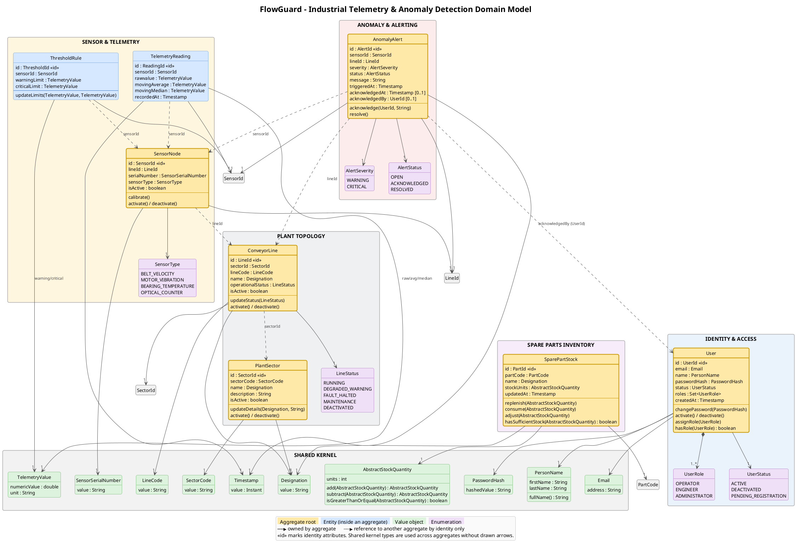
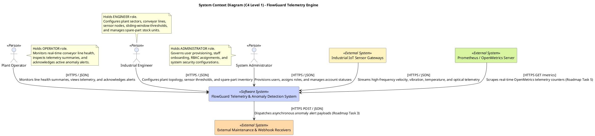
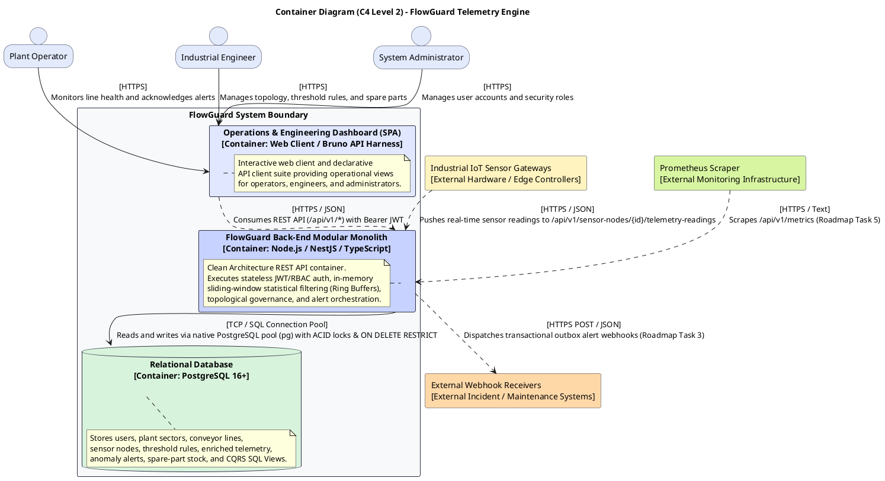
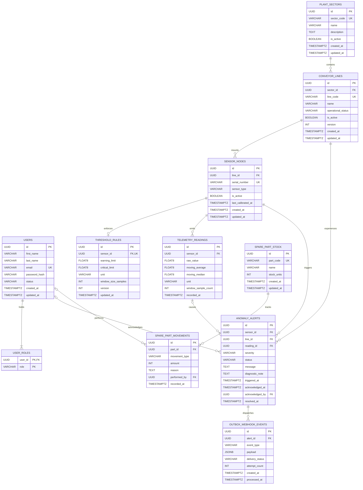

# Knowledge Base: FlowGuard (Industrial Line & Conveyor Telemetry & Anomaly Detection Engine) — Extended Edition

> **Metadata:** Version 2.4 | Scope: Personal Project (FlowGuard) | Last updated: October 2026
>
> **Suggested System Prompt for Chat:**
> *"Use this Knowledge Base as the absolute source of truth for the FlowGuard project. When answering, cite the section (e.g., see §3.2) to justify architecture or code decisions. Strictly follow the decisions made in ADRs (0001 to 0008) and the Clean Architecture rules. If a question is not covered, explicitly say 'The FlowGuard KB does not address this topic' instead of inventing."*

> **Update note (v2.3 — Contracts, Physical Persistence & Glossary Extension):** This edition adds information without removing anything from the existing content. The new sections **§16 to §27** formalize the REST API contractual specification (`06-api-design-specification.md`, `openapi.yaml`), the physical DDD→PostgreSQL mapping (`07-relational-mapping-and-persistence-strategy.md`), the relational ERD and CQRS views (`08-database-structure.md`), and the Global Ubiquitous Language Glossary (`glossary.md`). Sections §1–§15 remain unchanged.

> **Update note (v2.4 — Detailed Roadmap & Deployment Infrastructure Extension):** This edition adds information without removing anything from the existing content. The new sections **§28 to §30** formalize the detailed 28+ hour roadmap (`ROADMAP.md`), the Docker Compose infrastructure configuration (`docker-compose.yml`), and the version history of the KB itself. Sections §1–§27 remain 100% unchanged.

## Index
1. Overview & Business Context
2. Stakeholders & Personas
3. Engineering Principles & Guidelines
4. Key Architectural Scenarios
5. Architectural Decisions (ADRs 0001–0008)
6. Relational Persistence & Concurrency (PostgreSQL)
7. REST API, Security & Validation
8. Testing Strategy & CI/CD
9. Development Roadmap (20+ Hours)
10. **Detailed Domain Model (Structure & PlantUML)**
11. **Domain Model Rationale & Evolutionary Decisions**
12. **Architecture Summary & Service Breakdown**
13. **Component Architecture (C4 Level 3)**
14. **Use Case Diagram & Functional Scope**
15. **System Context & Container Diagrams (C4 Level 1 & 2)**
16. **API Design Specification & Contract-First Methodology**
17. **RBAC Endpoint Permissions Matrix (Complete)**
18. **DTO Contracts & Payload Specifications**
19. **Standardized Error Envelope & HTTP Status Code Resolution Matrix**
20. **Input Boundary Validation Architecture (Joi / Zod Pipes)**
21. **Relational Mapping & Persistence Strategy (DDD → PostgreSQL)**
22. **Physical DDL Mapping by Bounded Module**
23. **Concurrency Control, Transaction Demarcation & Reproducible Seeding**
24. **Physical Relational ERD & Referential Integrity Matrix**
25. **CQRS Read Views & Indexing Strategy**
26. **Ubiquitous Language & Architectural Glossary**
27. **OpenAPI 3.0.3 Contract Reference (Summary)**
28. **Detailed Engineering Roadmap & Milestone Breakdown (28+ Hours)**
29. **Infrastructure Deployment & Docker Compose Configuration**
30. **Version History & Document Evolution**

---

## Section Navigation Notes

### §1–§15 (Original Baseline — Unchanged)
The original sections of KB v2.2 remain **100% unchanged** and continue to be the primary source for:
* **Business vision, stakeholders, and personas** (§1, §2).
* **Engineering principles and guidelines** (§3).
* **Key architectural scenarios** (§4 — authentication, topological integrity, sliding-window ingestion, stock deduction).
* **ADRs 0001–0008** (§5 — Modular Monolith, Stack, PostgreSQL, Sliding Window, JWT/Argon2id, REST, Testing, CI/CD).
* **Relational persistence and concurrency** (§6 — golden constraints, optimistic/pessimistic locking, CQRS views).
* **REST API, security, and validation** (§7 — exception mapping, CORS, mass-assignment defense).
* **Testing strategy and CI/CD** (§8 — 4 Jest/Supertest/Bruno layers).
* **20+ hour roadmap** (§9 — Tasks 1–5).
* **Detailed Domain Model** (§10 — complete PlantUML, 5 aggregates + Shared Kernel).
* **Domain Model Rationale** (§11 — aggregate boundaries, decision logs, deletion invariants).
* **Architecture Summary & Service Breakdown** (§12 — processing pipeline, service matrix, complete REST endpoint matrix).
* **Component Architecture (C4 Level 3)** (§13 — Clean Architecture component diagram).
* **Use Case Diagram** (§14 — UC01–UC15 baseline + UC16–UC20 roadmap).
* **System Context & Container Diagrams (C4 Level 1 & 2)** (§15 — PlantUML diagrams).

### §16–§27 (v2.3 Extension — Information Added)

| Section | Content | Source Document |
|---|---|---|
| **§16** | Contract-First methodology, `/api/v1` versioning, content negotiation, HTTP semantics, and idempotency (Richardson Level 2). | `06-api-design-specification.md` §1–§2 |
| **§17** | Complete RBAC permission matrix by endpoint (Public, OPERATOR, ENGINEER, ADMINISTRATOR) with success/error codes. | `06-api-design-specification.md` §3 |
| **§18** | DTO specifications (request/response payloads) for all modules `FG-AUTH`, `FG-TOPO`, `FG-SENS`, `FG-INGEST`, `FG-ALERT`, `FG-STOCK`. | `06-api-design-specification.md` §4 |
| **§19** | Uniform JSON error envelope + HTTP status code resolution matrix (`200`–`500`) with architectural scenarios. | `06-api-design-specification.md` §5 |
| **§20** | Boundary validation architecture (Joi/Zod pipes, `stripUnknown: true`, fail-fast execution). | `06-api-design-specification.md` §6 |
| **§21** | Relational mapping strategy (DDD→PostgreSQL): zero ORM contamination, data mappers, dual identity (UUID + business codes), VO flattening, cross-aggregate refs by ID only. | `07-relational-mapping-and-persistence-strategy.md` §1–§2 |
| **§22** | Complete physical DDL by bounded module (`users`, `user_roles`, `plant_sectors`, `conveyor_lines`, `sensor_nodes`, `threshold_rules`, `telemetry_readings`, `anomaly_alerts`, `spare_part_stock`, `spare_part_movements`, `outbox_webhook_events`). | `07-relational-mapping-and-persistence-strategy.md` §3 |
| **§23** | Concurrency control (ACID multi-table transactions, pessimistic `SELECT FOR UPDATE`, optimistic `version`), deterministic seed script (`003_seed_industrial_baseline.sql`). | `07-relational-mapping-and-persistence-strategy.md` §4 |
| **§24** | Mermaid relational ERD + complete referential integrity & cascade actions matrix (CASCADE / RESTRICT / SET NULL) by FK. | `08-database-structure.md` §2, §4 |
| **§25** | CQRS read views (`v_conveyor_line_health_summary`, `v_sensor_latest_telemetry`) + indexing strategy (functional B-tree, time-series, partial indexes). | `08-database-structure.md` §5–§6 |
| **§26** | Ubiquitous Language & Architectural Glossary — definitions of all domain, statistical, and architectural concepts with cross-references. | `glossary.md` |
| **§27** | OpenAPI 3.0.3 contract reference (metadata, servers, tags, security scheme, parameters, schemas summary, executable tooling). | `openapi.yaml` |

### §28–§30 (v2.4 Extension — Information Added)

| Section | Content | Source Document |
|---|---|---|
| **§28** | Detailed Engineering Roadmap & Milestone Breakdown — 5 milestones (28+ hours) with target layers, granular deliverables, and reference architecture: (M1) Moving Median $\tilde{x}_W$ & IQR Outlier Rejection (6.0h); (M2) Optimistic & Pessimistic Concurrency Control (5.0h); (M3) Transactional Outbox & Async Webhook Alert Dispatcher (6.5h); (M4) Exhaustive Boundary Validation & Git-Native Bruno `.yml` Suites (6.0h); (M5) OpenMetrics/Prometheus Telemetry Scraper Endpoint (4.5h). Includes summary table with a total of 28.0h. | `ROADMAP.md` |
| **§29** | Infrastructure Deployment & Docker Compose Configuration — `postgres:16-alpine` + `backend` (Node.js/NestJS) services, healthchecks (`pg_isready`), migrations volume mounts (`/docker-entrypoint-initdb.d`), environment variables (`DB_*`, `JWT_SECRET`, `CORS_ALLOWED_ORIGINS`), `postgres_data` volume, and `flowguard-network` network (bridge). Includes boot sequence, operational commands, and CI/CD integration (§29.6). | `docker-compose.yml` |
| **§30** | Version History & Document Evolution — version table (v2.2 → v2.3 → v2.4), additive evolution principles (never subtractive), semantic versioning, KB ↔ repository file correspondence map, and suggested next steps (future §31–§34). | This document (meta-documentation) |

---

## Current State of the KB

* **Version:** 2.4 (Extended)
* **Original sections preserved:** §1–§15 (no content removed)
* **v2.3 sections preserved:** §16–§27 (no content removed)
* **Sections added in v2.4:** §28–§30 (3 new sections)
* **Total sections:** 30
* **Consolidated sources:** 10+ documents (`knowledge_base_flowguard.md`, `knowledge_base_esoft_eapli_arqsi.md`, `06-api-design-specification.md`, `07-relational-mapping-and-persistence-strategy.md`, `08-database-structure.md`, `glossary.md`, `openapi.yaml`, `ROADMAP.md`, `docker-compose.yml`, + ADRs 0001–0008 referenced internally)

---

## KB Evolution Principles (Summary)

1. **Additive, never subtractive:** Each version adds information without removing existing content. When a section is refined (e.g., §9 → §28), the original version remains accessible and the new section is explicitly marked as the authoritative source for the refined aspect.
2. **Explicit traceability:** Each new section documents the source file (`ROADMAP.md`, `docker-compose.yml`, `openapi.yaml`, etc.) and references the ADRs and sections of the Master KB (`knowledge_base_esoft_eapli_arqsi.md`) that justify it.
3. **Semantic versioning:** Minor increments (v2.3 → v2.4) reflect additive extensions; major increments (v2.x → v3.x) would be reserved for restructurings that break cross-reference compatibility.
4. **Single source of truth:** In case of conflict between this KB and a repository file (e.g., `openapi.yaml` diverging from §27), the repository file prevails — the KB must be updated to reflect the actual state of the code.

---

## 1. Overview & Business Context

### 1.1. The Real Problem
In modern assembly lines (factories) and high-capacity logistics centers (e.g., LIDL, Sonae distribution centers), failures in conveyor belts, blockages at crossings, and motor overloads cause unplanned stoppages that cost thousands of euros per minute. Traditional operators only discover these failures when the line has already physically stopped, through visual inspection or catastrophic failure.

### 1.2. The Solution (FlowGuard)
**FlowGuard** is a lightweight, high-performance backend engine and telemetry gateway. It solves the Industry 4.0 pain by:
* Ingesting industrial sensor data streams (velocity, vibration, temperature, optical counters) in real time.
* Applying sliding windows and statistical filtering algorithms **in memory** to compute moving averages and medians.
* Detecting micro-blockages or overheating *before* physical failure.
* Persisting telemetry and alert history while guaranteeing strict relational integrity (ACID).

### 1.3. Differentiation & Technical Highlights
* **Real Scope:** Solves a classic heavy logistics and industrial automation problem.
* **Data Domain:** Use of *Ring Buffers* (circular buffers) for sliding windows, avoiding memory overload.
* **Clean Architecture:** Rigorous isolation between Domain (business rules), Application (use cases), and Infrastructure (PostgreSQL, NestJS).
* **Light CQRS:** Separation of write operations (Commands) from optimized reads (Queries with SQL Views).

---

## 2. Stakeholders & Personas

The system is protected by Role-Based Access Control (RBAC) and serves three main personas:
1. **Plant Operators (`OPERATOR`):** Monitor line health in real time, acknowledge active anomaly alerts, and supervise daily throughput.
2. **Industrial Engineers & Maintenance Managers (`ENGINEER`):** Configure factory sectors, define line topologies, calibrate sliding-window *thresholds*, and analyze historical telemetry reports to schedule preventive maintenance.
3. **System Administrators (`ADMINISTRATOR`):** Responsible for security governance, account provisioning, role assignment, and database maintenance.
4. **Automated Integrators:** ML services, OpenMetrics/Prometheus scrapers, and message brokers (MQTT/RabbitMQ) that consume the standardized REST APIs.

---

## 3. Engineering Principles & Guidelines

FlowGuard adheres to the following principles (aligned with Master KB §1.2 and §10):
* **Principle 1 — The Dependency Rule:** All code points inward. The Domain (entities, VOs, Domain Services) does not know about NestJS, PostgreSQL, or HTTP.
* **Principle 2 — Database as a Fortress:** PostgreSQL is not a mere repository; it defends invariants (e.g., `ON DELETE RESTRICT`, `CHECK (stock_units >= 0)`).
* **Principle 3 — Intentional APIs:** Noun-based URIs, correct HTTP methods, and payload validation at the boundary (Joi/Zod) before touching the application layer.
* **Principle 4 — Testability by Design:** Business logic and sliding-window mathematics are testable in milliseconds without a DB or network.
* **Principle 5 — Less is More:** Use of a Modular Monolith instead of Microservices (1st Commandment of Distributed Systems).

---

## 4. Key Architectural Scenarios

### 4.1. Secure Engineer Authentication and Role-Based Authorization
* **Flow:** `POST /api/v1/auth/login` submits credentials. The system verifies the hash (Argon2id) and issues a signed JWT with claims (`sub`, `role`, `exp`). The `RolesGuard` intercepts future requests and verifies that the token has the `ENGINEER` role before allowing access to topology configuration routes.

### 4.2. Topological Integrity on Asset Deletion
* **Flow:** A `DELETE /api/v1/plant-sectors/{id}` request tries to delete a sector that has associated `ConveyorLines`. The PostgreSQL FK (`ON DELETE RESTRICT`) blocks the operation. The application catches the error and returns `409 Conflict` with details of the dependent assets, preserving the audit history.

### 4.3. Telemetry Ingestion and Statistical Evaluation (Sliding Window)
* **Flow:** `POST /api/v1/sensor-nodes/{sensorId}/telemetry-readings`. The payload is validated (Joi).
* The `TelemetryEvaluationEngine` processes the data through 4 filters (*Pipes and Filters*):
  1. *Sanitization:* Validates physical sensor limits.
  2. *Sliding Window:* Inserts the value into an in-memory *Ring Buffer* and computes the moving average (\(\mu_W\)) and moving median (\(\tilde{x}_W\)).
  3. *Evaluation:* Compares the smoothed metric against the `ThresholdRule` (WARNING/CRITICAL).
  4. *Action:* Persists the reading and, if a breach occurs, generates an `AnomalyAlert` and changes the line state (`RUNNING` -> `FAULT_HALTED`).

### 4.4. Stock Deduction under High Contention
* **Flow:** Multiple maintenance requests deduct stock parts simultaneously. The application opens a transaction and uses **Pessimistic Locking** (`SELECT ... FOR UPDATE`). The entity validates that stock does not become negative. If valid, it updates and `COMMIT`s; if not, it `ROLLBACK`s and returns `422 Unprocessable Entity`.

---

## 5. Architectural Decisions (ADRs 0001–0008)

### ADR-0001: Modular Monolith with Clean / Onion Architecture
* **Decision:** The system is packaged as a single deploy unit but divided into vertical modules (`IdentityAndAccess`, `PlantTopology`, `TelemetryIngestion`, `AnomalyAlerting`, `SparePartsInventory`).
* **Layers:** Domain (pure TypeScript) -> Application (Use Cases and Ports) -> Infrastructure & Presentation (NestJS Controllers, PostgreSQL Repositories).
* **Justification:** Eliminates network latency between modules, allows testing the domain in isolation, and facilitates evolution to microservices if needed in the future.

### ADR-0002: Technology Stack (Node.js + TypeScript + NestJS)
* **Decision:** Node.js (LTS) for non-blocking I/O (ideal for concurrent telemetry). TypeScript (Strict Mode) for static typing and DDD. NestJS over Express for dependency injection (IoC), modularity, and guards/pipes.
* **Justification:** Facilitates the implementation of Clean Architecture, with fast tests and a modern ecosystem.

### ADR-0003: Relational Persistence (PostgreSQL)
* **Decision:** PostgreSQL (v16+) with a normalized schema (3NF/BCNF), native constraints (`ON DELETE RESTRICT`, `CHECK`), functional indexing (case-insensitive), and `JSONB` for semi-structured metadata.
* **Concurrency:** ACID transactions, *Pessimistic Locking* (`FOR UPDATE`) for stock, and *Optimistic Locking* (`version` column) for configurations.
* **Justification:** MongoDB does not guarantee referential integrity on `DELETE`, being vulnerable to race conditions. PostgreSQL is the "fortress" of invariants.

### ADR-0004: In-Memory Sliding-Window Telemetry
* **Decision:** Telemetry processing via *Ring Buffers* (size \(N \le 128\)) kept in memory per sensor. Moving average calculation is instantaneous (\(O(W)\)).
* **Justification:** Querying the DB with `PERCENTILE_CONT` on every sensor reading would destroy performance (I/O and CPU). Memory usage is strictly bounded to \(O(S \times N)\).

### ADR-0005: Stateless JWT Authentication & RBAC
* **Decision:** JWT with `expiresIn: 8h` (industrial shift) and password hashing with **Argon2id** (memory-hard and GPU-resistant).
* **Rules:** Prevention of *Mass Assignment* (roles never come from the body), concealment of `password_hash` in queries and responses, and identical login responses (`401 Unauthorized`) to prevent enumeration.

### ADR-0006: REST API (Richardson Level 2) & OpenAPI 3.0
* **Decision:** Plural URIs, strict use of HTTP methods and status codes (`200`, `201`, `400`, `401`, `403`, `404`, `409`, `422`). Boundary validation with Joi/Zod. Interactive documentation at `/api/docs`.

### ADR-0007: Testing Strategy (Jest + Supertest + Bruno API Suites)
* **Decision (4 Layers):** Testing pyramid extended to 4 layers:
  1. **Unit Tests (Jest):** Focused on the Domain and the `SlidingWindowEngine`. Fast (< 1s), no I/O, no mocks.
  2. **Application Tests (Jest + Test Doubles):** Test Use Cases with *In-Memory Fakes* (e.g., `InMemoryDomainRepository`) and *Mocks/Spies*.
  3. **In-Memory HTTP Integration (Supertest):** Test the complete HTTP pipeline (Routers, Guards, Controllers, Exception Filters) in memory, without opening TCP ports (avoids conflicts and occupied ports in CI).
  4. **Black-Box API & Workflows (Bruno CLI):** Declarative **`.yml`** collections (Git-native) that run against a real server and PostgreSQL DB. Enable *State Chaining* (e.g., dynamically extract JWT, create sector, create line, ingest telemetry, and verify the alert). Executed via GUI (Bruno) or headless (`bru run`).
* **Justification:** Ultra-fast feedback (F.I.R.S.T.), independent tests, zero port conflicts in CI, and *end-to-end* verification versioned in Git without paid cloud dependencies (like Postman). Bruno solves the problem of unreadable JSON diffs and collaborator limits (max 3).

### ADR-0008: CI/CD and API Tooling (GitHub Actions + Bruno)
* **Decision:** Bruno for Git-native API collections (**`.yml`**). GitHub Actions to run CI (Lint, Build, Test, Audit) on every Push/PR.
* **Justification:** Bruno is free of cloud limits and its diffs in Git are readable. CI guarantees that no change breaks the build.

---

## 6. Relational Persistence & Concurrency (PostgreSQL)

* **Schema:** Highly normalized.
* **Golden Constraints:**
  * `CHECK (stock_units >= 0)` for stock.
  * `CHECK (critical_threshold > warning_threshold)` for rules.
  * `ON DELETE RESTRICT` to protect assets in use.
* **Optimistic Locking:** Use of a `version` column to avoid *lost updates* in configurations.
* **Pessimistic Locking:** Use of `SELECT ... FOR UPDATE` for spare-part stock deduction under high concurrency.
* **Optimized Views (CQRS in the DB):**
  * `v_conveyor_line_health_summary`: Aggregates line state, sensor count, and active alerts.
  * Avoids the **N+1 Queries** problem.

---

## 7. REST API, Security & Validation

* **Error Format:** Consistent JSON with `timestamp`, `status`, `error`, and `message` (no stack traces in production).
* **Exception Mapping:**
  * `400 Bad Request`: Syntax error or Joi/Zod validation error.
  * `401 Unauthorized`: Invalid/expired token.
  * `403 Forbidden`: Insufficient role.
  * `409 Conflict`: Referential integrity violation or optimistic version conflict.
  * `422 Unprocessable Entity`: Domain invariant violation (e.g., negative stock).
* **Security:** CORS with an *allowlist* (never `*`), JWT via `Authorization: Bearer <token>`, and *stripping* of disallowed fields in payloads (to avoid Mass Assignment).

---

## 8. Testing Strategy & CI/CD

The FlowGuard testing strategy is divided into 4 distinct layers:

1. **Unit Tests (Base - Jest):** Focused on the Domain and the `SlidingWindowEngine`. They run in milliseconds purely in memory (V8).
2. **Application Tests (Middle - Jest + Test Doubles):** Test Use Cases (Services). They inject *In-Memory Fake Repositories* to guarantee fast, isolated tests without a DB.
3. **Integration Tests (Upper-Middle - Supertest):** Test the complete HTTP pipeline (Routers, Guards, Controllers, Exception Filters) in memory, without invoking `app.listen()`. Avoids flakiness from occupied ports in CI.
4. **Black-Box API & CLI (Top - Bruno):** Git-native collections (`.bru`) that validate complete workflows (*Stateful Workflows*) against a real server, including *Token Extraction* and *State Chaining* (e.g., create sector -> create line -> ingest telemetry -> verify alert). Executed via Bruno GUI or CLI (`npx @usebruno/cli run`).

* **CI Pipeline (GitHub Actions):**
  1. `npm ci` (clean install).
  2. `tsc --noEmit` and ESLint (static analysis).
  3. `npm run build`.
  4. `npm test -- --coverage` (runs unit and integration tests).
  5. `npm audit` (security).
  6. *(Optional/QA)*: Execution of the Bruno CLI suite against the test DB (if applicable in the future).
* **API Tooling:** Bruno stores the `.bru` files in the repository, allowing calls to be executed and tokens to be extracted automatically (`bru.setEnvVar`). The choice of Bruno over Postman is due to Git integration (text files vs. monstrous JSON) and free-tier limits (Postman limits to 3 collaborators).

---

## 9. Development Roadmap (20+ Hours)

The current state (Baseline) is a functional system with Domain Models, Persistence, REST API, Security, and Tests. The next 20+ hours of work (with AI support) will focus on:

1. **Task 1 (Advanced Sliding Window):** Implement high-frequency moving median filters (using *min-max heaps* or *order statistic trees*) to reject transient vibration spikes.
2. **Task 2 (Concurrency):** Introduce *Optimistic Locking* (`version`) on all line state mutations and *Row-level locking* on stock.
3. **Task 3 (Dynamic Alert Engine):** Build an anomaly rules engine that fires asynchronous *webhooks* to external systems (using the *Transactional Outbox* pattern).
4. **Task 4 (Boundary Tests):** Expand integration tests and Bruno collections (`.bru`) with exhaustive error cases (400, 401, 403, 404, 409, 422) and chained end-to-end flows.
5. **Task 5 (Observability):** Expose a `/metrics` endpoint compatible with OpenMetrics/Prometheus for real-time scraping.

---

## 10. Detailed Domain Model (Structure & PlantUML)

The Domain Model is visually represented through UML and is organized into 5 main business aggregates, plus a *Shared Kernel*.

### 10.1. Package and Class Structure
* **IDENTITY & ACCESS:** `User` (Root), `UserRole` (Enum), `UserStatus` (Enum).
* **PLANT TOPOLOGY:** `PlantSector` (Root), `ConveyorLine` (Root), `LineStatus` (Enum).
* **SENSOR & TELEMETRY:** `SensorNode` (Root), `ThresholdRule` (Entity), `TelemetryReading` (Entity), `SensorType` (Enum).
* **ANOMALY & ALERTING:** `AnomalyAlert` (Root), `AlertSeverity` (Enum), `AlertStatus` (Enum).
* **SPARE PARTS INVENTORY:** `SparePartStock` (Root).
* **SHARED KERNEL:** `PersonName`, `Email`, `PasswordHash`, `SectorCode`, `LineCode`, `Designation`, `SensorSerialNumber`, `TelemetryValue`, `AbstractStockQuantity`, `Timestamp` (all Value Objects).

### 10.2. PlantUML Reference Code


---

## 11. Domain Model Rationale & Evolutionary Decisions

### 11.1. Aggregate Decomposition and Consistency Boundaries
The FlowGuard domain is organized into 5 business aggregates and a *Shared Kernel*, strictly adhering to the DDD invariant rule: *an aggregate defines a boundary within which business invariants are kept in a fully consistent state (ACID), and external entities may only reference the Aggregate Root through its globally unique business identifier*.

| Aggregate | Aggregate Root | Business Responsibility & Scope |
| --- | --- | --- |
| **Identity & Access Aggregate** | `User` | User credentials, personal name (`PersonName`), lifecycle state (`ACTIVE`, `DEACTIVATED`, `PENDING_REGISTRATION`), and Role-Based Access Control (`OPERATOR`, `ENGINEER`, `ADMINISTRATOR`). |
| **Plant Topology Aggregate** | `PlantSector`, `ConveyorLine` | Hierarchical management of industrial assets representing physical factory sectors, production segments, and conveyor belt topologies. |
| **Sensor & Telemetry Aggregate** | `SensorNode`, `ThresholdRule` | Heterogeneous sensor nodes (velocity, vibration, temperature, optical counters), calibration metadata, and sliding-window limits. |
| **Anomaly & Alerting Aggregate** | `AnomalyAlert` | Real-time threshold breaches, anomaly states, automated alert lifecycles, and operational line state transitions. |
| **Spare Parts Inventory Aggregate** | `SparePartStock` | Normalized abstract stock units (\(u \in \mathbb{N}_0\)) for replacement components and maintenance tracking. |

### 11.2. Evolutionary Decisions Log (Traceability)

**Decision Log 1: User Roles and Staff Onboarding Lifecycle (ADR-0005)**
* **Context:** The system requires distinct operational permissions for factory-floor operators, maintenance engineers, and administrators. Public registration must be restricted, while staff onboarding must follow a secure invitation flow.
* **Rationale:** The `UserRole` enumeration defines `{OPERATOR, ENGINEER, ADMINISTRATOR}`. The `UserStatus` enumeration defines `{ACTIVE, DEACTIVATED, PENDING_REGISTRATION}`. Public self-registration provisions default `OPERATOR` accounts with `PENDING_REGISTRATION` status until completed by an administrator.

**Decision Log 2: Hierarchical Referential Integrity on Asset Deletion (ADR-0003)**
* **Context:** Industrial topologies form strict parent-child hierarchies (`PlantSector` \(\rightarrow\) `ConveyorLine` \(\rightarrow\) `SensorNode`). Accidental deletion of active parent assets would corrupt telemetry audit records.
* **Rationale:** Applied via relational foreign keys with **`ON DELETE RESTRICT`** constraints. Asset deactivation must be done via *soft deactivation* (`is_active = FALSE`) instead of physical deletion.

**Decision Log 3: In-Memory Sliding-Window Telemetry Pipeline (ADR-0004)**
* **Context:** Raw sensor streams arrive at high frequency. Evaluating historical database queries for moving averages and medians on every ingestion request would saturate disk I/O and CPU.
* **Rationale:** Encapsulated in the *Domain Service* `TelemetryEvaluationEngine`, keeping circular *ring buffers* in memory bounded per active sensor to compute sliding statistics in microseconds.

**Decision Log 4: Non-Negative Abstract Stock Units**
* **Context:** Spare parts and maintenance inventory must be tracked without the overhead of complex unit conversion.
* **Rationale:** Modeled using the Value Object `AbstractStockQuantity`, supported by domain preconditions and PostgreSQL `CHECK (stock_units >= 0)` constraints to prevent negative balances.

### 11.3. Referential Integrity and Deletion Invariants
To satisfy integrity rules at both the database and domain level, deletion operations enforce strict consistency constraints:
* **Referential Guards:** Master assets (`PlantSector`, `ConveyorLine`) cannot be removed if active child sensors or historical telemetry records exist. Repository queries enforce dependency checks before deletion, returning `409 Conflict` on violations.
* **Soft Lifecycle Deactivation:** Assets that are no longer operational are marked inactive via domain methods (`ConveyorLine.deactivate()`) instead of being physically removed, preserving historical telemetry correlation.

---

## 12. Architecture Summary & Service Breakdown

### 12.1. Processing Pipeline
Every request in **FlowGuard** traverses a deterministic Clean Architecture pipeline:
**Client / Sensor Gateway $\rightarrow$ NestJS Routing Perimeter (`JwtAuthGuard`, `RolesGuard`, Joi/Zod Validation Pipe) $\rightarrow$ REST Controller $\rightarrow$ Application Service $\rightarrow$ Pure Domain Model / Sliding-Window Engine $\rightarrow$ Repository Port $\rightarrow$ Native PostgreSQL Pool (`pg`)**.

### 12.2. Services and Domain Components
| Service / Domain Component | Layer | Responsibility | Used by |
|---|---|---|---|
| `AuthAndUserService` | Application | Verifies user credentials against **Argon2id** hashes, issues stateless JWTs (8h shift expiry), and governs staff onboarding (`PENDING_REGISTRATION` $\rightarrow$ `ACTIVE`). | Authentication, User Provisioning, Role Management |
| `PlantTopologyService` | Application | Manages `PlantSector` and `ConveyorLine` lifecycles, enforces unique business codes (`sectorCode`, `lineCode`), handles soft deactivation, and coordinates optimistic concurrency locking (`Task 2`). | Sector & Conveyor Line Management, Operational Status Transitions |
| `SensorManagementService` | Application | Registers `SensorNode` transducers (`BELT_VELOCITY`, `MOTOR_VIBRATION`, `BEARING_TEMPERATURE`, `OPTICAL_COUNTER`), manages calibration states, and attaches `ThresholdRule` bounds. | Sensor Node Management, Threshold Calibration |
| `TelemetryIngestionService` | Application | Orchestrates real-time telemetry ingestion, invokes `TelemetryEvaluationEngine`, persists enriched readings, and atomically triggers alerts and line state transitions upon breaches. | High-Frequency Sensor Telemetry Ingestion |
| `TelemetryEvaluationEngine` | Domain Service | Executes the 4-stage *Pipes-and-Filters* in-memory pipeline over bounded circular **Ring Buffers** ($N \le 128$), computing Moving Averages ($\mu_W$) and Moving Medians ($\tilde{x}_W$, `Task 1`). | `TelemetryIngestionService` |
| `LineStateTransitionDomainService` | Domain Service | Evaluates severity breaches (`WARNING` vs. `CRITICAL`), instantiates `AnomalyAlert` aggregates, and transitions parent `ConveyorLine` states (`RUNNING` $\rightarrow$ `DEGRADED_WARNING` or `FAULT_HALTED`). | `TelemetryIngestionService` |
| `AnomalyAlertService` | Application | Governs alert acknowledgement (`OPEN` $\rightarrow$ `ACKNOWLEDGED` $\rightarrow$ `RESOLVED`) by operators and coordinates asynchronous Transactional Outbox webhook dispatches (`Task 3`). | Alert Monitoring, Operator Acknowledgement, Webhook Dispatch |
| `SparePartsStockService` | Application | Manages normalized non-negative integer spare-part balances ($u \in \mathbb{N}_0$), executing replenishments and row-locked (`SELECT ... FOR UPDATE`) deductions (`Task 2`). | Maintenance Inventory Management, Stock Adjustments |
| `LineHealthQueryService` | Application (CQRS Read) | Queries the pre-joined PostgreSQL View `v_conveyor_line_health_summary` to avoid N+1 queries and formats system counters for the OpenMetrics `/api/v1/metrics` endpoint (`Task 5`). | Floor Dashboards, Health Checks, Prometheus Scraping |

### 12.3. Feature Summary
* **Identity, Authentication & RBAC Governance (`FG-AUTH`):** Stateless authentication with JWT (8h shift), Argon2id, anti-enumeration, mass-assignment defense, and RBAC (`OPERATOR`, `ENGINEER`, `ADMINISTRATOR`).
* **Plant Sector & Conveyor Line Topology Management (`FG-TOPO`):** Hierarchical modeling, deletion protection (`ON DELETE RESTRICT`), and soft deactivation/reactivation.
* **Sensor Nodes & Threshold Rule Configuration (`FG-SENS`):** Support for multiple transducers, limits (Warning/Critical) protected by domain and SQL invariants (`CHECK`).
* **Real-Time Telemetry Ingestion & In-Memory Sliding Window (`FG-INGEST`):** Ring Buffers, sanitization, windowed aggregation (Moving Average and Median), evaluation, and atomic persistence with alerts.
* **Anomaly Alerting & Operational Acknowledgement (`FG-ALERT`):** Deterministic lifecycle (`OPEN` -> `ACKNOWLEDGED` -> `RESOLVED`), with operator notes and asynchronous webhooks (Outbox).
* **Abstract Spare-Part Inventory Control (`FG-STOCK`):** Abstract stock ($u \in \mathbb{N}_0$), safe deductions with `SELECT ... FOR UPDATE`, and validation against negative values (`422`).

### 12.4. Complete REST Endpoints Matrix

**Access Levels:** `Public`, `Gateway / Engineer`, `Operator+`, `Engineer+`, `Admin`.

#### 12.4.1. Diagnostics, Health & Observability
| Method | Endpoint | Description | Access | Success | Errors |
|---|---|---|---|---|---|
| `GET` | `/api/v1/health` | Liveness and readiness diagnostic probe | Public | `200 OK` | `503` |
| `GET` | `/api/v1/metrics` | Scrape OpenMetrics / Prometheus counters *(Task 5)* | Public / Scraper | `200 OK` (Text) | `500` |

#### 12.4.2. Authentication & User Governance (`FG-AUTH`)
| Method | Endpoint | Description | Access | Success | Errors |
|---|---|---|---|---|---|
| `POST` | `/api/v1/auth/login` | Authenticate credentials (Argon2id) and issue stateless JWT | Public | `200 OK` + Token | `400`, `401` |
| `POST` | `/api/v1/auth/register` | Public operator self-registration (`PENDING_REGISTRATION`) | Public | `201 Created` | `400`, `409` |
| `POST` | `/api/v1/users` | Provision staff account (`OPERATOR`, `ENGINEER`, `ADMINISTRATOR`) | Admin | `201 Created` | `400`, `401`, `403`, `409` |
| `GET` | `/api/v1/users` | List system users with pagination and role filtering | Admin | `200 OK` + Page | `401`, `403` |
| `PATCH` | `/api/v1/users/:id/status` | Activate or deactivate user account | Admin | `200 OK` | `400`, `401`, `403`, `404` |
| `PATCH` | `/api/v1/users/:id/roles` | Assign or revoke RBAC roles | Admin | `200 OK` | `400`, `401`, `403`, `404` |

#### 12.4.3. Plant Sectors & Conveyor Lines (`FG-TOPO`, `FG-QUERY`)
| Method | Endpoint | Description | Access | Success | Errors |
|---|---|---|---|---|---|
| `GET` | `/api/v1/plant-sectors` | List plant sectors (filterable by `isActive`) | Operator+ | `200 OK` + Array | `401` |
| `GET` | `/api/v1/plant-sectors/:id` | Get plant sector details by UUID or `sectorCode` | Operator+ | `200 OK` + Object | `401`, `404` |
| `POST` | `/api/v1/plant-sectors` | Register a new industrial plant sector | Engineer+ | `201 Created` | `400`, `401`, `403`, `409` |
| `PUT` | `/api/v1/plant-sectors/:id` | Update plant sector designation and description | Engineer+ | `200 OK` | `400`, `401`, `403`, `404`, `409` |
| `DELETE` | `/api/v1/plant-sectors/:id` | Delete unreferenced plant sector (`ON DELETE RESTRICT` guard) | Engineer+ | `204 No Content` | `401`, `403`, `404`, `409` |
| `GET` | `/api/v1/conveyor-lines` | List conveyor lines with CQRS health summary (`v_conveyor_line_health_summary`) | Operator+ | `200 OK` + Array | `401` |
| `GET` | `/api/v1/conveyor-lines/:id` | Get conveyor line details and current operational state | Operator+ | `200 OK` + Object | `401`, `404` |
| `POST` | `/api/v1/conveyor-lines` | Create conveyor line inside a plant sector | Engineer+ | `201 Created` | `400`, `401`, `403`, `404`, `409` |
| `PATCH` | `/api/v1/conveyor-lines/:id/operational-status` | Transition operational status (`RUNNING`, `MAINTENANCE`, `DEACTIVATED`) *(Optimistic Lock Task 2)* | Operator+ | `200 OK` | `400`, `401`, `404`, `409`, `422` |
| `DELETE` | `/api/v1/conveyor-lines/:id` | Delete unreferenced conveyor line (`ON DELETE RESTRICT` guard) | Engineer+ | `204 No Content` | `401`, `403`, `404`, `409` |

#### 12.4.4. Sensor Nodes, Threshold Rules & Telemetry Ingestion (`FG-SENS`, `FG-INGEST`)
| Method | Endpoint | Description | Access | Success | Errors |
|---|---|---|---|---|---|
| `GET` | `/api/v1/sensor-nodes` | List sensor nodes (filterable by `lineId`, `sensorType`, `isActive`) | Operator+ | `200 OK` + Array | `401` |
| `POST` | `/api/v1/sensor-nodes` | Attach a new sensor node to a conveyor line | Engineer+ | `201 Created` | `400`, `401`, `403`, `404`, `409` |
| `PUT` | `/api/v1/sensor-nodes/:id/threshold-rule` | Configure or update `warningLimit` and `criticalLimit` (`critical > warning`) | Engineer+ | `200 OK` | `400`, `401`, `403`, `404`, `422` |
| `PATCH` | `/api/v1/sensor-nodes/:id/deactivate` | Soft-deactivate sensor node | Engineer+ | `200 OK` | `401`, `403`, `404` |
| `POST` | `/api/v1/sensor-nodes/:id/telemetry-readings` | Ingest real-time telemetry reading, compute sliding-window stats ($\mu_W$, $\tilde{x}_W$), and evaluate anomaly bounds | Gateway / Engineer+ | `201 Created` + Evaluation Result | `400`, `401`, `404`, `422` |
| `GET` | `/api/v1/sensor-nodes/:id/telemetry-readings` | Query paginated historical readings and window metrics | Operator+ | `200 OK` + Page | `400`, `401`, `404` |

#### 12.4.5. Anomaly Alerts & Spare-Part Inventory (`FG-ALERT`, `FG-STOCK`)
| Method | Endpoint | Description | Access | Success | Errors |
|---|---|---|---|---|---|
| `GET` | `/api/v1/anomaly-alerts` | List anomaly alerts (filterable by `status`, `severity`, `lineId`, paginated) | Operator+ | `200 OK` + Page | `401` |
| `POST` | `/api/v1/anomaly-alerts/:id/acknowledge` | Intentional command: Operator acknowledges alert with diagnostic note | Operator+ | `200 OK` | `400`, `401`, `404`, `409`, `422` |
| `POST` | `/api/v1/anomaly-alerts/:id/resolve` | Intentional command: Mark acknowledged alert as resolved | Engineer+ | `200 OK` | `401`, `403`, `404`, `409`, `422` |
| `GET` | `/api/v1/spare-parts` | List spare-part inventory balances ($u \in \mathbb{N}_0$) | Operator+ | `200 OK` + Array | `401` |
| `POST` | `/api/v1/spare-parts` | Register new spare-part catalog item with initial stock | Engineer+ | `201 Created` | `400`, `401`, `403`, `409`, `422` |
| `POST` | `/api/v1/spare-parts/:id/replenish` | Increase abstract spare-part stock units | Engineer+ | `200 OK` + Balance | `400`, `401`, `403`, `404`, `422` |
| `POST` | `/api/v1/spare-parts/:id/consume` | Deduct abstract spare-part stock units (`SELECT ... FOR UPDATE`, prevents $< 0$) | Operator+ | `200 OK` + Balance | `400`, `401`, `404`, `422` |

---

## 13. Component Architecture (C4 Level 3)

### 13.1. Context and Layer Structure
The system follows the C4 model (Level 3), detailing the internal decomposition of the *Back-End Modular Monolith* container.

**Layer Pipeline:**
1. **Presentation & Delivery Layer (Primary / Driving Adapters):** NestJS Routers, `JwtAuthGuard`, `RolesGuard`, `HttpExceptionFilter`, and Joi/Zod validation (`stripUnknown: true`).
2. **Application Services Layer:** Use case orchestrator services (e.g., `TelemetryIngestionService`, `AnomalyAlertService`), ACID transaction demarcation, and Port coordination.
3. **Domain Core Layer:** Pure TypeScript entities, Aggregates, Value Objects, and Domain Services (`TelemetryEvaluationEngine`, `LineStateTransitionDomainService`).
4. **Infrastructure & Persistence Layer (Driven Adapters):** Port implementations (e.g., `PgUserRepository`, `PgSensorTelemetryRepository`), Data Mappers, and webhook adapters.

### 13.2. Component Diagram PlantUML

```plantuml
@startuml
!pragma layout smetana
skinparam packageStyle rectangle
skinparam componentStyle uml2
skinparam shadowing false
skinparam linetype ortho
skinparam nodesep 45
skinparam ranksep 55

skinparam component {
  BackgroundColor #F8F9FA
  BorderColor #2B2D42
  ArrowColor #1D3557
  FontName "Arial"
  FontSize 12
}

skinparam interface {
  BackgroundColor #FFFFFF
  BorderColor #1D3557
}

title FlowGuard Back-End - Component Diagram (C4 Level 3 / Clean Architecture Container)

' =========================================================
' EXTERNAL CLIENTS & INTEGRATORS (OpenAPI REST Interfaces)
' =========================================================
cloud "External Clients & Industrial Integrators" {
  [Operations & Engineering Client (SPA / Bruno)] as SPA #E2EAFC
  [Industrial IoT Sensor Gateways] as SensorGateways #FFF3BF
  [Prometheus Metrics Scraper (Task 5)] as Prometheus #D8F5A2
  [External Maintenance Webhook Receiver (Task 3)] as WebhookReceiver #FFD8A8
}

package "FlowGuard Back-End Modular Monolith Container (Node.js / NestJS / TypeScript)" {

  ' =========================================================
  ' 1. PRESENTATION & DELIVERY LAYER (Driving Adapters)
  ' =========================================================
  package "1. Presentation & Delivery Layer (HTTP Controllers, Guards & Validation Pipes)" {
    [Auth & User Controller\n(JwtAuthGuard, RolesGuard)] as C_Auth
    [Plant Topology Controller\n(Sectors & Conveyor Lines)] as C_Topology
    [Sensor & Threshold Controller\n(Calibration & Bounds)] as C_Sensor
    [Telemetry Ingestion Controller\n(High-Frequency Stream Boundary)] as C_Telemetry
    [Anomaly Alert Controller\n(Acknowledge & Resolve)] as C_Alert
    [Spare Parts Stock Controller\n(Abstract Integer Inventory)] as C_Stock
    [Health & Metrics Controller\n(Health + OpenMetrics Task 5)] as C_Metrics
  }

  ' REST Endpoints Exposed
  () "/api/v1/auth & /users" as API_Auth
  () "/api/v1/plant-sectors & /conveyor-lines" as API_Topology
  () "/api/v1/sensor-nodes & /threshold-rules" as API_Sensor
  () "/api/v1/sensor-nodes/:id/telemetry-readings" as API_Telemetry
  () "/api/v1/anomaly-alerts" as API_Alert
  () "/api/v1/spare-parts" as API_Stock
  () "/api/v1/health & /metrics" as API_Metrics

  API_Auth -down- C_Auth
  API_Topology -down- C_Topology
  API_Sensor -down- C_Sensor
  API_Telemetry -down- C_Telemetry
  API_Alert -down- C_Alert
  API_Stock -down- C_Stock
  API_Metrics -down- C_Metrics

  SPA ..> API_Auth : HTTPS / JSON
  SPA ..> API_Topology : HTTPS / JSON
  SPA ..> API_Sensor : HTTPS / JSON
  SPA ..> API_Alert : HTTPS / JSON
  SPA ..> API_Stock : HTTPS / JSON
  SensorGateways ..> API_Telemetry : HTTPS / JSON
  Prometheus ..> API_Metrics : HTTPS / GET

  ' =========================================================
  ' 2. APPLICATION SERVICES LAYER (Use Cases & Orchestration)
  ' =========================================================
  package "2. Application Services Layer (Transactional Use Cases)" {
    [AuthAndUserService\n(Argon2id, JWT & RBAC Onboarding)] as S_Auth
    [PlantTopologyService\n(Sector/Line Lifecycle & Optimistic Lock Task 2)] as S_Topology
    [SensorManagementService\n(Sensor Registration & Threshold Rules)] as S_Sensor
    [TelemetryIngestionService\n(Orchestrates Window Eval & Alert Creation)] as S_Telemetry
    [AnomalyAlertService\n(Alert Lifecycle & Outbox Webhook Task 3)] as S_Alert
    [SparePartsStockService\n(Row-Locked Stock Adjustments Task 2)] as S_Stock
    [LineHealthQueryService\n(CQRS Read Projections & Metrics Task 5)] as S_Query
  }

  C_Auth ..> S_Auth : executes
  C_Topology ..> S_Topology : executes
  C_Topology ..> S_Query : queries summary
  C_Sensor ..> S_Sensor : executes
  C_Telemetry ..> S_Telemetry : executes
  C_Alert ..> S_Alert : executes
  C_Stock ..> S_Stock : executes
  C_Metrics ..> S_Query : scrapes metrics

  ' =========================================================
  ' 3. DOMAIN CORE LAYER (Entities, VOs & Domain Services)
  ' =========================================================
  package "3. Domain Core Layer (Pure TypeScript Invariants & Sliding-Window Math)" {
    [Identity Aggregate\n(User, UserRole, PasswordHash)] as D_User
    [Plant Topology Aggregates\n(PlantSector, ConveyorLine, LineStatus)] as D_Topology
    [Sensor & Telemetry Aggregates\n(SensorNode, ThresholdRule, TelemetryReading)] as D_Sensor
    [Anomaly Alert Aggregate\n(AnomalyAlert, AlertSeverity, AlertStatus)] as D_Alert
    [Spare Parts Aggregate\n(SparePartStock, AbstractStockQuantity)] as D_Stock

    [TelemetryEvaluationEngine\n(Pipes & Filters: Ring Buffer, Moving Avg,\nMoving Median Task 1, Z-Score)] as DS_TelemetryEngine
    [LineStateTransitionDomainService\n(Coordinates Line Fault Halts & Warnings)] as DS_LineState
  }

  S_Auth ..> D_User : operates
  S_Topology ..> D_Topology : operates
  S_Sensor ..> D_Sensor : operates
  S_Telemetry ..> D_Sensor : operates
  S_Telemetry ..> DS_TelemetryEngine : evaluates window
  S_Telemetry ..> DS_LineState : transitions line
  S_Alert ..> D_Alert : operates
  S_Stock ..> D_Stock : operates

  DS_TelemetryEngine ..> D_Sensor : inspects bounds
  DS_LineState ..> D_Topology : mutates state
  DS_LineState ..> D_Alert : instantiates alert

  ' =========================================================
  ' 4. INFRASTRUCTURE & PERSISTENCE LAYER (Driven Adapters)
  ' =========================================================
  package "4. Infrastructure & Persistence Layer (Ports & Secondary Adapters)" {
    interface "IUserRepository" as IR_User
    interface "IPlantTopologyRepository" as IR_Topology
    interface "ISensorTelemetryRepository" as IR_Sensor
    interface "IAnomalyAlertRepository" as IR_Alert
    interface "ISparePartStockRepository" as IR_Stock
    interface "IAlertWebhookDispatcher" as IP_Webhook

    [PgUserRepository\n(pg Pool / UserMapper)] as R_User
    [PgPlantTopologyRepository\n(pg Pool / Optimistic Version Lock)] as R_Topology
    [PgSensorTelemetryRepository\n(pg Pool / Batch & Enriched Insert)] as R_Sensor
    [PgAnomalyAlertRepository\n(pg Pool / Transactional Outbox)] as R_Alert
    [PgSparePartStockRepository\n(pg Pool / SELECT FOR UPDATE)] as R_Stock
    [HttpWebhookDispatcherAdapter\n(Async Outbox Worker - Task 3)] as A_Webhook
  }

  S_Auth ..> IR_User : uses
  S_Topology ..> IR_Topology : uses
  S_Sensor ..> IR_Sensor : uses
  S_Telemetry ..> IR_Sensor : uses
  S_Telemetry ..> IR_Topology : uses
  S_Telemetry ..> IR_Alert : uses
  S_Alert ..> IR_Alert : uses
  S_Alert ..> IP_Webhook : dispatches
  S_Stock ..> IR_Stock : uses
  S_Query ..> IR_Topology : queries view
  S_Query ..> IR_Alert : queries counts

  R_User -up-|> IR_User
  R_Topology -up-|> IR_Topology
  R_Sensor -up-|> IR_Sensor
  R_Alert -up-|> IR_Alert
  R_Stock -up-|> IR_Stock
  A_Webhook -up-|> IP_Webhook
}

' =========================================================
' DATABASE STORE & EXTERNAL WEBHOOK TARGETS
' =========================================================
database "PostgreSQL 16+ Relational Database\n(3NF Schema, ON DELETE RESTRICT, CHECK stock >= 0,\nSELECT FOR UPDATE, v_conveyor_line_health_summary)" as PostgreSQL #D8F3DC

R_User ..> PostgreSQL : SQL / pg Pool
R_Topology ..> PostgreSQL : SQL / pg Pool
R_Sensor ..> PostgreSQL : SQL / pg Pool
R_Alert ..> PostgreSQL : SQL / pg Pool
R_Stock ..> PostgreSQL : SQL / pg Pool
A_Webhook ..> WebhookReceiver : HTTPS POST (JSON)

@enduml
```


---

## 14. Use Case Diagram & Functional Scope

The functional scope is divided between the *Baseline* (implemented) and the *Roadmap* (20+ future hours).

### 14.1. Use Cases (Baseline)
* **Identity & Access Governance:** `UC01` (Authenticate/Login), `UC02` (Provision Staff/RBAC), `UC03` (Manage User Status).
* **Plant Topology & Sensor Configuration:** `UC04` (Manage Sectors), `UC05` (Manage Lines), `UC06` (Register/Calibrate Sensors), `UC07` (Configure Thresholds), `UC08` (Manage Abstract Stock).
* **Real-Time Telemetry & Floor Operations:** `UC09` (Ingest Telemetry), `UC10` (Compute Moving Average), `UC11` (Generate Alert and Change Line State), `UC12` (Query Line Health - CQRS), `UC13` (Inspect Alerts), `UC14` (Acknowledge/Resolve Alert), `UC15` (Update Operational Status).

### 14.2. Use Cases (Roadmap)
* `UC16` (Moving Median and IQR Filter - Task 1)
* `UC17` (Optimistic Lock and Row-Level Locking - Task 2)
* `UC18` (Asynchronous Outbox Webhooks - Task 3)
* `UC19` (Run Bruno CLI Suites - Task 4)
* `UC20` (OpenMetrics/Prometheus Scraping - Task 5)

### 14.3. Use Case Diagram (Mermaid)


---

## 15. System Context & Container Diagrams (C4 Level 1 & 2)

### 15.1. System Context Diagram (C4 Level 1)


### 15.2. Container Diagram (C4 Level 2)


---

## 16. API Design Specification & Contract-First Methodology

### 16.1. Contract-First Methodology & Authoritative Source
In strict alignment with **ADR-0006** (RESTful API Design, Intentional Resource Modeling, Boundary Validation & OpenAPI 3.0) and with Roy Fielding's REST principles (KB §8.2, §8.3), the FlowGuard HTTP contract is governed by three invariants:

1. **Authoritative OpenAPI 3.0.3 Baseline:** The `docs/api/openapi.yaml` file is the **single source of truth** for all endpoints, request/response schemas, and security schemes. Any contract change requires synchronized updating of the OpenAPI before touching the code (`ADR-0006`).
2. **Intentional / Task-Based Resource Modeling (CQRS Alignment):** In addition to traditional CRUD, state mutations that carry specific domain intent — acknowledging an alert, transitioning a line to maintenance, consuming discrete stock units — are exposed as **intentional, intent-revealing sub-resources** (`POST /anomaly-alerts/{id}/acknowledge`, `PATCH /conveyor-lines/{id}/operational-status`, `POST /spare-parts/{id}/consume`), instead of generic `PUT /alerts/{id}` (KB §7.5, §8.2).
3. **Four-Tier Automated Contract Verification:** All contracts, validation boundaries, and status codes (`200`, `201`, `204`, `400`, `401`, `403`, `404`, `409`, `422`) are automatically verified via **Supertest** (in-memory integration) and Git-native **Bruno (`.bru`)** collections (black-box end-to-end), per `ADR-0007` and `ADR-0008`.

### 16.2. Protocol, Versioning & Content Negotiation
* **Base Path:** `/api/v1` (explicit versioning in the path, preserving backward compatibility for on-board industrial gateways).
* **Transport:** HTTPS mandatory in staging/production; HTTP allowed exclusively in local development and CI runners.
* **Content Negotiation:** JSON bodies with `application/json; charset=utf-8` (KB §8.2 Principle 3). The `/api/v1/metrics` endpoint (Roadmap Task 5) negotiates `text/plain; version=0.0.4; charset=utf-8` in compliance with the OpenMetrics/Prometheus exposition specification.
* **Casing & Naming Standards:**
  * **URI Resource Paths:** plural nouns in lowercase `kebab-case` (`/plant-sectors`, `/conveyor-lines`, `/sensor-nodes`, `/anomaly-alerts`, `/spare-parts`). CRUD verb names in URIs (`/getLines`, `/deleteSector`) are **strictly forbidden** (KB §8.2 Principle 1).
  * **JSON Payload Properties (DTOs):** `camelCase` (`sectorCode`, `warningLimit`, `movingAverage`, `stockUnits`).
  * **Domain Enumerations:** `UPPER_SNAKE_CASE` (`MOTOR_VIBRATION`, `DEGRADED_WARNING`, `FAULT_HALTED`, `ACKNOWLEDGED`).

### 16.3. HTTP Method Semantics & Idempotency (Richardson Maturity Level 2)
Per KB §8.2 (Principle 2) and §8.3:

| HTTP Method | Semantics in FlowGuard | Safe? | Idempotent? |
|---|---|---|---|
| **`GET`** | Retrieves resource representations or paginated/filtered collections. Never mutates state. | **Yes** | **Yes** |
| **`POST`** | Creates a subordinate resource in a collection (`201 Created` + `Location`) or fires an atomic domain command (telemetry, acknowledge, replenish/consume) — `200 OK`/`201 Created`. | No | **No** |
| **`PUT`** | Replaces the entirety of a mutable configuration (`UpdatePlantSector`, `UpsertThresholdRule`). | No | **Yes** |
| **`PATCH`** | Executes intentional and bounded state transitions (`/operational-status`, `/users/{id}/status`, `/sensor-nodes/{id}/deactivate`). | No | No |
| **`DELETE`** | Physical removal of a master record without references (`204 No Content`); blocked by `ON DELETE RESTRICT` if referenced (`409 Conflict`). | No | **Yes** |

---

## 17. RBAC Endpoint Permissions Matrix (Complete)

Per **ADR-0005**, FlowGuard enforces three roles (`OPERATOR`, `ENGINEER`, `ADMINISTRATOR`) validated via stateless JWT claims (`Authorization: Bearer <token>`) and active account verification (`UserStatus.ACTIVE`).

| Capability / Scope | Method | Resource URI | Permitted Roles | Success | Error Codes |
|---|---|---|---|---|---|
| **Diagnostics** | `GET` | `/api/v1/health` | **Public** | `200 OK` | `503` |
| **Observability (Task 5)** | `GET` | `/api/v1/metrics` | **Public / Scraper** | `200 OK` | `500` |
| **FG-AUTH** | `POST` | `/api/v1/auth/login` | **Public** | `200 OK` | `400`, `401`, `403` |
| **FG-AUTH** | `POST` | `/api/v1/auth/register` | **Public** | `201 Created` | `400`, `409` |
| **FG-AUTH** | `POST` | `/api/v1/users` | `ADMINISTRATOR` | `201 Created` | `400`, `401`, `403`, `409` |
| **FG-AUTH** | `GET` | `/api/v1/users?role=...&page=1&pageSize=20` | `ADMINISTRATOR` | `200 OK` | `400`, `401`, `403` |
| **FG-AUTH** | `PATCH` | `/api/v1/users/{id}/status` | `ADMINISTRATOR` | `200 OK` | `400`, `401`, `403`, `404` |
| **FG-AUTH** | `PATCH` | `/api/v1/users/{id}/roles` | `ADMINISTRATOR` | `200 OK` | `400`, `401`, `403`, `404` |
| **FG-TOPO** | `POST` | `/api/v1/plant-sectors` | `ENGINEER`, `ADMINISTRATOR` | `201 Created` | `400`, `401`, `403`, `409` |
| **FG-TOPO** | `GET` | `/api/v1/plant-sectors?isActive=true` | `OPERATOR`, `ENGINEER`, `ADMINISTRATOR` | `200 OK` | `400`, `401` |
| **FG-TOPO** | `GET` | `/api/v1/plant-sectors/{id}` | `OPERATOR`, `ENGINEER`, `ADMINISTRATOR` | `200 OK` | `401`, `404` |
| **FG-TOPO** | `PUT` | `/api/v1/plant-sectors/{id}` | `ENGINEER`, `ADMINISTRATOR` | `200 OK` | `400`, `401`, `403`, `404`, `409` |
| **FG-TOPO** | `DELETE` | `/api/v1/plant-sectors/{id}` | `ENGINEER`, `ADMINISTRATOR` | `204 No Content` | `401`, `403`, `404`, `409` |
| **FG-TOPO / QUERY** | `GET` | `/api/v1/conveyor-lines?sectorId=...` | `OPERATOR`, `ENGINEER`, `ADMINISTRATOR` | `200 OK` | `400`, `401` |
| **FG-TOPO** | `GET` | `/api/v1/conveyor-lines/{id}` | `OPERATOR`, `ENGINEER`, `ADMINISTRATOR` | `200 OK` | `401`, `404` |
| **FG-TOPO** | `POST` | `/api/v1/conveyor-lines` | `ENGINEER`, `ADMINISTRATOR` | `201 Created` | `400`, `401`, `403`, `404`, `409` |
| **FG-TOPO (Task 2)** | `PATCH` | `/api/v1/conveyor-lines/{id}/operational-status` | `OPERATOR`, `ENGINEER`, `ADMINISTRATOR` | `200 OK` | `400`, `401`, `404`, `409`, `422` |
| **FG-TOPO** | `DELETE` | `/api/v1/conveyor-lines/{id}` | `ENGINEER`, `ADMINISTRATOR` | `204 No Content` | `401`, `403`, `404`, `409` |
| **FG-SENS** | `GET` | `/api/v1/sensor-nodes?lineId=...&sensorType=...` | `OPERATOR`, `ENGINEER`, `ADMINISTRATOR` | `200 OK` | `400`, `401` |
| **FG-SENS** | `POST` | `/api/v1/sensor-nodes` | `ENGINEER`, `ADMINISTRATOR` | `201 Created` | `400`, `401`, `403`, `404`, `409` |
| **FG-SENS** | `PUT` | `/api/v1/sensor-nodes/{id}/threshold-rule` | `ENGINEER`, `ADMINISTRATOR` | `200 OK` | `400`, `401`, `403`, `404`, `422` |
| **FG-SENS** | `PATCH` | `/api/v1/sensor-nodes/{id}/deactivate` | `ENGINEER`, `ADMINISTRATOR` | `200 OK` | `401`, `403`, `404` |
| **FG-INGEST (Task 1)** | `POST` | `/api/v1/sensor-nodes/{id}/telemetry-readings` | `ENGINEER`, `ADMINISTRATOR` (or Gateway Token) | `201 Created` | `400`, `401`, `403`, `404`, `422` |
| **FG-INGEST** | `GET` | `/api/v1/sensor-nodes/{id}/telemetry-readings?page=1&pageSize=50` | `OPERATOR`, `ENGINEER`, `ADMINISTRATOR` | `200 OK` | `400`, `401`, `404` |
| **FG-ALERT** | `GET` | `/api/v1/anomaly-alerts?status=OPEN&severity=CRITICAL` | `OPERATOR`, `ENGINEER`, `ADMINISTRATOR` | `200 OK` | `400`, `401` |
| **FG-ALERT** | `POST` | `/api/v1/anomaly-alerts/{id}/acknowledge` | `OPERATOR`, `ENGINEER`, `ADMINISTRATOR` | `200 OK` | `400`, `401`, `404`, `409`, `422` |
| **FG-ALERT** | `POST` | `/api/v1/anomaly-alerts/{id}/resolve` | `ENGINEER`, `ADMINISTRATOR` | `200 OK` | `401`, `403`, `404`, `409`, `422` |
| **FG-STOCK** | `GET` | `/api/v1/spare-parts` | `OPERATOR`, `ENGINEER`, `ADMINISTRATOR` | `200 OK` | `401` |
| **FG-STOCK** | `POST` | `/api/v1/spare-parts` | `ENGINEER`, `ADMINISTRATOR` | `201 Created` | `400`, `401`, `403`, `409`, `422` |
| **FG-STOCK** | `POST` | `/api/v1/spare-parts/{id}/replenish` | `ENGINEER`, `ADMINISTRATOR` | `200 OK` | `400`, `401`, `403`, `404`, `422` |
| **FG-STOCK (Task 2)** | `POST` | `/api/v1/spare-parts/{id}/consume` | `OPERATOR`, `ENGINEER`, `ADMINISTRATOR` | `200 OK` | `400`, `401`, `404`, `422` |

---

## 18. DTO Contracts & Payload Specifications

### 18.1. Authentication & User Governance DTOs (`FG-AUTH`)

**`LoginRequestDTO`** (`POST /api/v1/auth/login`):
```json
{
  "email": "eng.ribeiro@flowguard.industrial",
  "password": "Str0ng!ShiftPassword#2026"
}
```

**`LoginResponseDTO`** (`200 OK`):
```json
{
  "accessToken": "eyJhbGciOiJIUzI1NiIsInR5cCI6IkpXVCJ9...",
  "tokenType": "Bearer",
  "expiresIn": 28800,
  "user": {
    "id": "6f8a2b10-9c44-4d1a-8b22-112233445566",
    "firstName": "Pedro",
    "lastName": "Ribeiro",
    "email": "eng.ribeiro@flowguard.industrial",
    "status": "ACTIVE",
    "roles": ["ENGINEER"]
  }
}
```

**`PublicRegisterRequestDTO`** (`POST /api/v1/auth/register`): `{ firstName, lastName, email, password }` → creates an `OPERATOR` account in `PENDING_REGISTRATION`.

**`CreateUserRequestDTO`** (`POST /api/v1/users`, Admin): `{ firstName, lastName, email, password, roles: [OPERATOR|ENGINEER|ADMINISTRATOR] }`.

**`UpdateUserStatusRequestDTO`** (`PATCH /users/{id}/status`, Admin): `{ status: UserStatusEnum }`.

**`UpdateUserRolesRequestDTO`** (`PATCH /users/{id}/roles`, Admin): `{ roles: UserRoleEnum[] }`.

### 18.2. Plant Topology & Optimistic Concurrency DTOs (`FG-TOPO`, `FG-QUERY`)

**`CreateConveyorLineRequestDTO`** (`POST /api/v1/conveyor-lines`):
```json
{
  "sectorId": "a1b2c3d4-e5f6-4a5b-8c9d-001122334455",
  "lineCode": "LINE-SORT-NORTH-01",
  "name": "North Parcel Sorter Primary Belt"
}
```

**`UpdateLineOperationalStatusRequestDTO`** (`PATCH /conveyor-lines/{id}/operational-status`): includes `expectedVersion` for Optimistic Concurrency Control (`ADR-0003`, Roadmap Task 2). If another engineer or an automatic failure transition modified the line in parallel, the endpoint rejects the stale write with HTTP `409 Conflict`.
```json
{
  "operationalStatus": "MAINTENANCE",
  "expectedVersion": 3,
  "reason": "Scheduled bearing replacement on drive roller #2"
}
```

**`ConveyorLineHealthSummaryResponseDTO`** (`GET /api/v1/conveyor-lines` — CQRS View Projection):
```json
{
  "id": "b2c3d4e5-f6a7-4b6c-9d0e-112233445566",
  "sectorId": "a1b2c3d4-e5f6-4a5b-8c9d-001122334455",
  "sectorCode": "SEC-LOGISTICS-A",
  "lineCode": "LINE-SORT-NORTH-01",
  "name": "North Parcel Sorter Primary Belt",
  "operationalStatus": "DEGRADED_WARNING",
  "isActive": true,
  "version": 4,
  "activeSensorCount": 4,
  "openWarningAlertCount": 1,
  "openCriticalAlertCount": 0,
  "updatedAt": "2026-10-28T14:22:10.000Z"
}
```

### 18.3. Sensor Node & Threshold Rule DTOs (`FG-SENS`)

**`UpsertThresholdRuleRequestDTO`** (`PUT /sensor-nodes/{id}/threshold-rule`): enforces the domain and SQL invariant `criticalLimit > warningLimit`. Violation → HTTP `422 Unprocessable Entity`.
```json
{
  "warningLimit": 4.5,
  "criticalLimit": 7.1,
  "unit": "mm/s",
  "windowSizeSamples": 32
}
```

**`CreateSensorNodeRequestDTO`** (`POST /sensor-nodes`): `{ lineId, serialNumber, sensorType }`.

### 18.4. Real-Time Telemetry Ingestion & Sliding-Window Evaluation DTOs (`FG-INGEST`)

**`IngestTelemetryReadingRequestDTO`** (`POST /sensor-nodes/{id}/telemetry-readings`):
```json
{
  "rawValue": 7.85,
  "unit": "mm/s",
  "recordedAt": "2026-10-28T14:25:00.120Z"
}
```

**`TelemetryIngestionEvaluationResponseDTO`** (`201 Created`): returns the persisted reading, enriched with the in-memory sliding-window statistics ($\mu_W$, $\tilde{x}_W$) and any `AnomalyAlert` or `ConveyorLine` state transitions triggered (`ADR-0004`).
```json
{
  "reading": {
    "id": "f9e8d7c6-b5a4-4f3e-8d2c-998877665544",
    "sensorId": "c3d4e5f6-a7b8-4c7d-8e1f-223344556677",
    "rawValue": 7.85,
    "movingAverage": 7.32,
    "movingMedian": 7.28,
    "unit": "mm/s",
    "windowSampleCount": 32,
    "recordedAt": "2026-10-28T14:25:00.120Z"
  },
  "evaluation": {
    "breachDetected": true,
    "severity": "CRITICAL",
    "previousLineStatus": "DEGRADED_WARNING",
    "newLineStatus": "FAULT_HALTED",
    "triggeredAlertId": "d4e5f6a7-b8c9-4d8e-9f2a-334455667788"
  }
}
```

### 18.5. Anomaly Alert Acknowledgement & Spare-Part Stock DTOs (`FG-ALERT`, `FG-STOCK`)

**`AcknowledgeAlertRequestDTO`** (`POST /anomaly-alerts/{id}/acknowledge`):
```json
{
  "diagnosticNote": "Inspecting drive motor mount bolts on Line North-01; belt halted safely."
}
```

**`StockAdjustmentRequestDTO`** (`POST /spare-parts/{id}/consume` or `/replenish`):
```json
{
  "units": 2,
  "reason": "Replaced 2 SKF-6204 bearings on LINE-SORT-NORTH-01 (Alert d4e5f6a7)"
}
```

**`SparePartStockResponseDTO`** (`200 OK`):
```json
{
  "id": "e5f6a7b8-c9d0-4e9f-8a3b-445566778899",
  "partCode": "PRT-BRG-6204",
  "name": "High-Speed Conveyor Roller Bearing SKF-6204",
  "stockUnits": 18,
  "updatedAt": "2026-10-28T14:30:15.000Z"
}
```

**`CreateSparePartRequestDTO`** (`POST /spare-parts`): `{ partCode, name, initialStockUnits: int ≥ 0 }`.

---

## 19. Standardized Error Envelope & HTTP Status Code Resolution Matrix

When a request fails validation, authentication, authorization, referential checks, or domain invariants, the global `HttpExceptionFilter` returns a uniform, RFC-compliant JSON envelope (stack traces never exposed in production, KB §9.2, §16.1):

```json
{
  "timestamp": "2026-10-28T14:32:10.405Z",
  "status": 409,
  "error": "Conflict",
  "message": "Cannot delete PlantSector SEC-LOGISTICS-A: actively referenced by 3 conveyor lines.",
  "path": "/api/v1/plant-sectors/a1b2c3d4-e5f6-4a5b-8c9d-001122334455",
  "details": [
    "Foreign key constraint fk_conveyor_lines_sector (ON DELETE RESTRICT) blocked deletion."
  ]
}
```

| Status Code | RFC Semantics | Architectural Scenario in FlowGuard |
|---|---|---|
| **`200 OK`** | Success | Safe `GET`, alert acknowledge/resolve, or stock balance update. |
| **`201 Created`** | Resource Created | Creation of user, plant sector, conveyor line, sensor node, spare part, or telemetry reading. |
| **`204 No Content`** | Empty Success | `DELETE` of sector or line without references. |
| **`400 Bad Request`** | Syntax / Validation Error | Joi/Zod validation failure at the perimeter (malformed UUID, missing required field, non-integer stock). |
| **`401 Unauthorized`** | Unauthenticated | Missing/malformed/expired Bearer JWT, or invalid login credentials (identical message for anti-enumeration, `ADR-0005`). |
| **`403 Forbidden`** | Unauthorized Role / Status | Valid JWT but insufficient RBAC role (e.g., `OPERATOR` on `DELETE /plant-sectors`) or `DEACTIVATED` account. |
| **`404 Not Found`** | Resource Not Found | Target UUID or business code (`sectorCode`, `lineCode`, `serialNumber`) does not exist. |
| **`409 Conflict`** | State / Referential Conflict | Duplicate business code (`sectorCode`, `email`), `ON DELETE RESTRICT` violation, invalid alert state transition, or optimistic `version` mismatch. |
| **`422 Unprocessable Entity`** | Domain Invariant Breach | Semantic violation: `criticalLimit <= warningLimit`, negative belt velocity, telemetry for `DEACTIVATED` sensor, or stock deduction exceeding `stockUnits`. |
| **`500 Internal Server Error`** | Unhandled Server Fault | Unexpected infrastructure failure; sanitized generic message. |

---

## 20. Input Boundary Validation Architecture (Joi / Zod Pipes)

Per KB §9.2 and **ADR-0005 / ADR-0006**, controllers never trust raw `req.body`, `req.query`, or `req.params`:

1. **Strict Schema Enforcement:** Each route attaches a declarative validation schema verifying primitive types, string bounds, UUID formats, and positive integer pagination (`page >= 1`, `1 <= pageSize <= 100`).
2. **Mass-Assignment Protection (`stripUnknown: true`):** Unrecognized fields — such as a client attempting to inject `"roles": ["ADMINISTRATOR"]` or `"status": "ACTIVE"` into `/api/v1/auth/register` — are stripped or rejected at the perimeter before reaching the controller.
3. **Fail-Fast Execution:** Invalid requests short-circuit immediately with HTTP `400 Bad Request`, consuming zero DB connections or domain CPU cycles.

---

## 21. Relational Mapping & Persistence Strategy (DDD → PostgreSQL)

### 21.1. Fundamental Rules (ADR-0001, ADR-0002, ADR-0003)
The FlowGuard persistence architecture enforces four foundational engineering rules:

1. **Zero ORM Contamination in the Domain Ring:** Entities, aggregate roots, and value objects written in 100% pure TypeScript with zero persistence decorators (`@Entity`, `@Column`) or driver imports (`ADR-0001`).
2. **Native Connection Pool (`pg`) & Explicit Bidirectional Data Mappers:** Repositories execute parameterized SQL (`$1, $2`) over a managed `pg.Pool`. Dedicated Data Mapper classes (Pure Fabrication, KB §4.1, §7.4) translate between encapsulated Aggregates and flat relational rows via `toDomain(row)` (reconstitute) and `toPersistence(aggregate)`.
3. **Database as a Fortress for Domain Invariants:** All structural invariants — hierarchical deletion blocks (`ON DELETE RESTRICT`), non-negative balances (`CHECK (stock_units >= 0)`), threshold ordering (`CHECK (critical_limit > warning_limit)`) — are enforced natively by the PostgreSQL engine (`ADR-0003`, KB §21.1).
4. **Evolutionary Continuity (Baseline → 20+ Hour Roadmap):** The schema supports the implemented baseline and scheduled enhancements (`version` columns for optimistic concurrency, pessimistic `SELECT ... FOR UPDATE`, `outbox_webhook_events` table for asynchronous webhook delivery).

### 21.2. Dual Identity Strategy: Surrogate UUID + Natural Business Codes
* **Technical Surrogate Key (`id UUID PRIMARY KEY`):** Every Aggregate Root and internal entity table uses RFC 4122 UUID (`gen_random_uuid()` / `crypto.randomUUID()`) as the immutable relational PK and FK target.
* **Domain Business Code (`sector_code`, `line_code`, `serial_number`, `part_code`):** Human-readable industrial identifiers encapsulated as Value Objects (`SectorCode`, `LineCode`, `SensorSerialNumber`, `PartCode`) mapped to `VARCHAR(30–40) NOT NULL` protected by **case-insensitive functional unique indexes** (`CREATE UNIQUE INDEX ... ON ... (UPPER(code))`). This prevents duplicates differing only in casing (`line-01` vs. `LINE-01`) even under concurrent writes.

### 21.3. Value Objects Mapping (Flattening & Collection Strategies)
VOs have no identity of their own (KB §3.2, §13.1) and are persisted using three deterministic patterns:

1. **Single-Column Primitive Flattening:** Single-attribute VOs (`Email`, `PasswordHash`, `Designation`, `SectorCode`, `LineCode`, `SensorSerialNumber`, `AbstractStockQuantity`) → typed columns in the aggregate table (`email VARCHAR(255)`, `stock_units INTEGER`).
2. **Multi-Column Prefixed Flattening:** Composite VOs (`PersonName`, `TelemetryValue`) → prefixed columns in the aggregate table:
   * `User.name` (`PersonName`) → `first_name VARCHAR(75) NOT NULL`, `last_name VARCHAR(75) NOT NULL`.
   * `ThresholdRule` → `warning_limit DOUBLE PRECISION NOT NULL`, `critical_limit DOUBLE PRECISION NOT NULL`, `unit VARCHAR(20) NOT NULL`.
   * `TelemetryReading` → `raw_value DOUBLE PRECISION NOT NULL`, `moving_average DOUBLE PRECISION NOT NULL`, `moving_median DOUBLE PRECISION NOT NULL`, `unit VARCHAR(20) NOT NULL`.
3. **Owned Dependent Tables (`ON DELETE CASCADE`):** Multi-value collections strictly within an Aggregate Root boundary — namely `User.roles: Set<UserRole>` — stored in a dependent table (`user_roles`) with a composite PK `(user_id, role)` and `FOREIGN KEY (user_id) REFERENCES users(id) ON DELETE CASCADE` (KB §3.2 Rule 4).

### 21.4. Cross-Aggregate References by Identifier Only
Per DDD aggregate rules (KB §3.2, §21.1):
* Aggregates never embed object references to other Aggregate Roots in memory, nor do repositories execute eager ORM graph loads across aggregate boundaries.
* Cross-aggregate links (`ConveyorLine → PlantSector`; `SensorNode → ConveyorLine`; `AnomalyAlert → SensorNode`, `ConveyorLine`, `User`) store only the target UUID (`sector_id`, `line_id`, `sensor_id`, `acknowledged_by`) backed by `FOREIGN KEY ... ON DELETE RESTRICT`.

### 21.5. Domain ↔ Infrastructure Boundary Diagram

```text
+----------------------------------------+          +----------------------------------------+
|              DOMAIN RING               |          |          INFRASTRUCTURE RING           |
|                                        |          |                                        |
|  +----------------------------------+  |  Mapper  |  +----------------------------------+  |
|  |   Aggregate Root / Entity        |  | Contract |  |   PgRepository + DataMapper      |  |
|  | - Technical UUID (EntityId)      |  |<-------->|  | - Parameterized SQL ($1, $2)     |  |
|  | - Business Code VOs (SectorCode) |  | toDomain |  | - Reconstitutes VOs & Entities   |  |
|  | - Embedded VOs (TelemetryValue)  |  | toPersist|  | - Manages Explicit Transactions  |  |
|  +----------------------------------+  |          |  +----------------------------------+  |
+----------------------------------------+          +----------------------------------------+
                                                                        |
                                                                        v
                                                    +----------------------------------------+
                                                    |        POSTGRESQL 16+ DATABASE         |
                                                    | - 3NF / BCNF Normalized Tables         |
                                                    | - FOREIGN KEY ... ON DELETE RESTRICT   |
                                                    | - CHECK Invariant Constraints          |
                                                    | - Functional Unique Indexes (LOWER)    |
                                                    | - CQRS Read View (v_conveyor_line_...) |
                                                    +----------------------------------------+
```

---

## 22. Physical DDL Mapping by Bounded Module

### 22.1. Identity & Access Module (`users`, `user_roles`)
```sql
CREATE TABLE users (
    id UUID PRIMARY KEY DEFAULT gen_random_uuid(),
    first_name VARCHAR(75) NOT NULL,
    last_name VARCHAR(75) NOT NULL,
    email VARCHAR(255) NOT NULL,
    password_hash VARCHAR(255) NOT NULL,
    status VARCHAR(30) NOT NULL DEFAULT 'ACTIVE',
    created_at TIMESTAMPTZ NOT NULL DEFAULT CURRENT_TIMESTAMP,
    updated_at TIMESTAMPTZ NOT NULL DEFAULT CURRENT_TIMESTAMP,
    CONSTRAINT chk_users_status CHECK (
        status IN ('ACTIVE', 'DEACTIVATED', 'PENDING_REGISTRATION')
    )
);

CREATE UNIQUE INDEX uq_users_email_lower ON users (LOWER(email));

CREATE TABLE user_roles (
    user_id UUID NOT NULL,
    role VARCHAR(30) NOT NULL,
    CONSTRAINT pk_user_roles PRIMARY KEY (user_id, role),
    CONSTRAINT fk_user_roles_user FOREIGN KEY (user_id)
        REFERENCES users(id) ON DELETE CASCADE,
    CONSTRAINT chk_user_roles_valid CHECK (
        role IN ('OPERATOR', 'ENGINEER', 'ADMINISTRATOR')
    )
);
```

### 22.2. Plant Topology Module (`plant_sectors`, `conveyor_lines`)
```sql
CREATE TABLE plant_sectors (
    id UUID PRIMARY KEY DEFAULT gen_random_uuid(),
    sector_code VARCHAR(30) NOT NULL,
    name VARCHAR(120) NOT NULL,
    description TEXT NULL,
    is_active BOOLEAN NOT NULL DEFAULT TRUE,
    created_at TIMESTAMPTZ NOT NULL DEFAULT CURRENT_TIMESTAMP,
    updated_at TIMESTAMPTZ NOT NULL DEFAULT CURRENT_TIMESTAMP
);

CREATE UNIQUE INDEX uq_plant_sectors_code_upper ON plant_sectors (UPPER(sector_code));

CREATE TABLE conveyor_lines (
    id UUID PRIMARY KEY DEFAULT gen_random_uuid(),
    sector_id UUID NOT NULL,
    line_code VARCHAR(30) NOT NULL,
    name VARCHAR(150) NOT NULL,
    operational_status VARCHAR(30) NOT NULL DEFAULT 'RUNNING',
    is_active BOOLEAN NOT NULL DEFAULT TRUE,
    version INTEGER NOT NULL DEFAULT 1,
    created_at TIMESTAMPTZ NOT NULL DEFAULT CURRENT_TIMESTAMP,
    updated_at TIMESTAMPTZ NOT NULL DEFAULT CURRENT_TIMESTAMP,
    CONSTRAINT fk_conveyor_lines_sector FOREIGN KEY (sector_id)
        REFERENCES plant_sectors(id) ON DELETE RESTRICT,
    CONSTRAINT chk_conveyor_lines_status CHECK (
        operational_status IN ('RUNNING', 'DEGRADED_WARNING', 'FAULT_HALTED', 'MAINTENANCE', 'DEACTIVATED')
    ),
    CONSTRAINT chk_conveyor_lines_active_consistency CHECK (
        (is_active = FALSE AND operational_status = 'DEACTIVATED') OR
        (is_active = TRUE AND operational_status <> 'DEACTIVATED')
    ),
    CONSTRAINT chk_conveyor_lines_version_positive CHECK (version >= 1)
);

CREATE UNIQUE INDEX uq_conveyor_lines_code_upper ON conveyor_lines (UPPER(line_code));
```

### 22.3. Sensor & Telemetry Module (`sensor_nodes`, `threshold_rules`, `telemetry_readings`)
```sql
CREATE TABLE sensor_nodes (
    id UUID PRIMARY KEY DEFAULT gen_random_uuid(),
    line_id UUID NOT NULL,
    serial_number VARCHAR(40) NOT NULL,
    sensor_type VARCHAR(30) NOT NULL,
    is_active BOOLEAN NOT NULL DEFAULT TRUE,
    last_calibrated_at TIMESTAMPTZ NULL,
    created_at TIMESTAMPTZ NOT NULL DEFAULT CURRENT_TIMESTAMP,
    updated_at TIMESTAMPTZ NOT NULL DEFAULT CURRENT_TIMESTAMP,
    CONSTRAINT fk_sensor_nodes_line FOREIGN KEY (line_id)
        REFERENCES conveyor_lines(id) ON DELETE RESTRICT,
    CONSTRAINT chk_sensor_nodes_type CHECK (
        sensor_type IN ('BELT_VELOCITY', 'MOTOR_VIBRATION', 'BEARING_TEMPERATURE', 'OPTICAL_COUNTER')
    )
);

CREATE UNIQUE INDEX uq_sensor_nodes_serial_upper ON sensor_nodes (UPPER(serial_number));

CREATE TABLE threshold_rules (
    id UUID PRIMARY KEY DEFAULT gen_random_uuid(),
    sensor_id UUID NOT NULL,
    warning_limit DOUBLE PRECISION NOT NULL,
    critical_limit DOUBLE PRECISION NOT NULL,
    unit VARCHAR(20) NOT NULL,
    window_size_samples INTEGER NOT NULL DEFAULT 32,
    version INTEGER NOT NULL DEFAULT 1,
    updated_at TIMESTAMPTZ NOT NULL DEFAULT CURRENT_TIMESTAMP,
    CONSTRAINT uq_threshold_rules_sensor UNIQUE (sensor_id),
    CONSTRAINT fk_threshold_rules_sensor FOREIGN KEY (sensor_id)
        REFERENCES sensor_nodes(id) ON DELETE CASCADE,
    CONSTRAINT chk_threshold_rules_bounds CHECK (critical_limit > warning_limit),
    CONSTRAINT chk_threshold_rules_window_size CHECK (window_size_samples BETWEEN 3 AND 128)
);

CREATE TABLE telemetry_readings (
    id UUID PRIMARY KEY DEFAULT gen_random_uuid(),
    sensor_id UUID NOT NULL,
    raw_value DOUBLE PRECISION NOT NULL,
    moving_average DOUBLE PRECISION NOT NULL,
    moving_median DOUBLE PRECISION NOT NULL,
    unit VARCHAR(20) NOT NULL,
    window_sample_count INTEGER NOT NULL DEFAULT 1,
    recorded_at TIMESTAMPTZ NOT NULL DEFAULT CURRENT_TIMESTAMP,
    CONSTRAINT fk_telemetry_readings_sensor FOREIGN KEY (sensor_id)
        REFERENCES sensor_nodes(id) ON DELETE RESTRICT,
    CONSTRAINT chk_telemetry_window_count CHECK (window_sample_count >= 1)
);
```

### 22.4. Anomaly Alerting, Spare Parts & Outbox (`anomaly_alerts`, `spare_part_stock`, `spare_part_movements`, `outbox_webhook_events`)
```sql
CREATE TABLE anomaly_alerts (
    id UUID PRIMARY KEY DEFAULT gen_random_uuid(),
    sensor_id UUID NOT NULL,
    line_id UUID NOT NULL,
    reading_id UUID NULL,
    severity VARCHAR(20) NOT NULL,
    status VARCHAR(20) NOT NULL DEFAULT 'OPEN',
    message TEXT NOT NULL,
    diagnostic_note TEXT NULL,
    triggered_at TIMESTAMPTZ NOT NULL DEFAULT CURRENT_TIMESTAMP,
    acknowledged_at TIMESTAMPTZ NULL,
    acknowledged_by UUID NULL,
    resolved_at TIMESTAMPTZ NULL,
    CONSTRAINT fk_alerts_sensor FOREIGN KEY (sensor_id)
        REFERENCES sensor_nodes(id) ON DELETE RESTRICT,
    CONSTRAINT fk_alerts_line FOREIGN KEY (line_id)
        REFERENCES conveyor_lines(id) ON DELETE RESTRICT,
    CONSTRAINT fk_alerts_reading FOREIGN KEY (reading_id)
        REFERENCES telemetry_readings(id) ON DELETE SET NULL,
    CONSTRAINT fk_alerts_ack_user FOREIGN KEY (acknowledged_by)
        REFERENCES users(id) ON DELETE RESTRICT,
    CONSTRAINT chk_alerts_severity CHECK (severity IN ('WARNING', 'CRITICAL')),
    CONSTRAINT chk_alerts_status CHECK (status IN ('OPEN', 'ACKNOWLEDGED', 'RESOLVED')),
    CONSTRAINT chk_alerts_ack_consistency CHECK (
        (status = 'OPEN' AND acknowledged_at IS NULL AND acknowledged_by IS NULL) OR
        (status IN ('ACKNOWLEDGED', 'RESOLVED') AND acknowledged_at IS NOT NULL AND acknowledged_by IS NOT NULL)
    )
);

CREATE TABLE spare_part_stock (
    id UUID PRIMARY KEY DEFAULT gen_random_uuid(),
    part_code VARCHAR(30) NOT NULL,
    name VARCHAR(150) NOT NULL,
    stock_units INTEGER NOT NULL DEFAULT 0,
    created_at TIMESTAMPTZ NOT NULL DEFAULT CURRENT_TIMESTAMP,
    updated_at TIMESTAMPTZ NOT NULL DEFAULT CURRENT_TIMESTAMP,
    CONSTRAINT chk_spare_part_stock_non_negative CHECK (stock_units >= 0)
);

CREATE UNIQUE INDEX uq_spare_part_code_upper ON spare_part_stock (UPPER(part_code));

CREATE TABLE spare_part_movements (
    id UUID PRIMARY KEY DEFAULT gen_random_uuid(),
    part_id UUID NOT NULL,
    movement_type VARCHAR(20) NOT NULL,
    amount INTEGER NOT NULL,
    reason TEXT NOT NULL,
    performed_by UUID NULL,
    recorded_at TIMESTAMPTZ NOT NULL DEFAULT CURRENT_TIMESTAMP,
    CONSTRAINT fk_part_movements_part FOREIGN KEY (part_id)
        REFERENCES spare_part_stock(id) ON DELETE RESTRICT,
    CONSTRAINT fk_part_movements_user FOREIGN KEY (performed_by)
        REFERENCES users(id) ON DELETE SET NULL,
    CONSTRAINT chk_part_movements_type CHECK (movement_type IN ('REPLENISHMENT', 'CONSUMPTION')),
    CONSTRAINT chk_part_movements_amount_positive CHECK (amount > 0)
);

-- Transactional Outbox for Asynchronous Alert Webhooks (Roadmap Task 3, KB §17.2)
CREATE TABLE outbox_webhook_events (
    id UUID PRIMARY KEY DEFAULT gen_random_uuid(),
    alert_id UUID NOT NULL,
    event_type VARCHAR(50) NOT NULL,
    payload JSONB NOT NULL,
    delivery_status VARCHAR(20) NOT NULL DEFAULT 'PENDING',
    attempt_count INTEGER NOT NULL DEFAULT 0,
    created_at TIMESTAMPTZ NOT NULL DEFAULT CURRENT_TIMESTAMP,
    processed_at TIMESTAMPTZ NULL,
    CONSTRAINT fk_outbox_alert FOREIGN KEY (alert_id)
        REFERENCES anomaly_alerts(id) ON DELETE CASCADE,
    CONSTRAINT chk_outbox_status CHECK (delivery_status IN ('PENDING', 'DISPATCHED', 'FAILED'))
);
```

---

## 23. Concurrency Control, Transaction Demarcation & Reproducible Seeding

### 23.1. Atomic Multi-Table Transactions & Locking Protocols (`ADR-0003`)
All multi-statement mutations execute within explicit `BEGIN ... COMMIT / ROLLBACK` blocks using a dedicated `PoolClient` acquired from `pg.Pool`:

1. **Telemetry Breach & Alert Creation (`TelemetryIngestionService`):**
   * Inserts the enriched `telemetry_readings` row.
   * If a threshold breach occurred, inserts the `anomaly_alerts` row, inserts the `outbox_webhook_events` JSONB record (Roadmap Task 3), and updates `conveyor_lines.operational_status` within the **exact same ACID transaction**. If any step fails, the entire transaction is rolled back.

2. **Pessimistic Row-Level Locking on Spare Parts (`SparePartsStockService` — Roadmap Task 2):**
   * Executes `SELECT id, part_code, name, stock_units FROM spare_part_stock WHERE id = $1 FOR UPDATE`.
   * Evaluates `SparePartStock.consume(quantity)` in the domain model.
   * Updates `stock_units = $2` and inserts the `spare_part_movements` audit record before issuing `COMMIT`.

3. **Optimistic Concurrency Control on Conveyor Lines (`PlantTopologyService` — Roadmap Task 2):**
   * Executes `UPDATE conveyor_lines SET operational_status = $1, is_active = $2, version = version + 1, updated_at = NOW() WHERE id = $3 AND version = $4`.
   * If `rowCount === 0` (and the line ID exists), throws `OptimisticConcurrencyConflictException`, mapped to HTTP `409 Conflict`.

### 23.2. Reproducible Seed Script (`003_seed_industrial_baseline.sql`)
To guarantee deterministic local bootstraps and repeatable Bruno/Supertest runs, seed migrations execute in strict FK dependency order:

1. **Identity Seeds:** 1 `ADMINISTRATOR` (`admin@flowguard.industrial`), 1 `ENGINEER` (`eng.ribeiro@flowguard.industrial`), and 1 `OPERATOR` (`op.silva@flowguard.industrial`) with precomputed `Argon2id` hashes.
2. **Plant Topology Seeds:** 2 Plant Sectors (`SEC-LOGISTICS-A`, `SEC-PACKAGING-B`) and 3 Conveyor Lines (`LINE-SORT-NORTH-01`, `LINE-SORT-SOUTH-02`, `LINE-PACK-MAIN-01`).
3. **Sensor & Threshold Seeds:** 4 calibrated `SensorNode`s (`MOTOR_VIBRATION`, `BELT_VELOCITY`, `BEARING_TEMPERATURE`, `OPTICAL_COUNTER`) with attached `ThresholdRule`s.
4. **Spare Parts Inventory Seeds:** 3 standard replacement parts (`PRT-BRG-6204`, `PRT-BELT-MOD-10`, `PRT-OPT-LENS-02`) with initial positive integer balances.

---

## 24. Physical Relational ERD & Referential Integrity Matrix

### 24.1. Mermaid ERD (KB §21.3)



### 24.2. Referential Integrity & Cascade Action Matrix (KB §21.3)

| Foreign Key Constraint | Source Table & Column | Target Table & Column | Delete Action | Architectural Rationale & Governing Rule |
|---|---|---|---|---|
| `fk_user_roles_user` | `user_roles(user_id)` | `users(id)` | **`CASCADE`** | VO collection owned strictly inside the `User` aggregate boundary (KB §3.2 Rule 4). |
| `fk_conveyor_lines_sector` | `conveyor_lines(sector_id)` | `plant_sectors(id)` | **`RESTRICT`** | Prevents deleting a `PlantSector` with conveyor lines (`409 Conflict`). |
| `fk_sensor_nodes_line` | `sensor_nodes(line_id)` | `conveyor_lines(id)` | **`RESTRICT`** | Prevents deleting a `ConveyorLine` with mounted sensors (`409 Conflict`). |
| `fk_threshold_rules_sensor` | `threshold_rules(sensor_id)` | `sensor_nodes(id)` | **`CASCADE`** | `ThresholdRule` is an internal entity owned by `SensorNode`; removing an unreferenced sensor removes its rule. |
| `fk_telemetry_readings_sensor` | `telemetry_readings(sensor_id)` | `sensor_nodes(id)` | **`RESTRICT`** | Protects historical telemetry logs; sensors with recorded data must be soft-deactivated, never purged. |
| `fk_alerts_sensor` | `anomaly_alerts(sensor_id)` | `sensor_nodes(id)` | **`RESTRICT`** | Preserves anomaly audit history tied to the source transducer. |
| `fk_alerts_line` | `anomaly_alerts(line_id)` | `conveyor_lines(id)` | **`RESTRICT`** | Preserves anomaly audit history tied to the affected line. |
| `fk_alerts_reading` | `anomaly_alerts(reading_id)` | `telemetry_readings(id)` | **`SET NULL`** | Allows archival/partitioning of old readings without losing the anomaly record. |
| `fk_alerts_ack_user` | `anomaly_alerts(acknowledged_by)` | `users(id)` | **`RESTRICT`** | Prevents deleting a user account that acknowledged industrial safety alerts (deactivation required). |
| `fk_outbox_alert` | `outbox_webhook_events(alert_id)` | `anomaly_alerts(id)` | **`CASCADE`** | Outbox delivery records belong to the lifecycle of the alert that triggered them. |
| `fk_part_movements_part` | `spare_part_movements(part_id)` | `spare_part_stock(id)` | **`RESTRICT`** | Prevents deleting a spare-part catalog item with inventory movement history. |

---

## 25. CQRS Read Views & Indexing Strategy

### 25.1. View 1: `v_conveyor_line_health_summary`
Aggregates each conveyor line with its parent sector code, active sensor count, and real-time open alert counts (warning/critical) in a single query:
```sql
CREATE OR REPLACE VIEW v_conveyor_line_health_summary AS
SELECT
    cl.id,
    cl.sector_id,
    ps.sector_code,
    ps.name AS sector_name,
    cl.line_code,
    cl.name,
    cl.operational_status,
    cl.is_active,
    cl.version,
    cl.updated_at,
    COUNT(DISTINCT sn.id) FILTER (WHERE sn.is_active = TRUE)::INTEGER AS active_sensor_count,
    COUNT(DISTINCT aa.id) FILTER (WHERE aa.status = 'OPEN' AND aa.severity = 'WARNING')::INTEGER AS open_warning_alert_count,
    COUNT(DISTINCT aa.id) FILTER (WHERE aa.status = 'OPEN' AND aa.severity = 'CRITICAL')::INTEGER AS open_critical_alert_count
FROM conveyor_lines cl
INNER JOIN plant_sectors ps ON cl.sector_id = ps.id
LEFT JOIN sensor_nodes sn ON sn.line_id = cl.id
LEFT JOIN anomaly_alerts aa ON aa.line_id = cl.id
GROUP BY cl.id, ps.sector_code, ps.name;
```

### 25.2. View 2: `v_sensor_latest_telemetry`
Uses `DISTINCT ON` to project each sensor node with its active threshold rule and most recent sliding-window reading:
```sql
CREATE OR REPLACE VIEW v_sensor_latest_telemetry AS
SELECT DISTINCT ON (sn.id)
    sn.id AS sensor_id,
    sn.serial_number,
    sn.sensor_type,
    sn.line_id,
    sn.is_active,
    tr.warning_limit,
    tr.critical_limit,
    tr.window_size_samples,
    rd.id AS latest_reading_id,
    rd.raw_value AS latest_raw_value,
    rd.moving_average AS latest_moving_average,
    rd.moving_median AS latest_moving_median,
    rd.recorded_at AS latest_recorded_at
FROM sensor_nodes sn
LEFT JOIN threshold_rules tr ON tr.sensor_id = sn.id
LEFT JOIN telemetry_readings rd ON rd.sensor_id = sn.id
ORDER BY sn.id, rd.recorded_at DESC NULLS LAST;
```

### 25.3. Indexing & Query Performance Strategy
1. **Case-Insensitive Uniqueness Indexes (Functional B-Tree):**
   * `CREATE UNIQUE INDEX uq_users_email_lower ON users (LOWER(email));`
   * `CREATE UNIQUE INDEX uq_plant_sectors_code_upper ON plant_sectors (UPPER(sector_code));`
   * `CREATE UNIQUE INDEX uq_conveyor_lines_code_upper ON conveyor_lines (UPPER(line_code));`
   * `CREATE UNIQUE INDEX uq_sensor_nodes_serial_upper ON sensor_nodes (UPPER(serial_number));`
   * `CREATE UNIQUE INDEX uq_spare_part_code_upper ON spare_part_stock (UPPER(part_code));`
2. **Time-Series Telemetry & Alert Lookup Indexes:**
   * `CREATE INDEX idx_telemetry_sensor_recorded_desc ON telemetry_readings (sensor_id, recorded_at DESC);` (accelerates `v_sensor_latest_telemetry` and sliding-window bootstrap queries).
   * `CREATE INDEX idx_alerts_line_status_severity ON anomaly_alerts (line_id, status, severity);` (accelerates `v_conveyor_line_health_summary` and operator alert filtering).
   * `CREATE INDEX idx_outbox_pending_created ON outbox_webhook_events (delivery_status, created_at ASC) WHERE delivery_status = 'PENDING';` (partial index optimizing the Roadmap Task 3 outbox relay worker).

---

## 26. Ubiquitous Language & Architectural Glossary

Alphabetically organized domain, statistical, and architectural concepts drawn from the problem statement, context, ADRs, domain model, and relational specifications. In strict compliance with DDD (KB §2.1, §3.1, §10.1), these exact terms must be used consistently across domain entities, value objects, application services, database migrations, OpenAPI schemas, and automated test suites.

| Concept | Explanation | Source / Reference |
|---|---|---|
| **Abstract Stock Quantity (`AbstractStockQuantity`)** | Immutable VO representing spare-part inventory balances as discrete, normalized non-negative integers ($u \in \mathbb{N}_0$). Eliminates physical unit conversion overhead while strictly preventing negative balances. | `01-problem-statement.md` §2.3; `domain-model.puml`; `ADR-0003` |
| **Access Control (RBAC)** | Server-side security mechanism restricting endpoint execution based on the authenticated user's assigned roles (`OPERATOR`, `ENGINEER`, `ADMINISTRATOR`) enforced via NestJS `RolesGuard`. | `02-context.md` §3; `ADR-0005`; KB §9.4, §16.1 |
| **Acknowledge Alert (`acknowledge`)** | Intentional domain operation executed by a `Plant Operator` (`OPERATOR`) transitioning an `AnomalyAlert` from `OPEN` to `ACKNOWLEDGED`, recording the operator's `UserId`, timestamp, and diagnostic note. | `08-architecture-summary.md` §2.5; `ADR-0006` |
| **Aggregate & Aggregate Root** | Cluster of domain entities and value objects treated as a single transactional (ACID) consistency boundary. External aggregates may only reference an Aggregate Root (`User`, `PlantSector`, `ConveyorLine`, `SensorNode`, `AnomalyAlert`, `SparePartStock`) by its unique identifier. | `domain-model.sketch.md` §2; KB §3.2, §3.3 |
| **Alert Severity (`AlertSeverity`)** | Enumeration classifying threshold breach criticality: `WARNING` (degraded operation requiring inspection) or `CRITICAL` (imminent failure halting the conveyor line). | `domain-model.puml`; `ADR-0004` |
| **Alert Status (`AlertStatus`)** | State machine governing the lifecycle of an `AnomalyAlert`: `OPEN → ACKNOWLEDGED → RESOLVED`. | `domain-model.puml`; `08-architecture-summary.md` §2.5 |
| **Anomaly Alert (`AnomalyAlert`)** | Aggregate Root generated automatically when a sensor's smoothed sliding-window metric breaches its configured `ThresholdRule`. Tracks severity, status, triggering reading, parent line, and operator acknowledgement. | `01-problem-statement.md` §2.1; `domain-model.puml` |
| **API Contract (`openapi.yaml`)** | Machine-readable OpenAPI 3.0.3 specification serving as the authoritative contract for all REST endpoints, DTO schemas, security schemes, and HTTP status codes. | `ADR-0006`; `docs/api/openapi.yaml`; KB §8.2 |
| **Application Service** | Orchestration class in the Application Ring coordinating a transactional use case, invoking domain methods and Domain Services, and interacting with outbound Repository Ports without containing raw business formulas or SQL. | `06-component-diagram-sketch.md` §2.2; KB §7.2 |
| **Architecture Decision Record (ADR)** | Versioned document capturing a significant architectural decision (`ADR-0001` through `ADR-0008`), its context, considered alternatives, and trade-offs. | `docs/sad/adrs/`; KB §1.2, §19.1 |
| **Argon2id** | Memory-hard cryptographic password hashing algorithm (winner of the Password Hashing Competition and OWASP primary recommendation) executed outside the Node.js event loop to protect credentials against GPU/ASIC cracking and timing attacks. | `ADR-0002`; `ADR-0005`; KB §9.4, §16.1 |
| **Bearer Token (JWT)** | Stateless RFC 7519 credential supplied in `Authorization: Bearer <token>`, containing signed identity (`sub`), `email`, `roles`, and 8-hour shift expiration (`exp`) claims. | `ADR-0005`; KB §9.4, §13.5 |
| **Bidirectional Data Mapper** | Pure fabrication infrastructure class (`UserMapper`, `ConveyorLineMapper`, `SensorNodeMapper`) translating between pure TypeScript Domain Aggregates and normalized PostgreSQL row records. | `ADR-0001`; `11-relational-mapping-and-persistence-strategy.md` §2; KB §4.1, §7.4 |
| **Boundary Validation Pipe** | Declarative Joi/Zod validation middleware executed at the NestJS routing perimeter before controllers run. Enforces schema types, whitelists fields (`stripUnknown: true`), and rejects malformed payloads with HTTP `400 Bad Request`. | `ADR-0006`; `10-api-design-specification.md` §6; KB §9.2 |
| **Bruno (`*.bru` Suites)** | Git-native, plain-text declarative API testing tool and CLI runner (`@usebruno/cli`) used for black-box multi-step workflow verification, automatic JWT extraction, and contract assertions without cloud lock-in. | `ADR-0007`; `ADR-0008`; KB §19.2, §22.2 |
| **Business Code** | Human-readable, domain-meaningful unique identifier (`SectorCode` e.g., `SEC-PACK-01`; `LineCode` e.g., `LINE-CONV-A1`; `SensorSerialNumber` e.g., `SN-VIB-9001`; `PartCode` e.g., `PRT-BRG-204`) enforced with case-insensitive uniqueness alongside internal UUID primary keys. | `domain-model.puml`; `ADR-0003`; KB §21.1 |
| **Check Constraint (`CHECK`)** | Native PostgreSQL table constraint enforcing domain invariants directly at the storage boundary (e.g., `CHECK (stock_units >= 0)`, `CHECK (critical_limit > warning_limit)`). | `ADR-0003`; `12-database-structure.md` §3; KB §11.4, §21.1 |
| **Circular Ring Buffer (`SlidingWindowBuffer`)** | Bounded in-memory array structure ($N \le 128$ samples per sensor) overwriting the oldest sample in $O(1)$ time. Prevents unbounded heap growth while enabling sub-millisecond statistical evaluation. | `ADR-0004`; `04-key-scenarios.md` §4 |
| **Clean / Onion Architecture** | Concentric architectural style enforcing *The Dependency Rule*: inner Domain and Application rings define pure business logic and abstract *Ports*, while outer rings provide NestJS HTTP *Driving Adapters* and PostgreSQL *Driven Adapters*. | `ADR-0001`; `03-principles-and-guidelines.md` §2; KB §7.2 |
| **Conveyor Line (`ConveyorLine`)** | Aggregate Root representing a physical motorized conveyor belt assembly within a `PlantSector`. Tracks its unique `LineCode`, operational status (`LineStatus`), active flag, and optimistic concurrency `version`. | `01-problem-statement.md` §2.2; `domain-model.puml` |
| **CQRS Read View (`v_conveyor_line_health_summary`)** | Pre-joined PostgreSQL View separating read-heavy dashboard projections (aggregating line state, active sensor count, open alert counts) from transactional write models to eliminate N+1 query bottlenecks. | `ADR-0003`; `12-database-structure.md` §5; KB §7.5, §21.2 |
| **Data Transfer Object (DTO)** | Immutable transport structure carrying serialized JSON data across the HTTP boundary (`RequestDTO` / `ResponseDTO`), preventing internal Domain Entities or database columns from leaking to clients. | `ADR-0006`; `10-api-design-specification.md` §4; KB §7.4 |
| **Foreign Key Restrict Policy (`ON DELETE RESTRICT`)** | Relational integrity rule blocking physical deletion of a parent record (`PlantSector`, `ConveyorLine`, `SensorNode`) if dependent child assets, telemetry logs, or alerts reference it, mapped deterministically to HTTP `409 Conflict`. | `01-problem-statement.md` §2.2; `ADR-0003`; `04-key-scenarios.md` §3; KB §9.3, §21.1 |
| **F.I.R.S.T. Principles** | Quality criteria for automated tests (*Fast, Independent, Repeatable, Self-Validating, Timely*) satisfied across Jest unit tests, in-memory Supertest suites, and Bruno CLI workflows. | `ADR-0007`; KB §14.2 |
| **Industrial Engineer (`ENGINEER`)** | Authenticated stakeholder role authorized to configure plant sectors, conveyor lines, sensor nodes, sliding-window threshold rules, and spare-part replenishments. | `02-context.md` §3; `ADR-0005` |
| **Interquartile Range (IQR) Outlier Filter** | Statistical dispersion filter ($IQR = Q_3 - Q_1$) scheduled in **Roadmap Task 1** to strip extreme single-sample electromagnetic or impact spikes from high-frequency vibration streams before threshold evaluation. | `01-problem-statement.md` §4; `ADR-0004` |
| **Line Status (`LineStatus`)** | Enumeration governing the operational state of a `ConveyorLine`: `RUNNING`, `DEGRADED_WARNING` (warning threshold breached), `FAULT_HALTED` (critical threshold breached), `MAINTENANCE`, or `DEACTIVATED`. | `domain-model.puml`; `08-architecture-summary.md` §2.2 |
| **Mass-Assignment Defense** | Security rule forbidding client payloads from injecting privileged fields (`roles`, `status`, `id`) during registration or updates, enforced via strict DTO whitelisting and Joi/Zod `stripUnknown: true`. | `ADR-0005`; `10-api-design-specification.md` §6; KB §9.4 |
| **Modular Monolith** | Macro-architectural deployment style packaging all vertical domain modules (`Identity`, `Topology`, `Telemetry`, `Alerting`, `Inventory`) into a single Node.js runtime process, honoring the 1st Commandment of Distributed Systems (*"Do not distribute"*). | `ADR-0001`; `03-principles-and-guidelines.md` §2; KB §7.4 |
| **Moving Average ($\mu_W$)** | Arithmetic mean computed in memory across the active sliding window $W$ ($\mu_W = \frac{1}{|W|}\sum x_i$) on every ingested sensor reading to smooth short-term signal jitter. | `01-problem-statement.md` §2.1; `ADR-0004` |
| **Moving Median ($\tilde{x}_W$)** | Order-statistic middle value across the sliding window $W$ ($\tilde{x}_W = \operatorname{median}(W)$). Interface established in the baseline engine; high-frequency dual-heap optimization is scheduled under **Roadmap Task 1**. | `01-problem-statement.md` §2.1, §4; `ADR-0004` |
| **Native Connection Pool (`pg` Pool)** | Node.js PostgreSQL driver managing reusable TCP database connections and explicit transactional clients (`BEGIN` / `COMMIT` / `ROLLBACK`) without heavy ORM decorator coupling. | `ADR-0003`; `11-relational-mapping-and-persistence-strategy.md` §1; KB §9.3 |
| **OpenMetrics / Prometheus Exporter** | Standardized `/api/v1/metrics` text endpoint scheduled under **Roadmap Task 5** to expose real-time counters and gauges (telemetry ingestion totals, active alerts, window latency) to enterprise monitoring scrapers. | `01-problem-statement.md` §2.5, §4; `08-architecture-summary.md` §3.1 |
| **Optimistic Concurrency Control (`version`)** | Integer version column (`version INT NOT NULL DEFAULT 1`) incremented on every aggregate update (`WHERE id = $1 AND version = $2`), preventing lost updates during concurrent administrative edits with HTTP `409 Conflict` (**Roadmap Task 2**). | `ADR-0003`; `11-relational-mapping-and-persistence-strategy.md` §5; KB §5.2 |
| **Pessimistic Row-Level Locking (`SELECT ... FOR UPDATE`)** | Database transaction lock serializing concurrent write operations on high-contention rows (such as `spare_part_stock` deductions and concurrent `conveyor_lines` status transitions) to prevent race conditions (**Roadmap Task 2**). | `01-problem-statement.md` §2.4, §4; `ADR-0003`; `04-key-scenarios.md` §5; KB §5.2, §11.7 |
| **Pipes and Filters Pipeline** | Architectural pattern structuring `TelemetryEvaluationEngine` into four sequential, decoupled processing stages: (1) Physical Plausibility Sanitizer, (2) Sliding-Window Statistical Aggregator, (3) Threshold Evaluator, and (4) State & Alert Dispatcher. | `ADR-0004`; `04-key-scenarios.md` §4; KB §7.5 |
| **Plant Operator (`OPERATOR`)** | Authenticated floor stakeholder role authorized to monitor conveyor line health, inspect sensor telemetry streams, acknowledge open anomaly alerts, and consume spare-part stock units during maintenance. | `02-context.md` §3; `ADR-0005` |
| **Plant Sector (`PlantSector`)** | Top-level topological Aggregate Root representing a physical factory zone or warehouse sorting area (e.g., Packaging Sector, Assembly Bay) containing one or more `ConveyorLine` aggregates. | `01-problem-statement.md` §2.2; `domain-model.puml` |
| **Sensor Node (`SensorNode`)** | Aggregate Root representing a physical industrial transducer mounted on a `ConveyorLine`, identified by a unique `SensorSerialNumber` and classified by `SensorType`. | `01-problem-statement.md` §2.1; `domain-model.puml` |
| **Sensor Type (`SensorType`)** | Enumeration defining the physical measurement domain of a `SensorNode`: `BELT_VELOCITY` (m/s), `MOTOR_VIBRATION` (mm/s), `BEARING_TEMPERATURE` (°C), or `OPTICAL_COUNTER` (units/min). | `domain-model.puml`; `08-architecture-summary.md` §2.3 |
| **Soft Deactivation (`isActive`)** | Safe lifecycle transition (`activate()` / `deactivate()`) marking a `PlantSector`, `ConveyorLine`, or `SensorNode` inactive without deleting its database row, preserving historical telemetry foreign keys. | `01-problem-statement.md` §2.2; `domain-model.sketch.md` §4 |
| **Spare Part Stock (`SparePartStock`)** | Aggregate Root governing the inventory balance (`AbstractStockQuantity`) and audit movements (`SparePartMovement`) of industrial replacement components. | `01-problem-statement.md` §2.3; `domain-model.puml` |
| **Supertest** | In-memory HTTP integration testing library mounting the NestJS application pipeline (`createApp`) without binding to a live TCP port, preventing `EADDRINUSE` CI failures. | `ADR-0007`; KB §9.2, §14.1 |
| **System Administrator (`ADMINISTRATOR`)** | Privileged stakeholder role responsible for staff account provisioning, RBAC role assignments, account activation/deactivation, and system security governance. | `02-context.md` §3; `ADR-0005` |
| **Telemetry Evaluation Engine (`TelemetryEvaluationEngine`)** | Pure stateless Domain Service executing the in-memory sliding-window statistical calculations ($\mu_W$, $\tilde{x}_W$, $\sigma_W$) and comparing smoothed values against `ThresholdRule` limits. | `ADR-0004`; `06-component-diagram-sketch.md` §2.3 |
| **Telemetry Reading (`TelemetryReading`)** | Immutable domain entity persisted for each ingested sensor sample, storing the `rawValue`, computed `movingAverage`, computed `movingMedian`, and `recordedAt` timestamp. | `domain-model.puml`; `ADR-0004` |
| **Threshold Rule (`ThresholdRule`)** | Domain entity attached to a `SensorNode` defining its `warningLimit` and `criticalLimit` (`TelemetryValue`), enforcing the invariant `criticalLimit > warningLimit`. | `domain-model.puml`; `ADR-0003`; `ADR-0004` |
| **Transactional Outbox (`outbox_webhook_events`)** | Reliability pattern scheduled under **Roadmap Task 3** that writes anomaly webhook payloads into a PostgreSQL `outbox_webhook_events` table within the same ACID transaction as the `AnomalyAlert`, guaranteeing at-least-once asynchronous delivery. | `01-problem-statement.md` §2.5, §4; `12-database-structure.md` §3.5; KB §17.2 |

---

## 27. OpenAPI 3.0.3 Contract Reference (Summary)

### 27.1. Metadata & Servers
* **Title:** FlowGuard — Industrial Line & Conveyor Telemetry Engine REST API
* **Version:** 1.0.0
* **License:** MIT
* **Servers:**
  * `http://localhost:3050/api/v1` — Local Development & Automated Testing
  * `https://api.flowguard.industrial/api/v1` — Production Industrial Telemetry Gateway

### 27.2. Tags / Endpoint Groups
* **Diagnostics & Observability:** `/health`, `/metrics` (Task 5).
* **Authentication & Users:** `/auth/login`, `/auth/register`, `/users`, `/users/{id}/status`, `/users/{id}/roles`.
* **Plant Sectors:** `/plant-sectors`, `/plant-sectors/{id}` (GET/PUT/DELETE).
* **Conveyor Lines:** `/conveyor-lines`, `/conveyor-lines/{id}`, `/conveyor-lines/{id}/operational-status` (CQRS health summaries + optimistic-locked status transitions).
* **Sensor Nodes & Thresholds:** `/sensor-nodes`, `/sensor-nodes/{id}/threshold-rule`, `/sensor-nodes/{id}/deactivate`.
* **Telemetry Ingestion:** `/sensor-nodes/{id}/telemetry-readings` (POST ingest + GET paginated).
* **Anomaly Alerts:** `/anomaly-alerts`, `/anomaly-alerts/{id}/acknowledge`, `/anomaly-alerts/{id}/resolve`.
* **Spare Parts Inventory:** `/spare-parts`, `/spare-parts/{id}/replenish`, `/spare-parts/{id}/consume`.

### 27.3. Security Scheme
* **`BearerAuth`:** `type: http`, `scheme: bearer`, `bearerFormat: JWT` — stateless RFC 7519 JWT issued by `POST /api/v1/auth/login`.

### 27.4. Components Summary
* **Parameters:** `UuidPathParam` (`id` UUIDv4), `PageParam` (`page ≥ 1`, default 1), `PageSizeParam` (`1 ≤ pageSize ≤ 100`, default 20).
* **Reusable Responses:** `400BadRequest`, `401Unauthorized`, `403Forbidden`, `404NotFound`, `409Conflict`, `422Unprocessable`.
* **Enumerations:** `UserRoleEnum`, `UserStatusEnum`, `LineStatusEnum`, `SensorTypeEnum`, `AlertSeverityEnum`, `AlertStatusEnum`.
* **Schemas:** `HealthStatusResponseDTO`, `ErrorResponseDTO`, `LoginRequestDTO`, `LoginResponseDTO`, `PublicRegisterRequestDTO`, `CreateUserRequestDTO`, `UpdateUserStatusRequestDTO`, `UpdateUserRolesRequestDTO`, `UserResponseDTO`, `PaginatedUsersResponseDTO`, `CreatePlantSectorRequestDTO`, `UpdatePlantSectorRequestDTO`, `PlantSectorResponseDTO`, `CreateConveyorLineRequestDTO`, `UpdateLineOperationalStatusRequestDTO`, `ConveyorLineHealthSummaryResponseDTO`, `CreateSensorNodeRequestDTO`, `UpsertThresholdRuleRequestDTO`, `ThresholdRuleResponseDTO`, `SensorNodeResponseDTO`, `IngestTelemetryReadingRequestDTO`, `TelemetryReadingResponseDTO`, `TelemetryIngestionEvaluationResponseDTO`, `PaginatedTelemetryReadingsResponseDTO`, `AcknowledgeAlertRequestDTO`, `AnomalyAlertResponseDTO`, `PaginatedAnomalyAlertsResponseDTO`, `CreateSparePartRequestDTO`, `StockAdjustmentRequestDTO`, `SparePartStockResponseDTO`.

### 27.5. Executable Tooling
* **Swagger UI / ReDoc:** served at `/api/docs` (ADR-0006).
* **Bruno CLI:** `npx @usebruno/cli run` executes the `.bru` collections versioned in the repository (ADR-0007, ADR-0008).
* **Contract Verification:** all OpenAPI responses are verified by Supertest + Bruno (see §16.1).

---

## 27. OpenAPI 3.0.3 Contract Reference (Summary)

*(Section §27 fully preserved from v2.3 — see the previous message of this conversation for the complete content. It remains the authoritative reference for the OpenAPI 3.0.3 contract, including metadata, servers, tags, security scheme, parameters, schemas summary, and executable tooling.)*

---

## 28. Detailed Engineering Roadmap & Milestone Breakdown (28+ Hours)

### 28.1. Project Status & Roadmap Scope
* **Project Status:** Active Baseline Implemented (`v1.0.0`)
* **Planned Upcoming Effort:** ~28 Hours across 5 Engineering Milestones
* **Architecture Reference:** Clean / Onion Modular Monolith (`docs/sad/`, `ADR-0001` to `ADR-0008`)

> **Evolution note:** This section formalizes and expands the 20+ hour roadmap referred to in §9, now detailing **28+ hours** organized into 5 milestones with granular deliverables, target layers, and reference architecture. The content of §9 remains valid as a macro view; this section is the **authoritative source** for iteration planning.

### 28.2. Baseline State (Already Implemented)
FlowGuard has an established architectural and functional foundation covering:

* **Architectural & Domain Documentation (`docs/`):** Complete Software Architecture Document (SAD), 8 Architecture Decision Records (`ADR-0001`–`ADR-0008`), C4 Model diagrams (Levels 1–3), Domain Model (`dm.puml`), OpenAPI 3.0.3 contract (`docs/api/openapi.yaml`), and Ubiquitous Language Glossary.
* **Database & Infrastructure (`docker-compose.yml`, `migrations/001–008`):** Reproducible PostgreSQL 16 schema in 3NF/BCNF with `ON DELETE RESTRICT` referential guards, `CHECK` constraints, functional case-insensitive unique indexes, CQRS read views (`v_conveyor_line_health_summary`, `v_sensor_latest_telemetry`), and deterministic seed data.
* **Core Domain & Application Layers (`backend/src/`):**
  * Stateless JWT authentication + `Argon2id` password hashing (`FG-AUTH`).
  * Plant Sector and Conveyor Line lifecycle management (`FG-TOPO`).
  * Sensor Node registration, calibration, and Threshold Rule bounds (`FG-SENS`).
  * Baseline circular Ring Buffer (`SlidingWindowBuffer`) with Moving Average ($\mu_W$) calculation (`FG-INGEST`).
  * Anomaly Alert creation, operator acknowledgement, and spare-part stock management (`FG-ALERT`, `FG-STOCK`).

### 28.3. Milestone 1: High-Frequency Moving Median ($\tilde{x}_W$) & IQR Outlier Rejection Engine

| Attribute | Detail |
|---|---|
| **Estimated Effort** | **6.0 Hours** |
| **Target Layer** | `backend/src/domain/sensor/` (`SlidingWindowBuffer.ts`, `TelemetryEvaluationEngine.ts`) |
| **Architectural Reference** | `ADR-0004`, `01-problem-statement.md` (§2.1, §4 Task 1) |

**Scope & Deliverables:**
- [ ] Implement **dual-heap (Min-Heap / Max-Heap)** order-statistic tracking within `SlidingWindowBuffer` to compute the Moving Median ($\tilde{x}_W$) in $O(\log W)$ time without copying or sorting the full window array on every sample.
- [ ] Add **Interquartile Range ($IQR = Q_3 - Q_1$)** spike filtering for `MOTOR_VIBRATION` and `OPTICAL_COUNTER` transducers, in order to remove single-sample electromagnetic noise before threshold comparison.
- [ ] Implement server startup warm-up (`bootstrapWindowState`) to hydrate active ring buffers from the last $N$ readings persisted in `telemetry_readings` on process restart.
- [ ] Add comprehensive Jest unit test suites covering even/odd window sizes, impulse spike rejection, and buffer rollover invariants.

### 28.4. Milestone 2: High-Contention Concurrency Control (Optimistic & Pessimistic Locking)

| Attribute | Detail |
|---|---|
| **Estimated Effort** | **5.0 Hours** |
| **Target Layer** | `backend/src/infrastructure/persistence/repositories/` & `backend/src/application/` |
| **Architectural Reference** | `ADR-0003`, `04-key-scenarios.md` (§5), `11-relational-mapping-and-persistence-strategy.md` (§4.1) |

**Scope & Deliverables:**
- [ ] Enforce **Optimistic Concurrency Control** (`version` column check: `WHERE id = $1 AND version = $2`) on `ConveyorLine` operational status transitions and `ThresholdRule` updates, throwing `OptimisticConcurrencyConflictException` (`409 Conflict`) on stale writes.
- [ ] Enforce **Pessimistic Row-Level Locking** (`SELECT ... FOR UPDATE`) within explicit PostgreSQL `PoolClient` transactions (`withTransaction`) for `SparePartStock.consume()` operations, preventing race conditions and negative inventory balances under concurrent maintenance requests.
- [ ] Write concurrent stress integration tests verifying that parallel stock deductions and simultaneous line status edits serialize deterministically without lost updates.

### 28.5. Milestone 3: Transactional Outbox Pattern & Asynchronous Webhook Alert Dispatcher

| Attribute | Detail |
|---|---|
| **Estimated Effort** | **6.5 Hours** |
| **Target Layer** | `backend/src/application/alert/`, `backend/src/infrastructure/persistence/repositories/PostgresAnomalyAlertRepository.ts` |
| **Architectural Reference** | `ADR-0004`, `ADR-0006`, `12-database-structure.md` (`outbox_webhook_events`) |

**Scope & Deliverables:**
- [ ] Persist an `outbox_webhook_events` record (status `PENDING`, `JSONB` payload) within the **exact same ACID transaction** that creates a `WARNING` or `CRITICAL` `AnomalyAlert`.
- [ ] Implement `HttpWebhookDispatcherAdapter` (implementing `IAlertWebhookDispatcher`) with configurable timeout, **HMAC-SHA256 payload signature headers** (`X-FlowGuard-Signature`), and exponential backoff retry logic.
- [ ] Build a non-blocking background relay poller that queries `idx_outbox_pending_created` (`FOR UPDATE SKIP LOCKED`) to dispatch pending events and transition rows to `DISPATCHED` or `FAILED`.
- [ ] Add unit and integration tests using mocked webhook receivers.

### 28.6. Milestone 4: Exhaustive Boundary Validation & Git-Native Bruno (`.bru`) Black-Box Suites

| Attribute | Detail |
|---|---|
| **Estimated Effort** | **6.0 Hours** |
| **Target Layer** | `backend/tests/integration/` & `backend/tests/bruno/FlowGuard/` |
| **Architectural Reference** | `ADR-0006`, `ADR-0007`, `ADR-0008` |

**Scope & Deliverables:**
- [ ] Complete Joi boundary validation pipes on all request DTOs (`stripUnknown: true`), ensuring mass-assignment attempts on `/auth/register` and `/users` are stripped or rejected with structured `400 Bad Request` diagnostics.
- [ ] Expand in-memory **Supertest** integration suites (`*.controller.spec.ts`) to assert all RFC status codes (`200`, `201`, `204`, `400`, `401`, `403`, `404`, `409`, `422`) on each module.
- [ ] Author chained **Bruno (`.bru` / `.yml`)** API collections under `backend/tests/bruno/FlowGuard/` covering end-to-end stateful workflows:
  1. **`01-Auth_and_Users`:** Admin login, JWT extraction (`bru.setEnvVar`), staff provisioning, RBAC role guards (`401`/`403`).
  2. **`02-Plant_Topology`:** Sector & line creation, `ON DELETE RESTRICT` conflict verification (`409 Conflict`).
  3. **`03-Sensors_and_Thresholds`:** Sensor attachment and invalid threshold rejection (`critical <= warning` $\rightarrow$ `422`).
  4. **`04-Telemetry_Sliding_Window`:** Multi-sample telemetry burst triggering automatic line halt (`FAULT_HALTED`).
  5. **`05-Anomaly_Alerts` & `06-Spare_Parts_Stock`:** Operator alert acknowledgement and non-negative stock deduction boundary tests.

### 28.7. Milestone 5: OpenMetrics / Prometheus Telemetry Scraper Endpoint (`/api/v1/metrics`)

| Attribute | Detail |
|---|---|
| **Estimated Effort** | **4.5 Hours** |
| **Target Layer** | `backend/src/presentation/http/controllers/HealthController.ts`, `backend/src/application/topology/LineHealthQueryService.ts` |
| **Architectural Reference** | `01-problem-statement.md` (§2.5, §4 Task 5), `08-architecture-summary.md` (§3.1) |

**Scope & Deliverables:**
- [ ] Implement an in-memory metrics registry tracking real-time counters and gauges:
  * `flowguard_telemetry_readings_ingested_total`
  * `flowguard_sliding_window_evaluation_duration_ms`
  * `flowguard_active_anomaly_alerts`
  * `flowguard_conveyor_lines_by_status`
- [ ] Expose `GET /api/v1/metrics` returning `text/plain; version=0.0.4; charset=utf-8` compliant with Prometheus scrapers.
- [ ] Add automated Supertest assertions verifying OpenMetrics exposition syntax and counter increments after telemetry ingestion.

### 28.8. Summary of Planned Effort

| Milestone | Core Architectural Area | Target Files / Modules | Est. Hours |
| :--- | :--- | :--- | :---: |
| **Milestone 1** | Moving Median ($\tilde{x}_W$) & IQR Outlier Filter | `domain/sensor/*` | **6.0 h** |
| **Milestone 2** | Optimistic (`version`) & Pessimistic (`FOR UPDATE`) Locks | `infrastructure/persistence/*`, `application/*` | **5.0 h** |
| **Milestone 3** | Transactional Outbox & Webhook Alert Dispatcher | `application/alert/*`, `infrastructure/*` | **6.5 h** |
| **Milestone 4** | Boundary Validation Pipes, Supertest & Bruno Suites | `presentation/http/*`, `tests/bruno/*` | **6.0 h** |
| **Milestone 5** | OpenMetrics / Prometheus Exporter (`/api/v1/metrics`) | `presentation/http/controllers/*` | **4.5 h** |
| **Total** | | | **28.0 Hours** |

---

## 29. Infrastructure Deployment & Docker Compose Configuration

### 29.1. Local Deployment Overview
FlowGuard provides a reproducible local deployment environment via **Docker Compose** (`docker-compose.yml`), which orchestrates two primary services:
1. **`postgres`** — PostgreSQL 16 Alpine, relational database container.
2. **`backend`** — FlowGuard Back-End Modular Monolith (Node.js / NestJS / TypeScript).

This setup guarantees that the local environment faithfully mirrors the production constraints defined in `ADR-0003` (PostgreSQL 16+) and `ADR-0001` (Modular Monolith deployable as a single unit).

### 29.2. Docker Compose Service Definitions

#### 29.2.1. PostgreSQL Service (`postgres`)

| Attribute | Value |
|---|---|
| **Image** | `postgres:16-alpine` |
| **Container Name** | `flowguard_postgres` |
| **Restart Policy** | `unless-stopped` |
| **Port Mapping** | `5433:5432` |
| **Volume Mounts** | `postgres_data:/var/lib/postgresql/data` (persistence); `./backend/src/infrastructure/persistence/migrations:/docker-entrypoint-initdb.d:ro` (auto-run of migrations on first boot) |
| **Network** | `flowguard-network` (bridge driver) |

**Environment Variables:**
```yaml
PORT: 3050
NODE_ENV: production
DB_HOST: postgres
DB_PORT: 5432
DB_USER: flowguard_user
DB_PASSWORD: flowguard_password
DB_NAME: flowguard_db
JWT_SECRET: ${JWT_SECRET:-flowguard-default-secret-key-change-in-production-2026}
CORS_ALLOWED_ORIGINS: ${CORS_ALLOWED_ORIGINS:-http://localhost:5173,http://localhost:3050}
```

**Healthcheck:**
```yaml
test: ["CMD-SHELL", "pg_isready -U flowguard_user -d flowguard_db"]
interval: 5s
timeout: 5s
retries: 5
```

> **Security note:** The hardcoded credentials (`flowguard_user` / `flowguard_password`) are intended exclusively for local development environments. In staging/production, these must be replaced by managed secrets (e.g., GitHub Actions Secrets, AWS Secrets Manager, HashiCorp Vault) and never committed to the repository.

> **Migrations note:** The read-only volume `./backend/src/infrastructure/persistence/migrations:/docker-entrypoint-initdb.d:ro` causes all `.sql` files present in that directory to be automatically executed by the official PostgreSQL entrypoint **only on the first initialization** of the `postgres_data` volume. To re-run migrations, the volume must be removed (`docker compose down -v`).

#### 29.2.2. Backend Service (`backend`)

| Attribute | Value |
|---|---|
| **Build Context** | `./backend` |
| **Dockerfile** | `Dockerfile` (in the `backend/` directory) |
| **Container Name** | `flowguard_backend` |
| **Restart Policy** | `unless-stopped` |
| **Port Mapping** | `3050:3050` |
| **Depends On** | `postgres` with `condition: service_healthy` |
| **Network** | `flowguard-network` (bridge driver) |

**Environment Variables:**
```yaml
PORT: 3050
NODE_ENV: production
DB_HOST: postgres
DB_PORT: 5433
DB_USER: flowguard_user
DB_PASSWORD: flowguard_password
DB_NAME: flowguard_db
JWT_SECRET: ${JWT_SECRET:-flowguard-default-secret-key-change-in-production-2026}
CORS_ALLOWED_ORIGINS: ${CORS_ALLOWED_ORIGINS:-http://localhost:5173,http://localhost:3050}
```

> **Security note (JWT_SECRET):** The default value `${JWT_SECRET:-flowguard-default-secret-key-change-in-production-2026}` is an explicit placeholder that **must be overridden** in any non-local environment. The `JWT_SECRET` environment variable must be provided via a non-versioned `.env` file or via a secrets manager. The same applies to `CORS_ALLOWED_ORIGINS`, which uses an explicit allowlist (never `*`), per `ADR-0005` and §7.

> **Dependencies note:** The condition `depends_on.postgres.condition: service_healthy` guarantees that the backend only starts after PostgreSQL passes the healthcheck (`pg_isready`), avoiding connection race conditions at boot.

### 29.3. Volumes & Networks

**Volume:**
```yaml
volumes:
  postgres_data:
    driver: local
```
Persists PostgreSQL datafiles between `docker compose down` / `up`, guaranteeing ACID durability (`ADR-0003`).

**Network:**
```yaml
networks:
  flowguard-network:
    driver: bridge
```
Isolated bridge network that allows inter-container communication by hostname (`postgres`, `backend`) without exposure to the host network except through mapped ports (`5433`, `3050`).

### 29.4. Boot Sequence

```text
1. docker compose up -d
   |
   ├─> [postgres] container starts
   |      └─> /docker-entrypoint-initdb.d/*.sql runs migrations 001–008
   |      └─> Healthcheck (pg_isready) reaches healthy state
   |
   └─> [backend] container waits for postgres service_healthy
          └─> Node.js starts, connects to pg.Pool
          └─> HTTP server listens on :3050
          └─> /api/v1/health endpoint available
```

### 29.5. Common Operational Commands

| Operation | Command |
|---|---|
| Start services | `docker compose up -d` |
| Stop services (preserves volume) | `docker compose down` |
| Stop and delete volume (reset DB) | `docker compose down -v` |
| View backend logs | `docker compose logs -f backend` |
| View PostgreSQL logs | `docker compose logs -f postgres` |
| Run psql in the container | `docker compose exec postgres psql -U flowguard_user -d flowguard_db` |
| Rebuild backend after changes | `docker compose up -d --build backend` |
| Check healthcheck | `docker compose ps` (`STATUS` column should show `healthy`) |

### 29.6. CI/CD Integration (ADR-0008)

In a CI environment (GitHub Actions), the recommended flow is:
1. `docker compose up -d postgres` — starts only PostgreSQL for integration tests.
2. `npm ci && npm run build && npm test` — runs unit and in-memory Supertest integration tests.
3. `npx @usebruno/cli run backend/tests/bruno/FlowGuard/` — executes Bruno CLI suites against the real server + PostgreSQL DB (Milestone 4).
4. `docker compose down -v` — cleanup.

> **Note:** The backend is typically built directly on the CI runner (not via Docker) to accelerate the feedback loop; the `backend` compose container is used for end-to-end smoke tests and production Dockerfile validation.

---

## 30. Version History & Document Evolution

### 30.1. KB Version History

| Version | Date | Scope | Sections | Main Additions |
|---|---|---|---|---|
| **v2.2** | October 2026 | Original baseline | §1–§15 | Business vision, stakeholders, principles, scenarios, ADRs 0001–0008, persistence, API, testing, 20h roadmap, Domain Model, Rationale, Architecture Summary, Component/Context/Container diagrams. |
| **v2.3** | October 2026 | Contractual & physical persistence extension | §1–§27 | Contract-First methodology, RBAC matrix, DTO contracts, error envelope, boundary validation, relational mapping, physical DDL, concurrency control, ERD, CQRS views, glossary, OpenAPI summary. |
| **v2.4** | October 2026 | Detailed roadmap & infrastructure extension | §1–§30 | Detailed 28h roadmap across 5 milestones with granular deliverables (§28), Docker Compose infrastructure configuration (§29), version history (§30). |

### 30.2. KB Evolution Principles

1. **Additive, never subtractive:** Each version adds information without removing existing content. When a section is refined (e.g., §9 → §28), the original version remains accessible and the new section is explicitly marked as the authoritative source for the refined aspect.
2. **Explicit traceability:** Each new section documents the source file (`ROADMAP.md`, `docker-compose.yml`, `openapi.yaml`, etc.) and references the ADRs and sections of the Master KB (`knowledge_base_esoft_eapli_arqsi.md`) that justify it.
3. **Semantic versioning:** Minor increments (v2.3 → v2.4) reflect additive extensions; major increments (v2.x → v3.x) would be reserved for restructurings that break cross-reference compatibility.
4. **Single source of truth:** In case of conflict between this KB and a repository file (e.g., `openapi.yaml` diverging from §27), the repository file prevails — the KB must be updated to reflect the actual state of the code.

### 30.3. KB ↔ Repository File Correspondence Map

| KB Section | Source File(s) |
|---|---|
| §1–§15 | `knowledge_base_flowguard.md` (v2.2), ADRs 0001–0008 |
| §16–§20 | `06-api-design-specification.md`, `openapi.yaml` |
| §21–§23 | `07-relational-mapping-and-persistence-strategy.md` |
| §24–§25 | `08-database-structure.md` |
| §26 | `glossary.md` |
| §27 | `openapi.yaml` |
| §28 | `ROADMAP.md` |
| §29 | `docker-compose.yml` |
| §30 | This document (meta-documentation) |