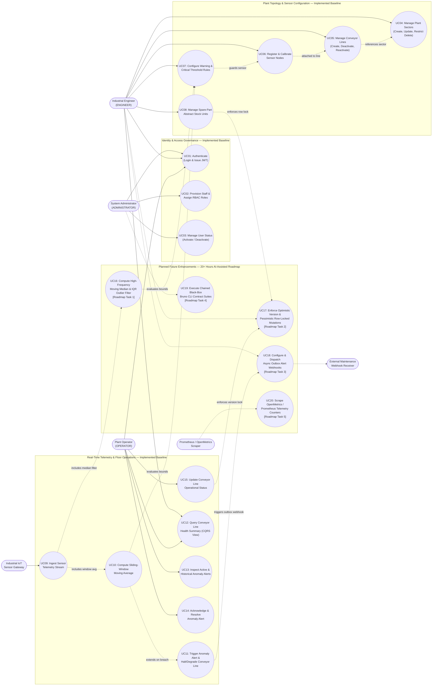

# Use Case Diagram & Functional Scope: FlowGuard

## 1. Functional Scope Overview (Implemented Baseline vs. 20+ Hour Roadmap)

In alignment with Requirements Engineering principles (KB §2.1), the Use Case Diagram below models the functional interactions between external actors and the **FlowGuard** system boundary. To provide complete clarity for project reviewers, use cases are explicitly partitioned into:
1. **Implemented Baseline Use Cases (`UC01`–`UC15`):** Core authentication, RBAC governance, plant sector and conveyor line topology management, sensor node and threshold configuration, real-time telemetry ingestion with moving-average evaluation, anomaly alert acknowledgement, and abstract spare-part inventory management.
2. **Planned 20+ Hour Roadmap Use Cases (`UC16`–`UC20`):** Advanced high-frequency moving-median & IQR outlier filtering (`Task 1`), concurrent optimistic/pessimistic locking workflows (`Task 2`), asynchronous transactional-outbox webhook dispatching (`Task 3`), automated black-box Bruno CLI contract verification (`Task 4`), and OpenMetrics/Prometheus telemetry scraping (`Task 5`).

---

## 2. Use Case Diagram (Mermaid)

