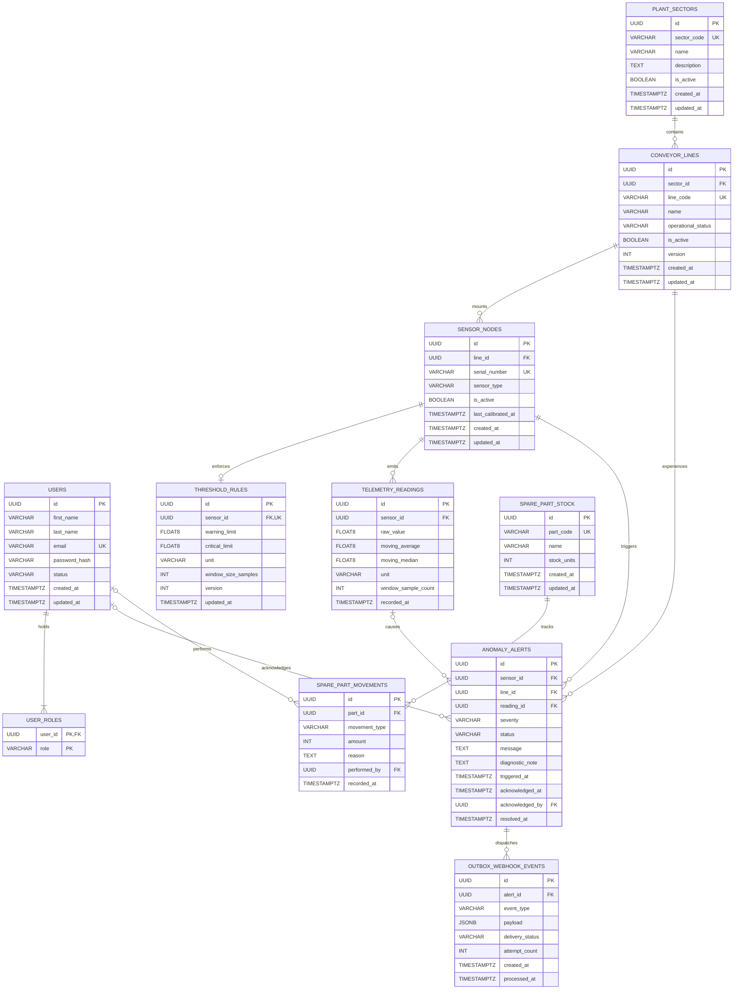

# Database Structure, Physical Relational ERD, Constraint Matrix & CQRS Views

## 1. Context, Strategic Rationale, and Architectural Alignment

The relational database tier of **FlowGuard** is engineered in **PostgreSQL 16+** to satisfy the strict data governance, high-concurrency write isolation, and low-latency read projection requirements established in **ADR-0001**, **ADR-0002**, and **ADR-0003** (`01-problem-statement.md`, §2.2–§2.4; KB §9.3, §11.3, §21.1–§21.3).

Rather than treating the database as a passive storage bucket, FlowGuard implements the **Database as a Fortress** principle (`03-principles-and-guidelines.md`, Principle 2):
* **Third Normal Form / Boyce-Codd Normal Form (3NF/BCNF):** All core operational tables eliminate transitive dependencies and redundant state (KB §11.3, §13.6).
* **Engine-Enforced Referential Integrity (`ON DELETE RESTRICT`):** Plant sectors, conveyor lines, sensor nodes, and users referenced by operational or historical records cannot be deleted physically, guaranteeing incorruptible industrial audit trails (`01-problem-statement.md`, §2.2).
* **Declarative Domain Invariants (`CHECK` Constraints):** Physical constraints guarantee non-negative spare-part inventory (`stock_units >= 0`), valid threshold hierarchies (`critical_limit > warning_limit`), and consistent lifecycle states (`is_active` vs. `operational_status`).
* **Lightweight CQRS via SQL Views:** Pre-aggregated relational views (`v_conveyor_line_health_summary` and `v_sensor_latest_telemetry`) eliminate N+1 query bottlenecks on operator dashboards and Prometheus scrapes (KB §7.5, §21.2).

---

## 2. Physical Relational Entity-Relationship Diagram (Mermaid ERD)

In accordance with KB §21.3, the physical PostgreSQL schema is modeled below using Mermaid ER notation:



---

## 3. Structural Table Specifications & Domain Invariant Checks

### 3.1. Identity & Access Governance (`users`, `user_roles`)

* **`users` Table:**
* `id` (`UUID`, PK): Surrogate technical identifier (`gen_random_uuid()`).
* `first_name` / `last_name` (`VARCHAR(75)`, NOT NULL): Decomposed personal name supporting structured operator and engineer rosters (`PersonName` Value Object).
* `email` (`VARCHAR(255)`, NOT NULL): Protected by functional unique index `uq_users_email_lower` on `LOWER(email)`.
* `password_hash` (`VARCHAR(255)`, NOT NULL): Stores salted **Argon2id** hashes. Excluded by default from general user queries (`ADR-0005`).
* `status` (`VARCHAR(30)`, NOT NULL): Enforced via `CHECK (status IN ('ACTIVE', 'DEACTIVATED', 'PENDING_REGISTRATION'))`.


* **`user_roles` Table:**
* Composite PK `(user_id, role)` with `ON DELETE CASCADE` from `users(id)`.
* `role` (`VARCHAR(30)`, NOT NULL): Enforced via `CHECK (role IN ('OPERATOR', 'ENGINEER', 'ADMINISTRATOR'))`.


### 3.2. Plant Topology Hierarchy (`plant_sectors`, `conveyor_lines`)

* **`plant_sectors` Table:**
* `id` (`UUID`, PK), `sector_code` (`VARCHAR(30)`, NOT NULL, unique on `UPPER(sector_code)`), `name` (`VARCHAR(120)`, NOT NULL), `description` (`TEXT`), `is_active` (`BOOLEAN`, DEFAULT `TRUE`).


* **`conveyor_lines` Table:**
* `id` (`UUID`, PK), `sector_id` (`UUID`, NOT NULL, FK `plant_sectors(id)` **`ON DELETE RESTRICT`**).
* `line_code` (`VARCHAR(30)`, NOT NULL, unique on `UPPER(line_code)`).
* `operational_status` (`VARCHAR(30)`, NOT NULL): Enforced via `CHECK (operational_status IN ('RUNNING', 'DEGRADED_WARNING', 'FAULT_HALTED', 'MAINTENANCE', 'DEACTIVATED'))`.
* `is_active` (`BOOLEAN`, NOT NULL DEFAULT `TRUE`): Coupled with `operational_status` via `chk_conveyor_lines_active_consistency`.
* `version` (`INTEGER`, NOT NULL DEFAULT `1`): Supports Optimistic Concurrency Control (`ADR-0003`, Roadmap Task 2).


### 3.3. Sensor Transducers, Thresholds & Telemetry Stream (`sensor_nodes`, `threshold_rules`, `telemetry_readings`)

* **`sensor_nodes` Table:**
* `id` (`UUID`, PK), `line_id` (`UUID`, NOT NULL, FK `conveyor_lines(id)` **`ON DELETE RESTRICT`**).
* `serial_number` (`VARCHAR(40)`, NOT NULL, unique on `UPPER(serial_number)`).
* `sensor_type` (`VARCHAR(30)`, NOT NULL): `CHECK (sensor_type IN ('BELT_VELOCITY', 'MOTOR_VIBRATION', 'BEARING_TEMPERATURE', 'OPTICAL_COUNTER'))`.


* **`threshold_rules` Table:**
* `id` (`UUID`, PK), `sensor_id` (`UUID`, NOT NULL, UNIQUE, FK `sensor_nodes(id)` **`ON DELETE CASCADE`** — owned local entity inside the `SensorNode` aggregate boundary).
* `warning_limit` / `critical_limit` (`DOUBLE PRECISION`, NOT NULL): Enforces `CHECK (critical_limit > warning_limit)`.
* `window_size_samples` (`INTEGER`, NOT NULL DEFAULT `32`): Enforces `CHECK (window_size_samples BETWEEN 3 AND 128)` matching `ADR-0004`.


* **`telemetry_readings` Table:**
* Append-only time-series audit table storing `raw_value`, `moving_average` ($\mu_W$), `moving_median` ($\tilde{x}_W$), `unit`, `window_sample_count`, and `recorded_at`.
* `sensor_id` (`UUID`, NOT NULL, FK `sensor_nodes(id)` **`ON DELETE RESTRICT`**) prevents deleting any sensor node that has recorded historical telemetry.


### 3.4. Anomaly Alerts, Outbox Webhooks & Spare-Part Inventory (`anomaly_alerts`, `outbox_webhook_events`, `spare_part_stock`, `spare_part_movements`)

* **`anomaly_alerts` Table:**
* Links `sensor_id` (`ON DELETE RESTRICT`), `line_id` (`ON DELETE RESTRICT`), `reading_id` (`ON DELETE SET NULL`), and `acknowledged_by` (`users(id)` `ON DELETE RESTRICT`).
* Enforces `chk_alerts_ack_consistency` so an alert in `ACKNOWLEDGED` or `RESOLVED` status is guaranteed to possess a non-null `acknowledged_by` user and `acknowledged_at` timestamp.


* **`outbox_webhook_events` Table (Roadmap Task 3):**
* Stores `payload JSONB NOT NULL` and `delivery_status` (`PENDING`, `DISPATCHED`, `FAILED`) to guarantee atomic event persistence alongside alert creation (KB §17.2).


* **`spare_part_stock` & `spare_part_movements` Tables:**
* `stock_units` (`INTEGER`, NOT NULL DEFAULT `0`): Enforces the core inventory invariant `CHECK (stock_units >= 0)`.
* `spare_part_movements` logs every discrete `REPLENISHMENT` or `CONSUMPTION` (`CHECK (amount > 0)`) with `ON DELETE RESTRICT` on `part_id`.


---

## 4. Referential Integrity and Cascade Action Matrix (KB §21.3)

| Foreign Key Constraint | Source Table & Column | Target Table & Column | Delete Action | Architectural Rationale & Governing Rule |
| --- | --- | --- | --- | --- |
| `fk_user_roles_user` | `user_roles(user_id)` | `users(id)` | **`CASCADE`** | Value Object collection owned strictly inside the `User` aggregate boundary (KB §3.2 Rule 4). |
| `fk_conveyor_lines_sector` | `conveyor_lines(sector_id)` | `plant_sectors(id)` | **`RESTRICT`** | Prevents deleting a `PlantSector` that still contains conveyor lines (`01-problem-statement.md` §2.2; returns `409 Conflict`). |
| `fk_sensor_nodes_line` | `sensor_nodes(line_id)` | `conveyor_lines(id)` | **`RESTRICT`** | Prevents deleting a `ConveyorLine` that has mounted sensor transducers (`409 Conflict`). |
| `fk_threshold_rules_sensor` | `threshold_rules(sensor_id)` | `sensor_nodes(id)` | **`CASCADE`** | `ThresholdRule` is an internal entity owned by `SensorNode`; removing an unreferenced sensor removes its rule. |
| `fk_telemetry_readings_sensor` | `telemetry_readings(sensor_id)` | `sensor_nodes(id)` | **`RESTRICT`** | Protects historical industrial telemetry logs; sensors with recorded data must be soft-deactivated, never purged. |
| `fk_alerts_sensor` | `anomaly_alerts(sensor_id)` | `sensor_nodes(id)` | **`RESTRICT`** | Preserves anomaly audit history linked to the originating transducer. |
| `fk_alerts_line` | `anomaly_alerts(line_id)` | `conveyor_lines(id)` | **`RESTRICT`** | Preserves anomaly audit history linked to the affected conveyor line. |
| `fk_alerts_reading` | `anomaly_alerts(reading_id)` | `telemetry_readings(id)` | **`SET NULL`** | Allows archival partitioning/pruning of old raw readings without losing the anomaly alert record. |
| `fk_alerts_ack_user` | `anomaly_alerts(acknowledged_by)` | `users(id)` | **`RESTRICT`** | Prevents deleting a user account that has acknowledged industrial safety alerts (deactivation required instead). |
| `fk_outbox_alert` | `outbox_webhook_events(alert_id)` | `anomaly_alerts(id)` | **`CASCADE`** | Outbox delivery records belong to the lifecycle of their triggering alert. |
| `fk_part_movements_part` | `spare_part_movements(part_id)` | `spare_part_stock(id)` | **`RESTRICT`** | Prevents deleting a spare-part catalog item that has historical inventory movements. |

---

## 5. Relational Views for Accelerated CQRS Querying (KB §21.2)

To eliminate the **N+1 Queries** performance anti-pattern during dashboard polling and OpenMetrics scraping (`ADR-0003`), FlowGuard deploys two read-optimized SQL Views:

### View 1: `v_conveyor_line_health_summary`

Aggregates each conveyor line with its parent sector code, active sensor count, and real-time counts of open warning and critical alerts in a single query:

```sql
CREATE OR REPLACE VIEW v_conveyor_line_health_summary AS
SELECT
    cl.id,
    cl.sector_id,
    ps.sector_code,
    ps.name AS sector_name,
    cl.line_code,
    cl.name,
    cl.operational_status,
    cl.is_active,
    cl.version,
    cl.updated_at,
    COUNT(DISTINCT sn.id) FILTER (WHERE sn.is_active = TRUE)::INTEGER AS active_sensor_count,
    COUNT(DISTINCT aa.id) FILTER (WHERE aa.status = 'OPEN' AND aa.severity = 'WARNING')::INTEGER AS open_warning_alert_count,
    COUNT(DISTINCT aa.id) FILTER (WHERE aa.status = 'OPEN' AND aa.severity = 'CRITICAL')::INTEGER AS open_critical_alert_count
FROM conveyor_lines cl
INNER JOIN plant_sectors ps ON cl.sector_id = ps.id
LEFT JOIN sensor_nodes sn ON sn.line_id = cl.id
LEFT JOIN anomaly_alerts aa ON aa.line_id = cl.id
GROUP BY cl.id, ps.sector_code, ps.name;

```

### View 2: `v_sensor_latest_telemetry`

Uses PostgreSQL's `DISTINCT ON` operator to project each sensor node alongside its active threshold rule and its most recent sliding-window telemetry reading:

```sql
CREATE OR REPLACE VIEW v_sensor_latest_telemetry AS
SELECT DISTINCT ON (sn.id)
    sn.id AS sensor_id,
    sn.serial_number,
    sn.sensor_type,
    sn.line_id,
    sn.is_active,
    tr.warning_limit,
    tr.critical_limit,
    tr.window_size_samples,
    rd.id AS latest_reading_id,
    rd.raw_value AS latest_raw_value,
    rd.moving_average AS latest_moving_average,
    rd.moving_median AS latest_moving_median,
    rd.recorded_at AS latest_recorded_at
FROM sensor_nodes sn
LEFT JOIN threshold_rules tr ON tr.sensor_id = sn.id
LEFT JOIN telemetry_readings rd ON rd.sensor_id = sn.id
ORDER BY sn.id, rd.recorded_at DESC NULLS LAST;

```

---

## 6. Indexing and Query Performance Strategy

1. **Case-Insensitive Uniqueness Indexes (Functional B-Tree):**
* `CREATE UNIQUE INDEX uq_users_email_lower ON users (LOWER(email));`
* `CREATE UNIQUE INDEX uq_plant_sectors_code_upper ON plant_sectors (UPPER(sector_code));`
* `CREATE UNIQUE INDEX uq_conveyor_lines_code_upper ON conveyor_lines (UPPER(line_code));`
* `CREATE UNIQUE INDEX uq_sensor_nodes_serial_upper ON sensor_nodes (UPPER(serial_number));`
* `CREATE UNIQUE INDEX uq_spare_part_code_upper ON spare_part_stock (UPPER(part_code));`


2. **Time-Series Telemetry & Alert Lookup Indexes:**
* `CREATE INDEX idx_telemetry_sensor_recorded_desc ON telemetry_readings (sensor_id, recorded_at DESC);` (accelerates `v_sensor_latest_telemetry` and sliding-window bootstrap warm-up queries).
* `CREATE INDEX idx_alerts_line_status_severity ON anomaly_alerts (line_id, status, severity);` (accelerates `v_conveyor_line_health_summary` and operator alert filtering).
* `CREATE INDEX idx_outbox_pending_created ON outbox_webhook_events (delivery_status, created_at ASC) WHERE delivery_status = 'PENDING';` (partial index optimizing the Roadmap Task 3 outbox relay worker).