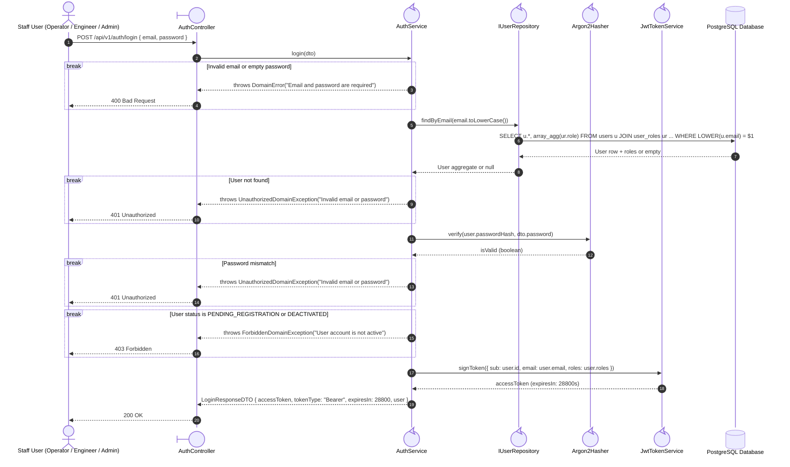
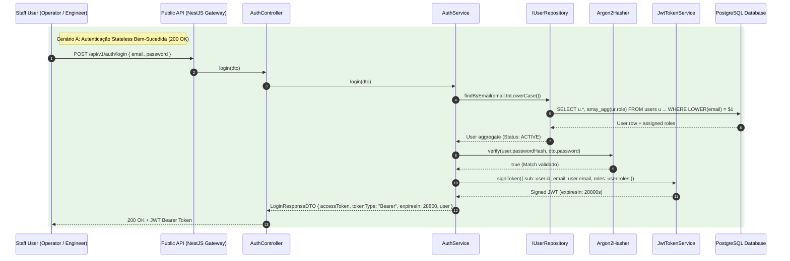
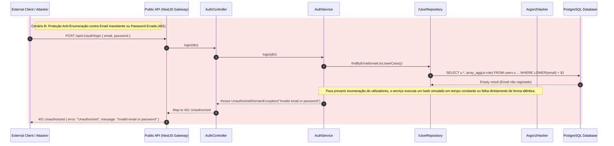
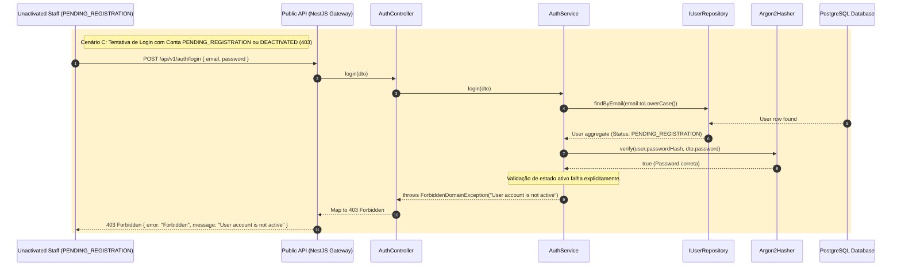

# FG01 — Authenticate Users and Manage Accounts & RBAC Roles

## 1. Requirements Engineering

### 1.1. User Story Description
As a System Administrator or Plant Staff member, I want to authenticate via stateless JWTs and manage user accounts and RBAC roles, so that industrial operations are protected by strict role segregation and cryptographic credential security.

### 1.2. Specifications and Architectural Clarifications
Source: `01-problem-statement.md` (§3), `02-context.md` (§3), `ADR-0005`, and `08-database-structure.md` (§3.1).

- **Role Taxonomy:** FlowGuard enforces three operational roles: `OPERATOR` (floor monitoring, alert acknowledgement, spare-part consumption), `ENGINEER` (topology, sensor, threshold, and spare-part configuration), and `ADMINISTRATOR` (user provisioning, role assignment, and account activation/deactivation). A user holds at least one role (`Set<UserRole>`).
- **Cryptographic Password Hardening (`Argon2id`):** Passwords are never stored or logged in plaintext. `Argon2Hasher` hashes credentials outside the Node.js event loop using memory-hard `Argon2id` parameters (64 MiB RAM, 3 iterations, parallelism 1).
- **Anti-Enumeration & Mass-Assignment Defense:**
  - Login failures for non-existent emails and wrong passwords return the exact same HTTP `401 Unauthorized` response (`"Invalid email or password"`).
  - Public registration (`POST /api/v1/auth/register`) accepts only `firstName`, `lastName`, `email`, and `password`. It provisions accounts strictly with the `OPERATOR` role and `PENDING_REGISTRATION` status until an `ADMINISTRATOR` activates the account. Client-supplied `roles` or `status` fields in public payloads are stripped/rejected.
- **Account Status Lifecycle:** Accounts exist in `ACTIVE`, `DEACTIVATED`, or `PENDING_REGISTRATION`. Only `ACTIVE` users can obtain a JWT or execute protected routes.

### 1.3. Acceptance Criteria
- **AC1 — Stateless Shift Authentication:** Valid credentials for an `ACTIVE` user at `POST /api/v1/auth/login` return HTTP `200 OK` with a signed RFC 7519 Bearer JWT (`expiresIn: 28800` seconds / 8-hour shift) containing `sub` (User UUID), `email`, and `roles`.
- **AC2 — Anti-Enumeration Login Guard:** Unknown email addresses or wrong passwords both return `401 Unauthorized` with an identical message. Accounts in `PENDING_REGISTRATION` or `DEACTIVATED` status return `403 Forbidden`.
- **AC3 — Safe Public Self-Registration:** `POST /api/v1/auth/register` creates a user with normalized lowercase `email`, `PersonName` (`firstName`, `lastName`), `Argon2id` hash, `OPERATOR` role, and `PENDING_REGISTRATION` status (`201 Created`). Duplicate emails (case-insensitive) return `409 Conflict`.
- **AC4 — Administrator Staff Provisioning:** Authenticated `ADMINISTRATOR` users can create pre-activated staff accounts (`POST /api/v1/users`) with explicit roles (`OPERATOR`, `ENGINEER`, `ADMINISTRATOR`), list users with pagination and role/status filters (`GET /api/v1/users`), and mutate status (`PATCH /api/v1/users/:id/status`) or roles (`PATCH /api/v1/users/:id/roles`).
- **AC5 — Password Hash Omission:** No API response or DTO ever serializes `passwordHash`.

### 1.4. Dependencies
- **Preceding Dependencies:** None (foundational security module).
- **Succeeding Dependencies:** `FG02`, `FG03`, `FG04`, `FG05`, `FG06` (all protected endpoints rely on `JwtAuthGuard`, `RolesGuard`, and `UserStatusGuard`).

### 1.5. Input and Output Data

| Field | Contract |
| --- | --- |
| `id` | Generated UUIDv4; path parameter for status and role updates |
| `firstName` / `lastName` | Required on register/create; non-empty trimmed strings, 1–75 chars |
| `email` | Required on login/register/create; valid RFC 5322 email, normalized to lowercase, unique (`uq_users_email_lower`) |
| `password` | Required on login/register/create; string, 8–128 chars; hashed via `Argon2id` |
| `roles` | Array of `OPERATOR \| ENGINEER \| ADMINISTRATOR` (mandatory on Admin `POST /users` and `PATCH /users/:id/roles`) |
| `status` | `ACTIVE \| DEACTIVATED \| PENDING_REGISTRATION` |

### 1.6. HTTP API

| Method | Path | Access | Success | Other outcomes |
| --- | --- | --- | --- | --- |
| `POST` | `/api/v1/auth/login` | Public | `200 OK`, `LoginResponseDTO` | `400` invalid payload; `401` invalid credentials; `403` account not active |
| `POST` | `/api/v1/auth/register` | Public | `201 Created`, `UserResponseDTO` | `400` invalid fields; `409` duplicate email |
| `POST` | `/api/v1/users` | `ADMINISTRATOR` | `201 Created`, `UserResponseDTO` | `400` invalid data; `401`/`403` denied; `409` duplicate email |
| `GET` | `/api/v1/users?role=...&status=...&page=1&pageSize=20` | `ADMINISTRATOR` | `200 OK`, paginated users | `400` invalid filter/pagination; `401`/`403` denied |
| `PATCH` | `/api/v1/users/:id/status` | `ADMINISTRATOR` | `200 OK`, `UserResponseDTO` | `400` invalid status/UUID; `401`/`403`; `404` missing user |
| `PATCH` | `/api/v1/users/:id/roles` | `ADMINISTRATOR` | `200 OK`, `UserResponseDTO` | `400` empty/invalid roles; `401`/`403`; `404` missing user |

### 1.7. System Sequence Diagrams (SSD)

#### 1.7.1. Authenticate User (`POST /api/v1/auth/login`)

#### 1.7.2. Error Origins and HTTP Translation

| Condition | Error Origin | HTTP Status |
| --- | --- | --- |
| Malformed email, blank name, or password < 8 chars | `Email.create()`, `PersonName.create()`, or `AuthService` throws `DomainError` | **400** |
| Email not found or `Argon2Hasher.verify()` returns `false` | `AuthService.login()` throws `UnauthorizedDomainException('Invalid email or password')` | **401** |
| Account is `PENDING_REGISTRATION` or `DEACTIVATED` | `AuthService.login()` / `UserStatusGuard` throws `ForbiddenDomainException` | **403** |
| Caller lacks `ADMINISTRATOR` role on `/users` | `RolesGuard.canActivate()` throws `ForbiddenException` | **403** |
| Target user UUID does not exist | `UserService` throws `EntityNotFoundException('User not found')` | **404** |
| Email already registered (SQLSTATE `23505` on `uq_users_email_lower`) | `PostgresUserRepository.save()` throws `ResourceConflictException` | **409** |

#### 1.7.3. Successful Login (Happy Path)

#### 1.7.4. Failed Login (Not-Valid Credentials)

#### 1.7.5 Failed Login (Deactivated Account)

