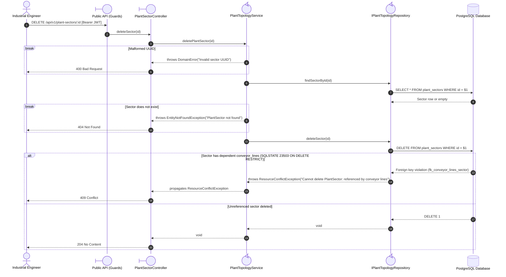
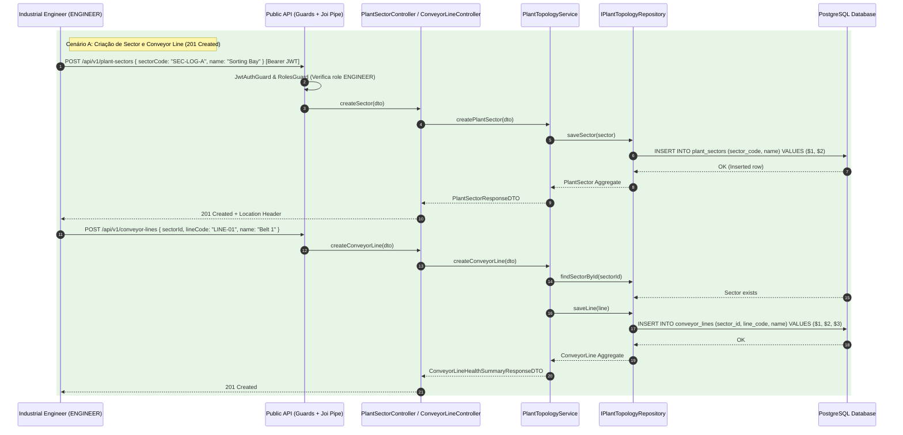
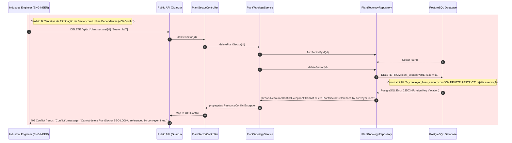
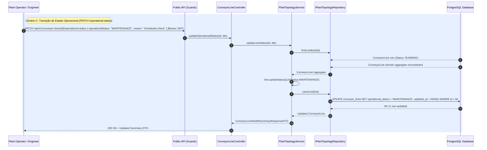

# FG02 — Manage Plant Sectors, Conveyor Lines & Query CQRS Health Summaries

## 1. Requirements Engineering

### 1.1. User Story Description
As an Industrial Engineer, I want to register and manage Plant Sectors and Conveyor Lines and query their real-time CQRS health summaries, so that the physical factory topology is accurately modeled, operational states are tracked, and referenced assets are protected against accidental deletion.

### 1.2. Specifications and Architectural Clarifications
Source: `01-problem-statement.md` (§2.2), `ADR-0003`, `07-relational-mapping-and-persistence-strategy.md` (§3.2), and `08-database-structure.md` (§3.2, §5).

- **Hierarchical Asset Topology:** A `PlantSector` represents a physical factory or logistics zone (identified by UUID `id` and unique uppercase business code `sectorCode`, e.g., `SEC-LOGISTICS-A`). Each `ConveyorLine` (identified by UUID `id` and unique `lineCode`, e.g., `LINE-SORT-NORTH-01`) belongs to exactly one `PlantSector`.
- **Operational State Machine (`LineStatus`):** A `ConveyorLine` maintains an `operationalStatus` in `{RUNNING, DEGRADED_WARNING, FAULT_HALTED, MAINTENANCE, DEACTIVATED}` coupled with `isActive: boolean`. When `isActive = false`, `operationalStatus` must be `DEACTIVATED`; when `isActive = true`, `operationalStatus` cannot be `DEACTIVATED` (enforced by domain invariant and SQL `chk_conveyor_lines_active_consistency`).
- **Strict Referential Deletion Guards (`ON DELETE RESTRICT`):**
  - Deleting a `PlantSector` that is referenced by any `ConveyorLine` (active or deactivated) is strictly blocked (`409 Conflict`).
  - Deleting a `ConveyorLine` that is referenced by any `SensorNode` or `AnomalyAlert` is strictly blocked (`409 Conflict`).
- **CQRS Read Projection (`v_conveyor_line_health_summary`):** Listing or retrieving conveyor lines returns pre-joined metrics (`activeSensorCount`, `openWarningAlertCount`, `openCriticalAlertCount`) in a single query without N+1 database round-trips.

### 1.3. Acceptance Criteria
- **AC1 — Plant Sector CRUD:** Engineers/Admins can create, list, retrieve by UUID, update, and delete unreferenced Plant Sectors. `sectorCode` is normalized to uppercase and immutable after creation; case-insensitive duplicates return `409 Conflict`.
- **AC2 — Conveyor Line Creation & Status Transitions:** Engineers/Admins can create Conveyor Lines linked to an existing `PlantSector`. Operators, Engineers, and Admins can transition a line's `operationalStatus` via `PATCH /api/v1/conveyor-lines/:id/operational-status`.
- **AC3 — Referential Integrity on Delete:** Attempting to delete a referenced `PlantSector` or `ConveyorLine` returns HTTP `409 Conflict` without mutating stored data.
- **AC4 — CQRS Health Summary Query:** `GET /api/v1/conveyor-lines` supports optional filtering by `sectorId` and `operationalStatus`, returning `ConveyorLineHealthSummaryResponseDTO` records backed by `v_conveyor_line_health_summary`.

### 1.4. Dependencies
- **Preceding Dependencies:** `FG01` (JWT authentication and `ENGINEER` / `OPERATOR` role guards).
- **Succeeding Dependencies:** `FG03` (Sensors attach to Conveyor Lines), `FG04` (Telemetry breaches transition Conveyor Line status), `FG05` (Alerts reference Conveyor Lines), `FG08` (Optimistic `version` locking on status transitions).

### 1.5. Input and Output Data

| Field | Contract |
| --- | --- |
| `sectorCode` / `lineCode` | Required on POST; trimmed, normalized to uppercase, 2–30 chars; unique (`uq_plant_sectors_code_upper`, `uq_conveyor_lines_code_upper`) |
| `name` | Required on POST/PUT; non-empty string (2–120 chars for sector, 2–150 chars for line) |
| `sectorId` | Required UUID on `POST /conveyor-lines`; must reference an existing `PlantSector` |
| `operationalStatus` | `RUNNING \| DEGRADED_WARNING \| FAULT_HALTED \| MAINTENANCE \| DEACTIVATED` |
| `expectedVersion` | Positive integer on `PATCH /conveyor-lines/:id/operational-status` (baseline defaults to current version if omitted; strictly enforced in `FG08`) |

### 1.6. HTTP API

| Method | Path | Access | Success | Other outcomes |
| --- | --- | --- | --- | --- |
| `POST` | `/api/v1/plant-sectors` | `ENGINEER`, `ADMINISTRATOR` | `201 Created`, sector DTO | `400` invalid data; `401`/`403`; `409` duplicate `sectorCode` |
| `GET` | `/api/v1/plant-sectors?isActive=...` | `OPERATOR+` | `200 OK`, sector array | `401` unauthorized |
| `GET` | `/api/v1/plant-sectors/:id` | `OPERATOR+` | `200 OK`, sector DTO | `400` malformed UUID; `401`; `404` not found |
| `PUT` | `/api/v1/plant-sectors/:id` | `ENGINEER`, `ADMINISTRATOR` | `200 OK`, sector DTO | `400` invalid data; `401`/`403`; `404` not found |
| `DELETE` | `/api/v1/plant-sectors/:id` | `ENGINEER`, `ADMINISTRATOR` | `204 No Content` | `400` malformed UUID; `401`/`403`; `404`; `409` referenced by lines |
| `POST` | `/api/v1/conveyor-lines` | `ENGINEER`, `ADMINISTRATOR` | `201 Created`, line summary DTO | `400` invalid data; `404` sector missing; `409` duplicate `lineCode` |
| `GET` | `/api/v1/conveyor-lines?sectorId=...&operationalStatus=...` | `OPERATOR+` | `200 OK`, summary array | `400` invalid filter; `401` unauthorized |
| `GET` | `/api/v1/conveyor-lines/:id` | `OPERATOR+` | `200 OK`, line summary DTO | `400` malformed UUID; `401`; `404` not found |
| `PATCH` | `/api/v1/conveyor-lines/:id/operational-status` | `OPERATOR+` | `200 OK`, line summary DTO | `400` invalid status; `404`; `409` version conflict; `422` invariant breach |
| `DELETE` | `/api/v1/conveyor-lines/:id` | `ENGINEER`, `ADMINISTRATOR` | `204 No Content` | `401`/`403`; `404`; `409` referenced by sensors/alerts |

### 1.7. System Sequence Diagrams (SSD)

#### 1.7.1. Delete Plant Sector with Referential Guard (`DELETE /api/v1/plant-sectors/:id`)

#### 1.7.2. Sector and Line Creation with Success

#### 1.7.3. Restrite Deletion

#### 1.7.4. Operational Status Transition

