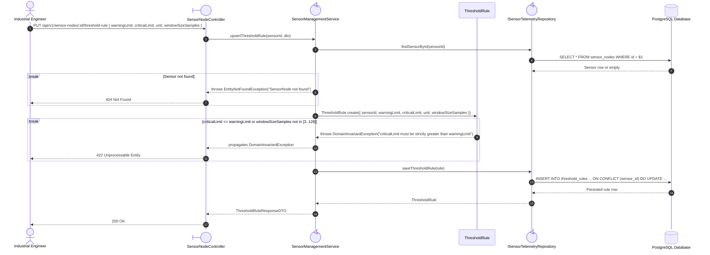
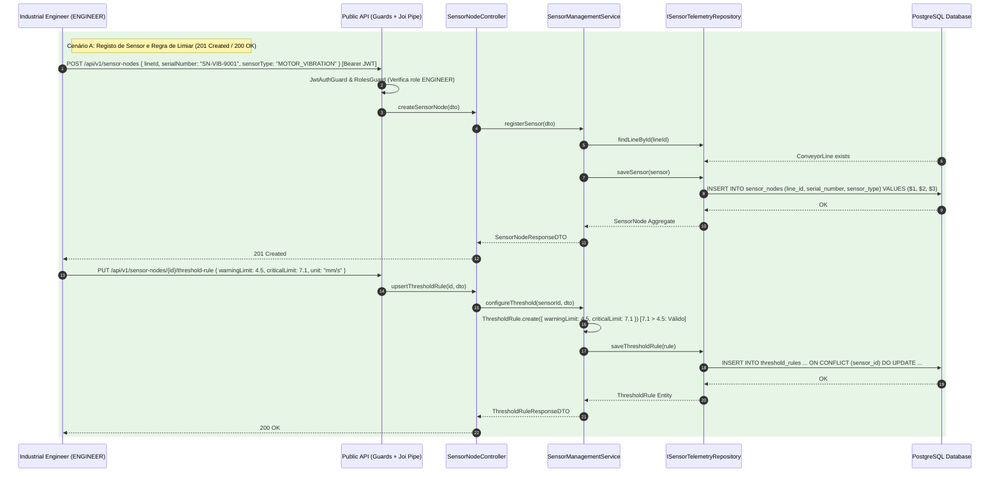
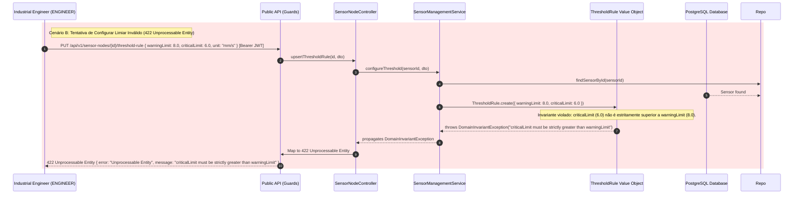
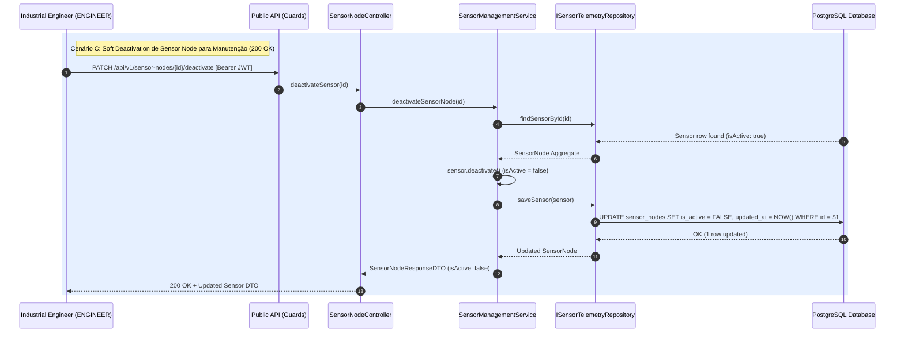

# FG03 — Register Sensor Nodes and Configure Threshold Rules

## 1. Requirements Engineering

### 1.1. User Story Description
As an Industrial Engineer, I want to register Sensor Nodes on Conveyor Lines and configure their Warning and Critical Threshold Rules, so that each industrial transducer has validated physical tolerance bounds for real-time anomaly detection.

### 1.2. Specifications and Architectural Clarifications
Source: `01-problem-statement.md` (§2.1), `ADR-0003`, `ADR-0004`, and `08-database-structure.md` (§3.3).

- **Transducer Classification (`SensorType`):** Each `SensorNode` is mounted on an existing `ConveyorLine` (`lineId`), identified by a globally unique `serialNumber` (`SN-VIB-9001`), and typed as one of `{BELT_VELOCITY, MOTOR_VIBRATION, BEARING_TEMPERATURE, OPTICAL_COUNTER}`.
- **Owned Threshold Rule Entity (`ThresholdRule`):** Each `SensorNode` owns at most one active `ThresholdRule` defining `warningLimit`, `criticalLimit`, measurement `unit` (`m/s`, `mm/s`, `C`, `units/min`), and `windowSizeSamples` ($3 \le N \le 128$, default $32$).
- **Threshold Ordering Invariant:** Both the domain entity (`ThresholdRule.create` / `updateLimits`) and the PostgreSQL `CHECK` constraint (`chk_threshold_rules_bounds`) enforce:
  $$\text{criticalLimit} > \text{warningLimit}$$
  Violating this rule returns HTTP `422 Unprocessable Entity`.
- **Soft Deactivation:** Sensors undergoing replacement or maintenance are soft-deactivated via `PATCH /api/v1/sensor-nodes/:id/deactivate` (`isActive = false`), preserving historical `telemetry_readings` and `anomaly_alerts` (`ON DELETE RESTRICT`).

### 1.3. Acceptance Criteria
- **AC1 — Sensor Registration:** Engineers/Admins can attach a new `SensorNode` to an existing `ConveyorLine` (`POST /api/v1/sensor-nodes`). Duplicate `serialNumber` (case-insensitive) returns `409 Conflict`; non-existent `lineId` returns `404 Not Found`.
- **AC2 — Threshold Rule Upsert & Invariant Validation:** Engineers/Admins can configure or replace a sensor's `ThresholdRule` via `PUT /api/v1/sensor-nodes/:id/threshold-rule`. If `criticalLimit <= warningLimit` or `windowSizeSamples` is outside `[3, 128]`, the system rejects the request with `422 Unprocessable Entity`.
- **AC3 — Multi-Criteria Filtering:** Operators, Engineers, and Admins can list sensors (`GET /api/v1/sensor-nodes`) filtered by `lineId`, `sensorType`, and `isActive`, including each sensor's attached `thresholdRule`.
- **AC4 — Safe Deactivation:** `PATCH /api/v1/sensor-nodes/:id/deactivate` marks the sensor inactive (`200 OK`) so it rejects new telemetry readings while retaining historical audit logs.

### 1.4. Dependencies
- **Preceding Dependencies:** `FG01` (Auth/RBAC), `FG02` (`ConveyorLine` must exist before attaching a `SensorNode`).
- **Succeeding Dependencies:** `FG04` (`TelemetryIngestionService` evaluates incoming readings against `SensorNode` and `ThresholdRule`).

### 1.5. Input and Output Data

| Field | Contract |
| --- | --- |
| `lineId` | Required UUID on `POST /sensor-nodes`; references `conveyor_lines(id)` |
| `serialNumber` | Required string, trimmed & uppercase, 3–40 chars, unique (`uq_sensor_nodes_serial_upper`) |
| `sensorType` | `BELT_VELOCITY \| MOTOR_VIBRATION \| BEARING_TEMPERATURE \| OPTICAL_COUNTER` |
| `warningLimit` / `criticalLimit` | Required finite numbers on `PUT .../threshold-rule`; must satisfy `criticalLimit > warningLimit` |
| `unit` | Required non-empty string (`mm/s`, `m/s`, `C`, `units/min`), max 20 chars |
| `windowSizeSamples` | Integer in `[3, 128]`, defaults to `32` |

### 1.6. HTTP API

| Method | Path | Access | Success | Other outcomes |
| --- | --- | --- | --- | --- |
| `POST` | `/api/v1/sensor-nodes` | `ENGINEER`, `ADMINISTRATOR` | `201 Created`, `SensorNodeResponseDTO` | `400` invalid data; `404` line missing; `409` duplicate `serialNumber` |
| `GET` | `/api/v1/sensor-nodes?lineId=...&sensorType=...&isActive=...` | `OPERATOR+` | `200 OK`, sensor array | `400` invalid filter; `401` unauthorized |
| `PUT` | `/api/v1/sensor-nodes/:id/threshold-rule` | `ENGINEER`, `ADMINISTRATOR` | `200 OK`, `ThresholdRuleResponseDTO` | `400` invalid types; `404` sensor missing; `422` `criticalLimit <= warningLimit` |
| `PATCH` | `/api/v1/sensor-nodes/:id/deactivate` | `ENGINEER`, `ADMINISTRATOR` | `200 OK`, `SensorNodeResponseDTO` | `400` malformed UUID; `404` sensor missing |

### 1.7. System Sequence Diagrams (SSD)

#### 1.7.1. Configure Sensor Threshold Rule (`PUT /api/v1/sensor-nodes/:id/threshold-rule`)

#### 1.7.2. Sensor Registration and Limiar Configuration Successful

#### 1.7.3. criticalLimit > warningLimit violation

#### 1.7.4. Soft Deactivation

