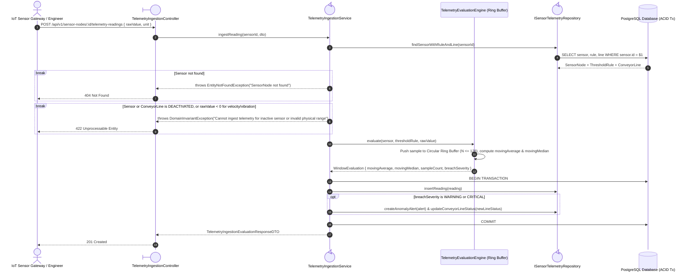
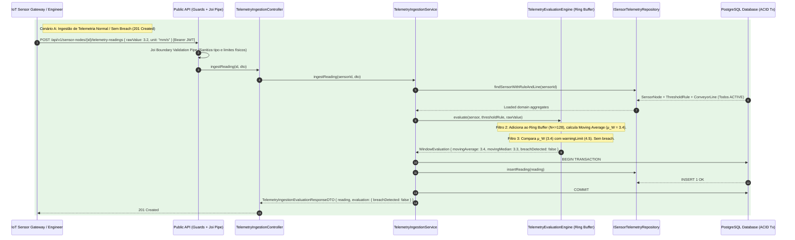
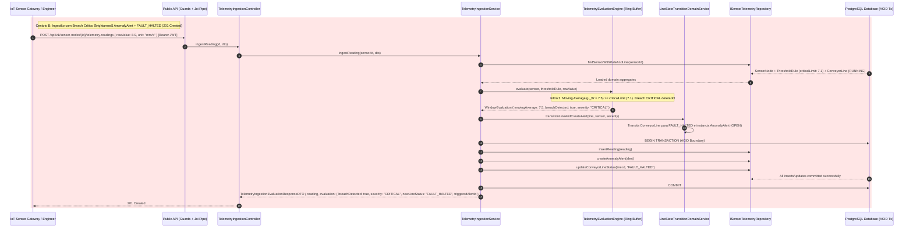
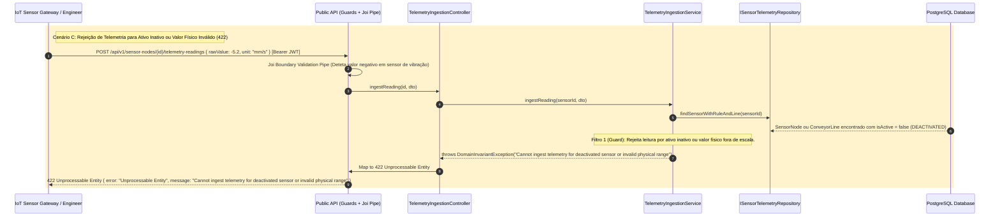

# FG04 — Ingest Real-Time Sensor Telemetry and Evaluate Sliding-Window Anomaly Rules

## 1. Requirements Engineering

### 1.1. User Story Description
As an Industrial IoT Sensor Gateway or Industrial Engineer, I want to ingest real-time sensor telemetry streams and evaluate sliding-window moving averages in memory, so that sustained threshold breaches automatically trigger anomaly alerts and transition affected conveyor lines to degraded or halted states.

### 1.2. Specifications and Architectural Clarifications
Source: `01-problem-statement.md` (§2.1), `ADR-0004`, `04-key-scenarios.md` (§4), and `06-component-diagram-sketch.md` (§2.3, §3.1).

- **Four-Stage Pipes-and-Filters Pipeline (`TelemetryEvaluationEngine`):**
  1. **Filter 1 — Physical Plausibility & Active State Guard:** Rejects readings sent to a `DEACTIVATED` `SensorNode` or a `DEACTIVATED` `ConveyorLine` (`422 Unprocessable Entity`). Rejects physically impossible negative values for `BELT_VELOCITY`, `MOTOR_VIBRATION`, or `OPTICAL_COUNTER`, and temperatures below absolute zero (`< -273.15 C`) (`422 Unprocessable Entity`).
  2. **Filter 2 — Bounded Circular Ring Buffer Aggregation:** Appends `rawValue` to the sensor's in-memory `SlidingWindowBuffer` (capacity $N = \text{windowSizeSamples} \le 128$) and computes the real-time **Moving Average ($\mu_W$)** and baseline **Moving Median ($\tilde{x}_W$)**.
  3. **Filter 3 — Threshold Breach Evaluation:** Compares the smoothed window metric against the sensor's `ThresholdRule`:
     - If $\mu_W \ge \text{criticalLimit}$: breach severity is `CRITICAL`.
     - Else if $\mu_W \ge \text{warningLimit}$: breach severity is `WARNING`.
     - Otherwise: no breach (`breachDetected: false`).
  4. **Filter 4 — Atomic State Transition & Persistence (`LineStateTransitionDomainService`):** Inside a single ACID transaction, persists the enriched `TelemetryReading`. If a `WARNING` breach occurs while the parent `ConveyorLine` is `RUNNING`, transitions the line to `DEGRADED_WARNING` and creates an `OPEN` `AnomalyAlert`. If a `CRITICAL` breach occurs, transitions the line to `FAULT_HALTED` and creates an `OPEN` `CRITICAL` `AnomalyAlert`.

### 1.3. Acceptance Criteria
- **AC1 — Sub-Millisecond In-Memory Window Calculation:** Ingesting a reading at `POST /api/v1/sensor-nodes/:id/telemetry-readings` updates the sensor's bounded ring buffer ($N \le 128$) and persists `rawValue`, `movingAverage`, `movingMedian`, and `windowSampleCount` (`201 Created`).
- **AC2 — Automatic Alert & Line State Mutation on Breach:** Breaching `warningLimit` or `criticalLimit` atomically persists an `AnomalyAlert` (`status = 'OPEN'`) and updates the parent `ConveyorLine` (`DEGRADED_WARNING` or `FAULT_HALTED`), returning the evaluation summary in the `201 Created` payload.
- **AC3 — Physical & Lifecycle Invariant Enforcement:** Sending telemetry to an inactive sensor/line or providing physically impossible values returns `422 Unprocessable Entity` without polluting the ring buffer or database.
- **AC4 — Paginated Historical Query:** `GET /api/v1/sensor-nodes/:id/telemetry-readings?page=1&pageSize=50` returns readings ordered by `recorded_at DESC`.

### 1.4. Dependencies
- **Preceding Dependencies:** `FG02` (`ConveyorLine`), `FG03` (`SensorNode` and `ThresholdRule`).
- **Succeeding Dependencies:** `FG05` (Operators acknowledge generated `AnomalyAlert` records), `FG07` (Milestone 1 upgrades $\tilde{x}_W$ to dual-heap $O(\log W)$ + IQR spike rejection), `FG09` (Milestone 3 dispatches outbox webhooks on alert creation).

### 1.5. Input and Output Data

| Field | Contract |
| --- | --- |
| `rawValue` | Required finite number (`DOUBLE PRECISION`); validated against physical transducer bounds |
| `unit` | Required non-empty string matching the sensor's threshold rule unit |
| `recordedAt` | Optional ISO-8601 timestamp; defaults to current UTC time |
| `reading` (Output) | `{ id, sensorId, rawValue, movingAverage, movingMedian, unit, windowSampleCount, recordedAt }` |
| `evaluation` (Output) | `{ breachDetected, severity, previousLineStatus, newLineStatus, triggeredAlertId }` |

### 1.6. HTTP API

| Method | Path | Access | Success | Other outcomes |
| --- | --- | --- | --- | --- |
| `POST` | `/api/v1/sensor-nodes/:id/telemetry-readings` | `ENGINEER`, `ADMINISTRATOR` (Gateway) | `201 Created`, `TelemetryIngestionEvaluationResponseDTO` | `400` malformed body/UUID; `401`/`403`; `404` sensor missing; `422` inactive asset or impossible physical value |
| `GET` | `/api/v1/sensor-nodes/:id/telemetry-readings?page=1&pageSize=50` | `OPERATOR+` | `200 OK`, paginated readings | `400` invalid pagination; `401`; `404` sensor missing |

### 1.7. System Sequence Diagrams (SSD)

#### 1.7.1. Ingest Telemetry Reading & Trigger Anomaly Alert (`POST /api/v1/sensor-nodes/:id/telemetry-readings`)

#### 1.7.2. Normal Telemtry Ingestion

#### 1.7.3. Critical Break Ingestion

#### 1.7.4. Sensor Rejection (Inactive Line / Wrong Physical Value)

